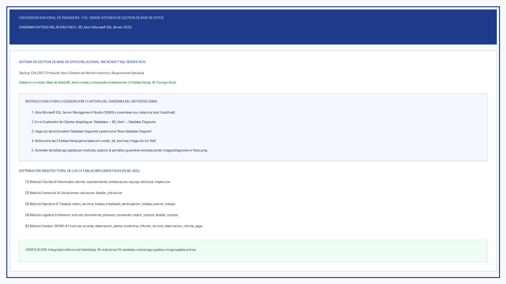

<div align="center">

<p align="center"></p>  
**UNIVERSIDAD NACIONAL DE INGENIERÍA**  
**Ingeniería de Software**  
**Período:** 2026-2  
**Curso:** Sistema de Gestión de Base de Datos  
**Código:** SW609  
**NRC:** [completar]  
**Docente:** Mg. Richard Leonardo Berrocal Navarro  
**INFORME DE TRABAJO PARCIAL (TP1)**  
**Nombre del startup:** DALERST  
**Nombre del producto:** Keel  
**Relación de integrantes**

| Código | Apellidos y nombres |
| :---- | :---- |
| 20244028F | Nuñez Villazana Franz Pool |
| 20244011F | Puris Ricaldi Roy Farid |
| 20240243J | Castro Aguirre Lenin Giomar |
| 20232156D | Ramos Jacay Dair David |

Lima, octubre de 2026

</div>

# Registro de versiones del informe

| Versión | Fecha | Autor | Descripción de modificación |
| :---- | :---- | :---- | :---- |
| 1.0 | 29/10/2026 | Franz Nuñez | Primera versión del informe: Capítulo I. |
| 1.1 | 30/10/2026 | Roy Farid Puris Ricaldi | Redacción del Capítulo I (secciones 1.1 a 1.3). |
| 1.2 | 12/11/2026 | Roy Farid Puris Ricaldi | Redacción de los capítulos II y III (secciones 2.1 a 3.3). |
| 1.3 | 12/11/2026 | Dair David Ramos Jacay | Redacción del Capítulo IV: evaluación y elección del SGBD relacional (4.1.1) y especificación e implementación del diagrama entidad-relación físico (4.2.1). |

*Cada fila lleva un solo autor. Agregar una fila por cada versión relevante (secciones nuevas, correcciones por retroalimentación del docente, etc.).*

# Contenido

- [Registro de versiones del informe](#registro-de-versiones-del-informe)
- [Student Outcome](#student-outcome)
- [Capítulo I: Introducción](#capítulo-i-introducción)
  - [1.1. Startup profile](#11-startup-profile)
    - [1.1.1. Descripción del startup](#111-descripción-del-startup)
    - [1.1.2. Perfiles de integrantes del equipo](#112-perfiles-de-integrantes-del-equipo)
  - [1.2. Solution profile](#12-solution-profile)
    - [1.2.1. Antecedentes y problemática](#121-antecedentes-y-problemática)
    - [1.2.2. Propuesta de valor](#122-propuesta-de-valor)
  - [1.3. Segmentos objetivo](#13-segmentos-objetivo)
- [Capítulo II: Recopilación y análisis de requisitos](#capítulo-ii-recopilación-y-análisis-de-requisitos)
  - [2.1. Entrevistas](#21-entrevistas)
    - [2.1.1. Diseño de entrevistas](#211-diseño-de-entrevistas)
    - [2.1.2. Registro de entrevistas](#212-registro-de-entrevistas)
    - [2.1.3. Análisis de entrevistas](#213-análisis-de-entrevistas)
  - [2.2. Requisitos](#22-requisitos)
- [Capítulo III: Diseño de base de datos](#capítulo-iii-diseño-de-base-de-datos)
  - [3.1. Entidades](#31-entidades)
  - [3.2. Atributos](#32-atributos)
  - [3.3. Enfoque relacional](#33-enfoque-relacional)
    - [3.3.1. Diagrama entidad-relación lógico](#331-diagrama-entidad-relación-lógico)
  - [3.4. Enfoque no relacional (TF1)](#34-enfoque-no-relacional-tf1)
    - [3.4.1. Colecciones](#341-colecciones)
    - [3.4.2. Validación de esquema](#342-validación-de-esquema)
    - [3.4.3. Patrones de modelo de datos](#343-patrones-de-modelo-de-datos)
- [Capítulo IV: Implementación de base de datos](#capítulo-iv-implementación-de-base-de-datos)
  - [4.1. Sistema de gestión de base de datos](#41-sistema-de-gestión-de-base-de-datos)
    - [4.1.1. Evaluación y elección del sistema de gestión de base de datos relacional](#411-evaluación-y-elección-del-sistema-de-gestión-de-base-de-datos-relacional)
    - [4.1.2. Evaluación y elección del sistema de gestión de base de datos no relacional (TF1)](#412-evaluación-y-elección-del-sistema-de-gestión-de-base-de-datos-no-relacional-tf1)
  - [4.2. Diagramas de datos](#42-diagramas-de-datos)
    - [4.2.1. Diagrama entidad-relación físico](#421-diagrama-entidad-relación-físico)
    - [4.2.2. Diagrama de documentos (TF1)](#422-diagrama-de-documentos-tf1)
  - [4.3. Scripts de creación de la base de datos (TF1)](#43-scripts-de-creación-de-la-base-de-datos-tf1)
    - [4.3.1. Scripts de creación y carga de datos de la base de datos relacional](#431-scripts-de-creación-y-carga-de-datos-de-la-base-de-datos-relacional)
    - [4.3.2. Scripts de creación y carga de datos de la base de datos no relacional](#432-scripts-de-creación-y-carga-de-datos-de-la-base-de-datos-no-relacional)
  - [4.4. Consultas (TF1)](#44-consultas-tf1)
    - [4.4.1. Consultas para la base de datos relacional](#441-consultas-para-la-base-de-datos-relacional)
    - [4.4.2. Consultas para la base de datos no relacional](#442-consultas-para-la-base-de-datos-no-relacional)
- [Conclusiones](#conclusiones)
  - [Conclusiones y recomendaciones](#conclusiones-y-recomendaciones)
  - [Video About-the-Team](#video-about-the-team)
- [Bibliografía](#bibliografía)
- [Anexos](#anexos)
  - [Anexo A. Videos de exposiciones](#anexo-a-videos-de-exposiciones)

# Student Outcome

ABET - EAC - Student Outcome 7: la capacidad de adquirir y aplicar nuevos conocimientos según sea necesario, utilizando estrategias de aprendizaje apropiadas.

| Criterio específico | Acciones realizadas | Conclusiones |
| :---- | :---- | :---- |
| 7.c1. Actualiza conceptos y conocimientos necesarios para su desarrollo profesional y, en especial, para su proyecto en soluciones de ingeniería de software. | [Por integrante: nombres y apellidos, y las acciones realizadas en cada entrega relacionadas con el criterio.] | [Conclusión grupal, acumulable en cada entrega.] |
| 7.c2. Reconoce la necesidad del aprendizaje permanente para el desempeño profesional y el desarrollo de proyectos en soluciones de ingeniería de software. | [Por integrante: nombres y apellidos, y las acciones realizadas en cada entrega relacionadas con el criterio.] | [Conclusión grupal, acumulable en cada entrega.] |

# Capítulo I: Introducción

## 1.1. Startup profile

### 1.1.1. Descripción del startup

DALERST es una startup peruana dedicada al desarrollo de software para empresas de distintos rubros. Su nombre nace de la combinación de los nombres de sus cuatro integrantes, estudiantes de Ingeniería de Software de la Universidad Nacional de Ingeniería (UNI), quienes la conformaron en 2026 en el marco de un proyecto académico con visión de empresa.

La startup ofrece sus soluciones bajo el modelo de software como servicio (SaaS): el cliente accede a la plataforma desde la web, sin instalar ni mantener infraestructura propia, y paga una suscripción. Los productos de DALERST se construyen por módulos, de modo que cada empresa activa solo las funciones que su operación necesita y puede ampliarlas a medida que crece.

El equipo parte de una idea simple: muchas empresas todavía gestionan procesos clave con hojas de cálculo, cuadernos y mensajes dispersos, y pierden tiempo y dinero por ello. DALERST busca reemplazar esa dispersión por sistemas ordenados, apoyados en bases de datos bien diseñadas, que den a cada empresa información confiable y a la mano.

Su primer producto es Keel, una plataforma para la gestión de reparaciones y mantenimiento de embarcaciones. Keel es el punto de partida de la startup en el sector marítimo; su descripción detallada se desarrolla en la sección 1.2.

**Misión.** Desarrollar software en la nube, modular y accesible, que ayude a las empresas a ordenar sus procesos y a decidir con información confiable, de manera que puedan operar con menos tiempo y recursos perdidos.

**Visión.** Ser una empresa de software reconocida en el Perú y en América Latina por crear productos que simplifican la operación de las empresas, empezando por los sectores que hoy trabajan con herramientas poco integradas.

**Valores.** Los valores que guían el trabajo de DALERST son los siguientes:

- **Rigor técnico:** diseñamos con criterio los datos y la arquitectura de cada solución.
- **Modularidad:** cada cliente usa solo lo que necesita y puede crecer a su ritmo.
- **Cercanía con el cliente:** partimos de entender cómo trabaja realmente cada empresa antes de proponer una solución.
- **Mejora continua:** aprendemos de cada entrevista, de cada prueba y de cada error.

**Contexto.** DALERST se desarrolla como proyecto del curso Sistemas de Gestión de Base de Datos (SW609), del periodo 2026-2, a cargo del docente Mg. Richard Leonardo Berrocal Navarro. En este informe se presenta la primera entrega, que corresponde a la presentación del startup, la problemática y los segmentos objetivo.

### 1.1.2. Perfiles de integrantes del equipo

Los cuatro integrantes del equipo cursan Ingeniería de Software en la Universidad Nacional de Ingeniería, carrera que forma profesionales en el análisis, el diseño, la construcción y el mantenimiento de sistemas de software. A continuación se presenta el perfil de cada uno.

<table>
<tr>
<td width="160" align="center"></td>
<td><b>Franz Pool Nuñez Villazana</b><br><b>Código:</b> 20244028F. Carrera: Ingeniería de Software (UNI).<br><b>Acerca de mí:</b> Estudiante de Ingeniería de Software (UNI) desde 2024, actualmente en el sexto ciclo. Interesado en manejo de datos y el desarrollo de aplicaciones web.</td>
</tr>
<tr>
<td width="160" align="center"></td>
<td><b>Roy Farid Puris Ricaldi</b><br><b>Código:</b> 20244011F. Carrera: Ingeniería de Software (UNI).<br><b>Acerca de mí:</b> Estudiante de Ingeniería de Software de la UNI desde 2024, actualmente en el sexto ciclo. Participó en el ICPC y trabaja con algoritmos y estructuras de datos.</td>
</tr>
<tr>
<td width="160" align="center"></td>
<td><b>Lenin Giomar Castro Aguirre</b><br><b>Código:</b> 20240243J. Carrera: Ingeniería de Software (UNI). Rol: Team Leader del equipo.<br><b>Acerca de mí:</b> Estudiante de Ingeniería de Software de la UNI desde 2024, actualmente en el sexto ciclo. Participó en el ICPC, interesado en el desarrollo de soluciones de software.</td>
</tr>
<tr>
<td width="160" align="center"></td>
<td><b>Dair David Ramos Jacay</b><br><b>Código:</b> 20232156D. Carrera: Ingeniería de Software (UNI).<br><b>Acerca de mí:</b> Estudiante de Ingeniería de Software (UNI) desde 2023, actualmente en el sexto ciclo. Participó en el Regional ICPC y trabajó con algoritmos y estructuras de datos. Interesado en manejo de datos y el desarrollo de aplicaciones web.</td>
</tr>
</table>

**Conocimientos técnicos del equipo.** Los cuatro integrantes tienen una base sólida en algoritmos y estructuras de datos, y todos participaron en el ICPC (International Collegiate Programming Contest). Esta experiencia aporta al proyecto capacidad de análisis, rigor para razonar sobre el rendimiento de las soluciones y habilidad para modelar los datos de un sistema, algo central en un curso de bases de datos.

## 1.2. Solution profile

### 1.2.1. Antecedentes y problemática

El Perú cuenta con una flota de embarcaciones numerosa y diversa. La Sociedad Nacional de Pesquería informó que 16 405 de las 18 211 embarcaciones pesqueras del país, es decir el 90 %, son artesanales o de menor escala (Proactivo, s. f.). En 2025, los puertos peruanos registraron 20 794 arribos y 20 952 zarpes de naves, un 11,5 % y un 12,2 % más que en 2024, y en la Amazonía operaron 4 251 naves de pasajeros y más de 1 800 embarcaciones de carga mixta (MundoMarítimo, 2026).

La reparación y el mantenimiento de esa flota se atienden en astilleros y talleres de distinto tamaño. Los astilleros de los Servicios Industriales de la Marina (SIMA Perú), ubicados en Callao, Iquitos y Chimbote, realizan trabajos de recorrido y mantenimiento de embarcaciones nacionales e internacionales de los sectores naviero, portuario y pesquero (Andina, s. f.). Además, el sector se está modernizando: SIMA ha iniciado la ampliación de sus astilleros (Andina, s. f.) y se anuncian proyectos de construcción y reparación naval de mayor escala en el país (Perú Retail, 2024).

En paralelo, la digitalización del mantenimiento naval es un tema de investigación actual. Un estudio de 2026 sobre el registro digital de la sala de máquinas observa que el registro manual produce datos duplicados, errores en la programación del mantenimiento y dificultades para controlar los repuestos disponibles (Robbi et al., 2026).

Esto deja ver una brecha: la flota crece y los astilleros se modernizan, pero la gestión diaria de cada reparación (qué trabajos se hacen, quién los hace, con qué repuestos y en cuánto tiempo) suele apoyarse en registros manuales o en herramientas que no están conectadas entre sí.

**Problema.** Las empresas que reparan y mantienen embarcaciones no pueden gestionar las reparaciones de manera idónea y, como consecuencia, pierden tiempo y recursos. Para delimitar la problemática se aplicó la técnica de las 5 W y 2 H:

**Who (¿Quiénes?):**

- Astilleros y talleres de reparación naval, de gran, mediana y pequeña escala.
- Jefes de taller y de proyecto, que deben planificar y controlar cada reparación.
- Personal técnico y de almacén, que ejecuta los trabajos y administra los repuestos.
- Gerencias, que necesitan información para decidir y para responder a sus clientes.
- Armadores y dueños de embarcaciones, afectados de forma indirecta cuando su nave tarda más de lo previsto en volver a operar.

**What (¿Qué problema?):**

- No pueden manejar las reparaciones de manera adecuada, lo que provoca pérdida de tiempo y de recursos.
- La información de cada embarcación, de sus trabajos y de su historial de mantenimiento está dispersa.
- Los trabajos y el personal se planifican sin una visión completa de la carga de trabajo.
- El control de repuestos y materiales es débil.

**Where (¿Dónde ocurre?):**

- En los procesos de gestión de embarcaciones dentro de los astilleros y talleres del país, como los de Callao, Chimbote e Iquitos (Andina, s. f.).
- En las áreas de taller, almacén y oficina técnica, donde la información debe fluir entre varias personas.

**When (¿Cuándo ocurre?):**

- Cuando una embarcación ingresa y se estiman trabajos, tiempos y costos.
- Durante la ejecución de la reparación, sobre todo cuando se atienden varias embarcaciones a la vez.
- Al programar el mantenimiento preventivo y al entregar la embarcación terminada.

**Why (¿Por qué ocurre?):**

- La información no está reunida en un solo sistema y se registra de forma manual, lo que genera duplicados y errores (Robbi et al., 2026).
- Cada empresa trabaja de manera distinta y las herramientas genéricas no se adaptan a su forma de operar.
- Las empresas pequeñas y medianas, que son mayoría en la flota (Proactivo, s. f.), tienen pocos recursos para adoptar sistemas costosos.

**How (¿Cómo se presenta?):**

- Retrasos en la entrega de las embarcaciones y dificultad para estimar tiempos.
- Repuestos que faltan en el momento justo o que se compran de más.
- Reprocesos y trabajos repetidos por falta de trazabilidad.
- Personal con poca carga en unos momentos y sobrecargado en otros.

**How much (¿Qué impacto tiene?):**

- Más días de embarcación detenida, horas de personal sin uso productivo y repuestos comprados o almacenados sin control, lo que se traduce en pérdida de tiempo y de dinero para la empresa y para sus clientes.
- La escala de la flota (18 211 embarcaciones pesqueras y más de 20 000 arribos de naves en 2025) indica que el problema afecta a un mercado amplio (Proactivo, s. f.; MundoMarítimo, 2026).
- El costo exacto de cada reparación mal gestionada se medirá con las entrevistas del Capítulo II.

**Problemática.** Las empresas de reparación y mantenimiento naval atienden una flota grande sin una herramienta que integre la gestión de sus reparaciones. Esto alarga los tiempos de entrega, aumenta los costos y desperdicia el trabajo y los materiales disponibles. DALERST propone resolverlo con un sistema que ordene esa gestión en un solo lugar.

### 1.2.2. Propuesta de valor

**Problema a resolver.** Las empresas que reparan y mantienen embarcaciones no gestionan sus reparaciones de forma adecuada y, por ello, pierden tiempo y recursos.

**Propuesta.** Keel es el primer producto de DALERST: un software como servicio (SaaS) que centraliza la gestión de las reparaciones y del mantenimiento de embarcaciones de todo tipo, es decir, de cualquier nave del ámbito marítimo. Como cada empresa trabaja de manera distinta, Keel es modular: cada cliente contrata y usa solo las funciones que necesita. El nombre hace referencia a la quilla (keel, en inglés), la pieza central del casco de una nave: Keel busca ser la base sobre la que se organiza la operación de un astillero o de un taller naval.

**Hipótesis Lean UX**

- Creemos que las empresas que reparan y mantienen embarcaciones, en especial las pequeñas y medianas, necesitan una plataforma que reúna la información de sus reparaciones y les permita planificar y controlar su trabajo.
- Creemos que, al implementar un sistema modular como Keel, con registro de embarcaciones, órdenes de trabajo, control de personal y de repuestos, estas empresas reducirán sus retrasos y aprovecharán mejor sus recursos.
- Sabremos que esto es cierto cuando las empresas que prueben Keel registren menos retrasos en las entregas, menos faltantes o excesos de repuestos y un uso constante de la plataforma en su trabajo diario.

**Lean UX Canvas**

**1. Problema de negocio.** Las empresas de reparación naval no gestionan bien sus reparaciones: la información está dispersa, la planificación es débil y el control de repuestos es deficiente, lo que genera pérdida de tiempo y de recursos.

**2. Resultados comerciales.** Conseguir las primeras empresas suscritas, lograr un uso constante de la plataforma, validar qué módulos son los más valorados y posicionar a Keel como una herramienta accesible para el sector marítimo.

**3. Usuarios y clientes.** Astilleros, talleres de reparación y empresas de mantenimiento naval. Dentro de ellos, usan la plataforma la gerencia, los jefes de taller o de proyecto, los técnicos y el personal de almacén.

**4. Beneficios del usuario.** Tener la información de cada embarcación y de cada trabajo en un solo lugar, planificar mejor las reparaciones, perder menos tiempo y recursos, y pagar solo por los módulos que usa.

**5. Ideas de soluciones.** Plataforma web modular que puede incluir los siguientes módulos:

- Registro de embarcaciones y de su historial de mantenimiento.
- Órdenes de trabajo y seguimiento del estado de cada reparación.
- Planificación y asignación del personal técnico.
- Almacén y control de repuestos y materiales.
- Mantenimiento preventivo con alertas y calendario.
- Reportes e indicadores para la gerencia.

**6. Hipótesis.** Si las empresas centralizan sus reparaciones en Keel, entonces reducirán los retrasos y el desperdicio de repuestos, porque tendrán visibilidad de todo el proceso en un solo lugar.

**7. Lo más importante que se necesita aprender primero.** Qué procesos de la reparación son los que más tiempo hacen perder, qué herramientas usan hoy las empresas, qué módulos estarían dispuestas a pagar y si la modalidad por suscripción les resulta viable.

**8. Menor cantidad de trabajo para resolver las dudas.** Entrevistar a empresas de reparación naval de cada segmento (Capítulo II) y construir un prototipo básico con registro de embarcaciones, órdenes de trabajo y control de repuestos para validar su utilidad.

<p align="center"></p>

## 1.3. Segmentos objetivo

Keel se dirige a las empresas que reparan y mantienen embarcaciones. Se distinguen segmentos primarios y secundarios según el tamaño y el tipo de operación de la empresa. Las fuentes consultadas no publican un registro consolidado de empresas de reparación naval; por ello, el tamaño de cada segmento se estima a partir de la flota que atiende y se afinará con las entrevistas del Capítulo II.

**Segmentos primarios**

**Astilleros de gran escala.** Empresas con instalaciones y proyectos de gran envergadura, como SIMA Perú, que opera astilleros en Callao, Iquitos y Chimbote (Andina, s. f.). La Armada del Perú planea la renovación de 23 buques en los próximos años (Revista Economía, s. f.), y SIMA desarrolla un proyecto para ampliar su capacidad de reparación con un nuevo dique seco (Perú Retail, 2024). Gestionan muchos trabajos a la vez, por lo que necesitan control de personal, de almacén y de plazos.

**Astilleros y talleres medianos y pequeños de la costa.** Atienden principalmente a embarcaciones pesqueras. La flota pesquera del país suma 18 211 embarcaciones, de las cuales 16 405 (90 %) son artesanales o de menor escala (Proactivo, s. f.). Son empresas de menor tamaño, con procesos más manuales y poco presupuesto, para las que un servicio modular y por suscripción es una alternativa adecuada.

**Talleres y empresas de mantenimiento fluvial de la Amazonía.** Atienden el transporte de personas y de carga por los ríos amazónicos. En 2025 operaron en esa región 4 251 naves de pasajeros y más de 1 800 embarcaciones de carga mixta (MundoMarítimo, 2026), y SIMA cuenta con un astillero en Iquitos (Andina, s. f.). Dependen de que las embarcaciones vuelvan a operar con rapidez, pues son un medio de transporte clave en la región.

**Segmentos secundarios**

**Empresas navieras, pesqueras y de transporte con flota propia.** Algunas cuentan con áreas internas de mantenimiento que también necesitan registrar el historial de sus embarcaciones y programar el mantenimiento preventivo.

**Armadores y propietarios de embarcaciones.** No usan Keel para gestionar reparaciones, pero se benefician al recibir información más clara sobre el estado y los plazos de sus naves.

**Criterio de priorización.** Por la facilidad de acceso y por el tamaño de la flota atendida, el equipo prioriza como primer público a los astilleros y talleres medianos y pequeños, y usará los otros segmentos para validar y ampliar la plataforma.

# Capítulo II: Recopilación y análisis de requisitos

## 2.1. Entrevistas

### 2.1.1. Diseño de entrevistas

Para identificar las entidades de datos, sus atributos y las relaciones que debe modelar Keel, se preparó una entrevista semiestructurada para una persona de Refrymar Perú S.A.C., empresa que se dedica al mantenimiento y la reparación de sistemas de refrigeración de embarcaciones. El entrevistado trabaja desde hace varios años en la dirección de la empresa. Recibe los pedidos, coordina la revisión inicial y prepara las propuestas con el área técnica, por lo que conoce los datos que se manejan en cada etapa del servicio.

Refrymar pertenece al segmento de astilleros y talleres medianos y pequeños de la costa, que es el segmento prioritario definido en la sección 1.3. En esta entrega se entrevistó solo a este segmento; los demás se validarán en las siguientes entregas.

La guía tiene 18 preguntas principales agrupadas en ocho bloques que siguen el orden del proceso de reparación. Para obtener respuestas concretas, se pidió al entrevistado que eligiera un servicio reciente y lo siguiera de principio a fin. Antes de la entrevista, el entrevistado revisó la guía y se acordó hacer solo las preguntas principales. Las preguntas son las siguientes.

**Entrevistado:** integrante de la dirección de Refrymar Perú S.A.C.

**Bloque 1: Empresa y caso reciente**

1. ¿Qué servicios realiza Refrymar Perú y cuál es su participación en ellos?
2. Pensemos en una reparación reciente que conozca bien. ¿Qué necesitaba el cliente y cómo transcurrió el servicio desde el primer contacto hasta su situación actual?

**Bloque 2: Clientes, embarcaciones y equipos**

3. En ese servicio, ¿quién contrató la reparación y con quién coordinaron las decisiones?
4. ¿Cómo identifican la embarcación y el sistema o equipo que van a intervenir, y dónde guardan su historial?

**Bloque 3: Solicitudes, inspecciones y cotizaciones**

5. En el caso que estamos siguiendo, ¿cómo recibieron el pedido y qué revisaron antes de preparar la primera cotización?
6. ¿Qué información incluyeron en la cotización y cómo determinaron el importe y el plazo?
7. ¿Cómo se acordó la cotización definitiva y qué evidencia se conservó de esa aprobación?

**Bloque 4: Organización, ejecución y cambios**

8. Con el presupuesto aceptado, ¿cómo organizaron los trabajos y quién quedó a cargo de cada uno?
9. Mientras se ejecutaba el servicio, ¿cómo sabían qué se había hecho, qué faltaba y qué se estaba haciendo?
10. Cuando aparece una falla o un trabajo que no estaba incluido en lo aprobado, ¿cómo deciden qué hacer? Cuéntenos un caso, si les ha ocurrido.

**Bloque 5: Repuestos, herramientas y compras**

11. En esa reparación, ¿cómo controlaron los repuestos y materiales utilizados y las herramientas que debían devolverse?
12. Si falta un repuesto o material, ¿cómo gestionan su compra y confirman que está disponible para usarlo?

**Bloque 6: Seguridad y pruebas**

13. ¿Cómo interviene el responsable de seguridad, salud ocupacional y medio ambiente (SSOMA) antes y durante los trabajos, y qué deja registrado?
14. ¿Cómo verificaron que la reparación quedó bien y qué resultados conservaron?

**Bloque 7: Entrega, cobro y cierre**

15. ¿Cómo presentaron el resultado al cliente y cómo quedó registrada su conformidad o sus observaciones?
16. Después de la entrega, ¿cómo gestionan el cobro y qué debe quedar resuelto para dar el servicio por cerrado?

**Bloque 8: Problemas actuales y adopción de Keel**

17. De todo el recorrido, ¿qué dificultad de gestión les genera más trabajo o pérdidas? Cuéntenos la última vez que ocurrió y cómo la resolvieron.
18. Pensando en esa dificultad, ¿qué tendría que resolver una herramienta como Keel para que Refrymar decida probarla, y qué podría impedir que la use?

### 2.1.2. Registro de entrevistas

**Segmento:** astilleros y talleres medianos y pequeños de la costa (segmento primario). Entrevista 1 de 1.

| Campo | Dato |
| :---- | :---- |
| Nombres | Alexis Yanpoll |
| Apellidos | Garay Yovera |
| Edad | 20 |
| Distrito | Rimac |
| Empresa y cargo | Refrymar Perú S.A.C., dirección de la empresa |
| Fecha y modalidad | 12/11/2026, por videollamada |
| URL de YouTube | [https://www.youtube.com/watch?v=hxBYQtThdpo](https://www.youtube.com/watch?v=hxBYQtThdpo) |
| Minuto de inicio y duración | Inicio: 00:00. Duración: 18:42. |

<p align="center"></p>

**Resumen de las respuestas**

**Empresa y caso reciente (preguntas 1 y 2).** Refrymar se dedica al mantenimiento y la reparación de sistemas de refrigeración, sobre todo de embarcaciones pesqueras del Callao y de otros puertos del país, y también hace trabajos eléctricos y electrónicos relacionados con esos sistemas. El entrevistado recibe los pedidos, coordina la revisión inicial y prepara la propuesta con el área técnica de refrigeración. Como caso reciente contó el de una embarcación que no alcanzaba la temperatura de operación necesaria para conservar el pescado. Recibieron el aviso, prepararon la cotización, organizaron los trabajos, retiraron del almacén los materiales y ejecutaron la reparación. Durante la intervención encontraron un componente deteriorado que no estaba en la cotización inicial; lo cotizaron por separado y esperaron la autorización del cliente. Al final hicieron las pruebas, entregaron el informe y cobraron.

**Clientes, embarcaciones y equipos (preguntas 3 y 4).** El servicio lo contrató una empresa pesquera, que coordina por medio de un representante. Una misma empresa puede pedir trabajos para varias embarcaciones, y si cambia de representante lo comunica y el nuevo continúa con lo coordinado antes. La embarcación se identifica por su nombre, su matrícula y la empresa que contrata el servicio. Del equipo se anota la ubicación a bordo, la marca, el modelo y otros datos propios del equipo cuando están disponibles. Las cotizaciones y los informes se guardan en carpetas digitales ordenadas por cliente y embarcación, pero las fotografías y los mensajes quedan en otros lugares y hay que buscarlos para armar el historial.

**Solicitud, inspección y cotización (preguntas 5, 6 y 7).** El pedido llegó por correo al área de operaciones, donde se anotó el contacto, la embarcación, el problema reportado y la urgencia. Luego se coordinó una inspección: quien revisó el sistema registró observaciones, fotografías y mediciones, y con eso se definió el alcance inicial. Si el cliente no contrata, igual se conservan la ficha y la propuesta; cuando la inspección tiene un costo propio, se acuerda antes de hacerla. La cotización incluye los trabajos propuestos, los repuestos y materiales con sus cantidades y precios, la mano de obra, los gastos de traslado, los gases, la moneda, el IGV, el plazo estimado de ejecución, la vigencia y las condiciones del servicio. El importe se calcula con el costo de materiales, las horas de mano de obra, otros gastos y el margen comercial, y para el plazo se considera el acceso a la embarcación, porque a veces el puerto se cierra por el clima. En este caso el cliente pidió cambiar una parte del alcance y se envió una segunda versión. Cada cotización tiene un número y una versión, y se guarda cada PDF para saber qué cambió. El representante aceptó la nueva versión por correo; esa respuesta se conserva y recién entonces se pasa a la ejecución. Si la cotización vence o no hay respuesta, se hace seguimiento, y si no se aprueba queda archivada.

**Organización, ejecución y cambios (preguntas 8, 9 y 10).** Con la cotización aprobada se abre una orden de servicio vinculada a esa cotización y a la embarcación. El jefe técnico divide el alcance en trabajos y asigna un responsable a cada uno según su especialidad, experiencia y disponibilidad. Pueden participar varios técnicos, pero cada trabajo tiene un responsable, fechas previstas y recursos. Algunas actividades siguen una secuencia y otras avanzan en paralelo. Durante la ejecución, el responsable de cada trabajo comunica el avance y se registra en una hoja de Excel, donde se distingue lo pendiente, lo que está en ejecución, en espera o en pruebas. Si falta un repuesto o una autorización se anota, y los cambios de fecha los corrige el jefe técnico. Cuando aparece algo no incluido, el técnico lo reporta y explica por qué; el jefe técnico revisa qué se necesita y operaciones prepara la propuesta para el cliente, que debe aprobarla antes de ejecutarla, como pasó con el componente deteriorado.

**Repuestos, herramientas y compras (preguntas 11 y 12).** La empresa tiene un almacén de repuestos, materiales y herramientas que se controla en Excel, con código, descripción, ubicación, cantidad y unidad. Cada salida indica la orden de servicio, el trabajo y la persona que recibe. Al terminar se informa cuánto se consumió y cuánto sobró, y el sobrante vuelve al inventario. Las herramientas se controlan como préstamos que deben devolverse. También se revisan físicamente las existencias, porque si una salida no se anota a tiempo el registro muestra más de lo que hay. Si falta un repuesto, el técnico lo comunica, almacén verifica el stock y compras lo solicita al proveedor, cuyos datos y contactos se guardan. Al recibir el pedido se verifican cantidades y condiciones, y recién entonces se actualiza el stock. Si llega solo una parte, se registra lo recibido y lo pendiente. El trabajo afectado espera y los demás continúan si no dependen de ese repuesto.

**Seguridad y pruebas (preguntas 13 y 14).** El responsable de SSOMA supervisa los trabajos y revisa las condiciones de seguridad antes, durante y después de la intervención. Registra los controles, las observaciones, los responsables y las evidencias. Ante riesgos específicos, como una fuga de amoniaco, los controles son más estrictos. Para verificar la reparación, el jefe técnico define las pruebas según el equipo y el alcance. Con la embarcación en el muelle se registran las condiciones de operación, como presión y temperatura, y se comparan con los criterios del equipo. Si están en el rango aceptable, la prueba se valida y se informa al cliente. Si una prueba falla, se registra el resultado, se corrige la causa y se vuelve a probar.

**Entrega, cobro y cierre (preguntas 15 y 16).** El jefe técnico prepara un informe con el problema inicial, el diagnóstico, los trabajos realizados, los materiales y las pruebas. Se envía al representante del cliente y se coordina una revisión para obtener su conformidad, por correo u otro medio. Las observaciones del cliente se registran; si corresponden al alcance del servicio se corrigen y se verifica todo de nuevo. El cobro se hace según el presupuesto aprobado y los adicionales autorizados. El cliente paga por transferencia y administración verifica el ingreso en la cuenta antes de marcar el trabajo como pagado y asociar el comprobante; el movimiento se registra en el sistema de caja de la empresa. Para cerrar el servicio deben estar terminados los trabajos y las pruebas, hecha la entrega técnica y registrada la garantía con sus condiciones.

**Problemas actuales y adopción de Keel (preguntas 17 y 18).** La mayor dificultad es que la información está repartida en mensajes, hojas de Excel, fotografías y documentos. Para preparar un informe hay que pedir todo a varias áreas y se pierde tiempo; la demora no está solo en la ejecución, sino también en la parte administrativa de entregar el informe y los documentos. Para probar una herramienta, pediría ver el estado de cada reparación y reunir en el sistema los trabajos, los materiales y lo demás; que los técnicos puedan registrar desde el celular; que el cliente pueda consultar el avance y aprobar lo que corresponda; y que registrar no tome mucho tiempo ni genere duplicados. La evaluarían con una prueba en una reparación, revisando si facilita el seguimiento y reduce el tiempo de preparar el informe. Sobre el precio no dio una cifra. Al cierre indicó que las preguntas cubrieron lo necesario para entender la situación de la empresa.

### 2.1.3. Análisis de entrevistas

**Segmento:** astilleros y talleres medianos y pequeños de la costa (1 entrevista). Como hay una sola entrevista, los porcentajes se calculan sobre los registros y las necesidades que mencionó el entrevistado, no sobre un grupo de personas.

**Características objetivas**

- Refrymar atiende principalmente a embarcaciones pesqueras del Callao y de otros puertos del país, y sus clientes son empresas que coordinan por medio de un representante.
- El servicio sigue nueve etapas: pedido, inspección, cotización, aprobación, orden de servicio, ejecución de trabajos, pruebas, entrega con conformidad, y cobro y cierre.
- Intervienen siete roles: operaciones, jefe técnico, técnicos, almacén, compras, SSOMA y administración.

De los ocho registros del proceso que mencionó, siete (87,5 %) se llevan en herramientas no conectadas entre sí (correo, Excel y carpetas con PDF). Solo los pagos (12,5 %) se registran en un sistema.

| Medio actual | Registros que se llevan ahí | Cantidad | Porcentaje |
| :---- | :---- | :---- | :---- |
| Correo | Pedido del cliente, aprobación de la cotización, conformidad del cliente | 3 | 37,5 % |
| Excel | Avance de los trabajos, inventario y salidas de almacén | 2 | 25,0 % |
| Carpetas digitales y PDF | Historial de cotizaciones e informes, versiones de la cotización | 2 | 25,0 % |
| Sistema de caja | Pagos | 1 | 12,5 % |
| **Total** | | 8 | 100 % |

**Características subjetivas**

- Lo que más le preocupa es el tiempo que se pierde buscando información dispersa, sobre todo al preparar el informe final y los documentos de entrega.
- Ve con buenos ojos una herramienta que reúna todo, pero la probaría primero en una sola reparación antes de adoptarla.
- No dio una cifra de precio, así que la viabilidad de la suscripción queda pendiente de validar.

El entrevistado mencionó cinco necesidades. Dos de ellas (40 %) ya están en los módulos propuestos en la sección 1.2.2, y tres (60 %) son nuevas y se agregan como requisitos.

| Necesidad mencionada | ¿Está en los módulos de la 1.2.2? | Cómo se atiende |
| :---- | :---- | :---- |
| Ver el estado de cada reparación | Sí | Órdenes de trabajo y seguimiento del estado |
| Reunir trabajos, materiales y documentos en un solo lugar | Sí | Registro de embarcaciones, órdenes de trabajo y almacén |
| Que los técnicos registren desde el celular | No | Nuevo requisito (HU12) |
| Que el cliente consulte el avance y apruebe en línea | No | Nuevo requisito (HU22) |
| Registrar rápido y sin duplicados | No | Requisito no funcional |

**Conclusión del segmento.** La entrevista respalda la hipótesis de la sección 1.2.2: el problema principal es la información dispersa, que hace perder tiempo en el seguimiento y en la entrega. También confirma los datos que Keel debe manejar: clientes y representantes, embarcaciones y equipos, solicitudes con inspección, cotizaciones con versiones, órdenes de servicio divididas en trabajos, almacén y compras, SSOMA, pruebas, informe con conformidad y pagos.

## 2.2. Requisitos

Los requisitos funcionales se escriben como historias de usuario. Cada una indica la pregunta de la entrevista de la que surge.

| ID | Historia de usuario | Origen |
| :---- | :---- | :---- |
| HU01 | Como personal de operaciones, quiero registrar clientes y sus representantes, indicando cuál está vigente, para saber con quién coordinar cada servicio. | P3 |
| HU02 | Como personal de operaciones, quiero registrar embarcaciones con su nombre, matrícula y empresa contratante, y sus equipos con ubicación a bordo, marca, modelo y número de serie, para identificarlos sin confusiones. | P4 |
| HU03 | Como personal de operaciones, quiero consultar en un solo lugar el historial de servicios, cotizaciones, informes y fotografías de una embarcación, para no buscarlos en carpetas y mensajes separados. | P4, P17 |
| HU04 | Como personal de operaciones, quiero registrar una solicitud con el contacto, la embarcación, el problema reportado y la urgencia, para empezar el servicio con la información completa. | P5 |
| HU05 | Como técnico, quiero registrar la inspección inicial con observaciones, mediciones y fotografías, para definir el alcance de la cotización. | P5 |
| HU06 | Como personal de operaciones, quiero elaborar cotizaciones con trabajos, materiales, mano de obra, traslados, moneda, IGV, plazo, vigencia y condiciones, para presentar un presupuesto completo. | P6 |
| HU07 | Como personal de operaciones, quiero que cada cotización tenga número y versión y que se conserven todas las versiones, para saber qué cambió entre una y otra. | P7 |
| HU08 | Como personal de operaciones, quiero registrar la aprobación del cliente con la fecha, el representante y la evidencia, para pasar a la ejecución solo con una versión aprobada. | P7 |
| HU09 | Como personal de operaciones, quiero ver las cotizaciones vencidas o sin respuesta, para hacerles seguimiento o archivarlas. | P7 |
| HU10 | Como jefe técnico, quiero abrir una orden de servicio vinculada a la cotización aprobada y a la embarcación, para organizar la ejecución. | P8 |
| HU11 | Como jefe técnico, quiero dividir la orden en trabajos y asignar a cada uno un responsable, técnicos de apoyo, fechas previstas y trabajos previos, para planificar la reparación. | P8 |
| HU12 | Como técnico, quiero registrar el avance de mi trabajo desde el celular y cambiar su estado (pendiente, en ejecución, en espera, en pruebas o terminado), para que todos sepan cómo va. | P9, P18 |
| HU13 | Como jefe técnico, quiero ver el estado de todas las reparaciones y sus trabajos, incluidos los que esperan un repuesto o una autorización, para reprogramar fechas. | P9, P18 |
| HU14 | Como técnico, quiero reportar un hallazgo no incluido en la cotización, para que operaciones prepare un adicional y el cliente lo apruebe antes de ejecutarlo. | P10 |
| HU15 | Como encargado de almacén, quiero registrar artículos con código, descripción, ubicación, stock y unidad, para saber qué hay disponible. | P11 |
| HU16 | Como encargado de almacén, quiero registrar cada salida con la orden, el trabajo y la persona que recibe, y luego lo consumido y lo devuelto, para controlar el uso de materiales. | P11 |
| HU17 | Como encargado de almacén, quiero registrar el préstamo y la devolución de herramientas, para saber quién tiene cada una. | P11 |
| HU18 | Como encargado de compras, quiero registrar pedidos a proveedores y sus recepciones parciales o completas, para actualizar el stock solo con lo recibido. | P12 |
| HU19 | Como responsable de SSOMA, quiero registrar controles, observaciones, responsables y evidencias antes, durante y después de los trabajos, para dejar constancia de la seguridad. | P13 |
| HU20 | Como jefe técnico, quiero registrar las pruebas con los valores medidos de presión y temperatura y compararlos con el rango aceptable, para validar la reparación o repetir la prueba si falla. | P14 |
| HU21 | Como jefe técnico, quiero generar el informe técnico con lo ya registrado (problema, diagnóstico, trabajos, materiales y pruebas), para entregarlo más rápido. | P15, P17 |
| HU22 | Como representante del cliente, quiero consultar el avance de mi reparación y aprobar cotizaciones y adicionales en línea, para no depender del correo. | P18 |
| HU23 | Como personal de operaciones, quiero registrar la conformidad o las observaciones del cliente y su atención, para cerrar la entrega. | P15 |
| HU24 | Como personal de administración, quiero registrar el pago, verificarlo y asociar el comprobante, para marcar la orden como pagada. | P16 |
| HU25 | Como jefe técnico, quiero cerrar la orden solo cuando los trabajos, las pruebas, la conformidad y el pago estén completos, y registrar la garantía, para dar el servicio por terminado. | P16 |

Además, el entrevistado pidió que registrar la información sea rápido y no genere duplicados. Esto se considera un requisito no funcional de usabilidad e integridad de datos.

# Capítulo III: Diseño de base de datos

## 3.1. Entidades

A partir de la entrevista y de los requisitos se identificaron 24 entidades. Están ordenadas según la etapa del proceso en la que aparecen.

| Entidad | Descripción |
| :---- | :---- |
| Cliente | Empresa que contrata los servicios de reparación, por ejemplo una pesquera. |
| Representante | Persona que coordina con la empresa reparadora en nombre del cliente. Un cliente puede cambiar de representante. |
| Embarcacion | Nave del cliente que recibe los servicios. |
| Equipo | Sistema o equipo de refrigeración instalado en una embarcación. |
| Solicitud | Pedido de servicio que hace un cliente. |
| Inspeccion | Revisión técnica previa que permite definir el alcance y cotizar. |
| Cotizacion | Propuesta económica enviada al cliente. Cada cambio genera una nueva versión, y los trabajos adicionales que aparecen durante la ejecución se cotizan por separado. |
| DetalleCotizacion | Cada línea de una cotización. |
| OrdenServicio | Orden que se abre al aprobarse una cotización y agrupa todo el trabajo de una reparación. |
| Trabajo | Parte del alcance de una orden que se asigna a un responsable. |
| Empleado | Persona que trabaja en la empresa reparadora: técnicos, jefe técnico, almacén, compras, SSOMA, operaciones y administración. |
| ParticipacionTrabajo | Relación entre un trabajo y los técnicos que participan en él. |
| AvanceTrabajo | Registro de avance que reporta el responsable de un trabajo. |
| Articulo | Repuesto, material, herramienta o gas que se guarda en el almacén. |
| MovimientoAlmacen | Entrada o salida de un artículo: salida para un trabajo, devolución de sobrante, préstamo de herramienta, ingreso por compra o ajuste por inventario. |
| Proveedor | Empresa a la que se compran repuestos y materiales. |
| OrdenCompra | Pedido de compra a un proveedor cuando falta un repuesto o material. |
| DetalleCompra | Cada artículo pedido en una compra, con lo recibido. |
| Prueba | Prueba que valida un trabajo. Si falla, se registra un nuevo intento. |
| ObservacionSSOMA | Control, observación o incidente de seguridad registrado en una orden. |
| Evidencia | Fotografía o documento que respalda una inspección, un avance, una prueba o una observación de seguridad. |
| InformeTecnico | Informe final que se entrega al cliente. |
| ObservacionCliente | Observación del cliente sobre la entrega. |
| Pago | Pago del cliente por una orden de servicio. |

## 3.2. Atributos

Para cada entidad se listan sus atributos principales. PK indica la clave primaria y FK una clave foránea.

#### Cliente

| Atributo | Descripción |
| :---- | :---- |
| `id_cliente` (PK) | Identificador del cliente. |
| `razon_social` | Nombre legal de la empresa. |
| `ruc` | Número de RUC, único. |
| `direccion` | Dirección fiscal. |
| `telefono` | Teléfono de contacto. |
| `correo` | Correo de contacto. |

#### Representante

| Atributo | Descripción |
| :---- | :---- |
| `id_representante` (PK) | Identificador del representante. |
| `id_cliente` (FK) | Cliente al que representa. |
| `nombres` | Nombres del representante. |
| `apellidos` | Apellidos del representante. |
| `cargo` | Cargo en la empresa cliente. |
| `telefono` | Teléfono de contacto. |
| `correo` | Correo de contacto. |
| `fecha_inicio` | Desde cuándo representa al cliente. |
| `fecha_fin` | Hasta cuándo lo representó; vacío si sigue vigente. |

#### Embarcacion

| Atributo | Descripción |
| :---- | :---- |
| `id_embarcacion` (PK) | Identificador de la embarcación. |
| `id_cliente` (FK) | Empresa propietaria o que contrata el servicio. |
| `nombre` | Nombre de la embarcación. |
| `matricula` | Matrícula, única. |
| `tipo` | Tipo de embarcación, por ejemplo pesquera. |
| `puerto_base` | Puerto donde suele operar. |

#### Equipo

| Atributo | Descripción |
| :---- | :---- |
| `id_equipo` (PK) | Identificador del equipo. |
| `id_embarcacion` (FK) | Embarcación donde está instalado. |
| `tipo_equipo` | Tipo de equipo, por ejemplo compresor o evaporador. |
| `marca` | Marca del equipo. |
| `modelo` | Modelo del equipo. |
| `numero_serie` | Número de serie, si está disponible. |
| `ubicacion_a_bordo` | Lugar de la embarcación donde se encuentra. |
| `refrigerante` | Refrigerante que usa, por ejemplo amoniaco. |

#### Solicitud

| Atributo | Descripción |
| :---- | :---- |
| `id_solicitud` (PK) | Identificador de la solicitud. |
| `id_cliente` (FK) | Cliente que hace el pedido. |
| `id_representante` (FK) | Persona que hizo el pedido. |
| `id_embarcacion` (FK) | Embarcación afectada. |
| `fecha_recepcion` | Fecha y hora en que llegó el pedido. |
| `canal` | Medio por el que llegó: correo, teléfono u otro. |
| `problema_reportado` | Descripción del problema según el cliente. |
| `urgencia` | Nivel de urgencia: baja, media o alta. |
| `estado` | Recibida, inspeccionada, cotizada, aprobada o archivada. |

#### Inspeccion

| Atributo | Descripción |
| :---- | :---- |
| `id_inspeccion` (PK) | Identificador de la inspección. |
| `id_solicitud` (FK) | Solicitud que origina la inspección. |
| `id_empleado` (FK) | Persona que revisó el sistema. |
| `fecha` | Fecha de la inspección. |
| `observaciones` | Hallazgos de la revisión. |
| `mediciones` | Valores medidos durante la revisión. |
| `alcance_inicial` | Trabajos que se proponen a partir de la revisión. |
| `costo` | Costo de la inspección, si se cobra aparte. |

#### Cotizacion

| Atributo | Descripción |
| :---- | :---- |
| `id_cotizacion` (PK) | Identificador de la cotización. |
| `id_solicitud` (FK) | Solicitud a la que responde. |
| `id_orden` (FK) | Orden de servicio, solo si es un adicional surgido durante la ejecución. |
| `id_representante_aprueba` (FK) | Representante que la aprobó. |
| `numero` | Número de la cotización. |
| `version` | Versión de la cotización (1, 2, 3...). |
| `tipo` | Principal o adicional. |
| `fecha_emision` | Fecha en que se emitió. |
| `moneda` | Moneda de los importes. |
| `subtotal` | Importe sin impuestos. |
| `igv` | Impuesto general a las ventas. |
| `total` | Importe total. |
| `plazo_dias` | Plazo estimado de ejecución en días. |
| `fecha_vigencia` | Fecha hasta la que es válida. |
| `condiciones` | Condiciones del servicio. |
| `archivo_pdf` | Ruta del PDF enviado al cliente. |
| `estado` | Borrador, enviada, aprobada, rechazada, vencida o archivada. |
| `fecha_aprobacion` | Fecha en que el cliente la aprobó. |
| `evidencia_aprobacion` | Ruta del correo o documento de aprobación. |

#### DetalleCotizacion

| Atributo | Descripción |
| :---- | :---- |
| `id_detalle` (PK) | Identificador de la línea. |
| `id_cotizacion` (FK) | Cotización a la que pertenece. |
| `id_articulo` (FK) | Artículo del almacén, si la línea es un repuesto o material. |
| `concepto` | Mano de obra, repuesto, material, gas, traslado u otro. |
| `descripcion` | Descripción de la línea. |
| `cantidad` | Cantidad cotizada. |
| `unidad` | Unidad de medida, por ejemplo horas o kilos. |
| `precio_unitario` | Precio por unidad. |
| `subtotal` | Cantidad por precio unitario. |

#### OrdenServicio

| Atributo | Descripción |
| :---- | :---- |
| `id_orden` (PK) | Identificador de la orden. |
| `id_cotizacion` (FK) | Cotización aprobada que la origina. |
| `id_embarcacion` (FK) | Embarcación que se repara. |
| `id_jefe_tecnico` (FK) | Empleado a cargo de la ejecución. |
| `numero` | Número de la orden. |
| `fecha_apertura` | Fecha en que se abrió. |
| `fecha_cierre` | Fecha en que se cerró. |
| `estado` | Abierta, en ejecución, en pruebas, entregada, pagada o cerrada. |
| `condiciones_garantia` | Condiciones de la garantía del servicio. |
| `fecha_fin_garantia` | Fecha en que vence la garantía. |

#### Trabajo

| Atributo | Descripción |
| :---- | :---- |
| `id_trabajo` (PK) | Identificador del trabajo. |
| `id_orden` (FK) | Orden a la que pertenece. |
| `id_responsable` (FK) | Empleado responsable del trabajo. |
| `id_trabajo_previo` (FK) | Trabajo que debe terminar antes, si van en secuencia. |
| `descripcion` | Qué se debe hacer. |
| `especialidad` | Especialidad requerida, por ejemplo refrigeración o electricidad. |
| `fecha_inicio_prevista` | Inicio planificado. |
| `fecha_fin_prevista` | Fin planificado. |
| `fecha_inicio_real` | Inicio real. |
| `fecha_fin_real` | Fin real. |
| `estado` | Pendiente, en ejecución, en espera, en pruebas o terminado. |
| `motivo_espera` | Razón de la espera, por ejemplo falta de repuesto o de autorización. |

#### Empleado

| Atributo | Descripción |
| :---- | :---- |
| `id_empleado` (PK) | Identificador del empleado. |
| `nombres` | Nombres. |
| `apellidos` | Apellidos. |
| `dni` | Documento de identidad, único. |
| `rol` | Rol en la empresa. |
| `especialidad` | Especialidad técnica, si aplica. |
| `telefono` | Teléfono de contacto. |
| `activo` | Indica si sigue trabajando en la empresa. |

#### ParticipacionTrabajo

| Atributo | Descripción |
| :---- | :---- |
| `id_trabajo` (PK, FK) | Trabajo. |
| `id_empleado` (PK, FK) | Técnico que participa. |
| `funcion` | Responsable o apoyo. |
| `horas_trabajadas` | Horas dedicadas al trabajo. |

#### AvanceTrabajo

| Atributo | Descripción |
| :---- | :---- |
| `id_avance` (PK) | Identificador del avance. |
| `id_trabajo` (FK) | Trabajo al que corresponde. |
| `id_empleado` (FK) | Quien reporta el avance. |
| `fecha_hora` | Momento del reporte. |
| `descripcion` | Lo realizado o encontrado. |
| `estado_reportado` | Estado del trabajo en ese momento. |
| `porcentaje_avance` | Porcentaje de avance estimado. |

#### Articulo

| Atributo | Descripción |
| :---- | :---- |
| `id_articulo` (PK) | Identificador del artículo. |
| `codigo` | Código interno, único. |
| `descripcion` | Descripción del artículo. |
| `tipo` | Repuesto, material, herramienta o gas. |
| `unidad` | Unidad de medida. |
| `ubicacion` | Lugar del almacén donde se guarda. |
| `stock_actual` | Cantidad disponible. |
| `stock_minimo` | Cantidad mínima antes de comprar. |
| `precio_unitario` | Precio de referencia. |

#### MovimientoAlmacen

| Atributo | Descripción |
| :---- | :---- |
| `id_movimiento` (PK) | Identificador del movimiento. |
| `id_articulo` (FK) | Artículo que se mueve. |
| `id_trabajo` (FK) | Trabajo para el que sale o del que vuelve, si aplica. |
| `id_empleado` (FK) | Persona que recibe o entrega. |
| `id_detalle_compra` (FK) | Línea de compra, si es un ingreso por compra. |
| `tipo` | Salida, devolución, préstamo, ingreso o ajuste. |
| `cantidad` | Cantidad movida. |
| `fecha` | Fecha del movimiento. |
| `fecha_devolucion_prevista` | Para préstamos de herramientas. |
| `observacion` | Notas del movimiento. |

#### Proveedor

| Atributo | Descripción |
| :---- | :---- |
| `id_proveedor` (PK) | Identificador del proveedor. |
| `razon_social` | Nombre legal. |
| `ruc` | Número de RUC, único. |
| `contacto` | Persona de contacto. |
| `telefono` | Teléfono. |
| `correo` | Correo. |

#### OrdenCompra

| Atributo | Descripción |
| :---- | :---- |
| `id_compra` (PK) | Identificador de la compra. |
| `id_proveedor` (FK) | Proveedor al que se pide. |
| `id_trabajo` (FK) | Trabajo que espera la compra, si aplica. |
| `id_empleado` (FK) | Persona de compras que la registra. |
| `fecha_pedido` | Fecha del pedido. |
| `estado` | Solicitada, recibida parcialmente, recibida o anulada. |
| `total` | Importe total. |

#### DetalleCompra

| Atributo | Descripción |
| :---- | :---- |
| `id_detalle_compra` (PK) | Identificador de la línea. |
| `id_compra` (FK) | Compra a la que pertenece. |
| `id_articulo` (FK) | Artículo pedido. |
| `cantidad_pedida` | Cantidad pedida. |
| `cantidad_recibida` | Cantidad recibida hasta el momento. |
| `precio_unitario` | Precio de compra. |
| `fecha_recepcion` | Fecha de la última recepción. |
| `condicion_recepcion` | Estado en que llegó el artículo. |

#### Prueba

| Atributo | Descripción |
| :---- | :---- |
| `id_prueba` (PK) | Identificador de la prueba. |
| `id_trabajo` (FK) | Trabajo que se prueba. |
| `id_empleado` (FK) | Quien hizo la prueba. |
| `tipo_prueba` | Por ejemplo, prueba de funcionamiento en muelle. |
| `parametro` | Magnitud medida, por ejemplo presión o temperatura. |
| `valor_medido` | Valor obtenido. |
| `unidad` | Unidad del valor. |
| `valor_minimo` | Límite inferior aceptable. |
| `valor_maximo` | Límite superior aceptable. |
| `resultado` | Conforme o no conforme. |
| `numero_intento` | Número de intento de la prueba. |
| `fecha` | Fecha de la prueba. |

#### ObservacionSSOMA

| Atributo | Descripción |
| :---- | :---- |
| `id_observacion` (PK) | Identificador de la observación. |
| `id_orden` (FK) | Orden donde se registra. |
| `id_trabajo` (FK) | Trabajo relacionado, si aplica. |
| `id_responsable` (FK) | Empleado de SSOMA que la registra. |
| `fecha` | Fecha del registro. |
| `momento` | Antes, durante o después de la intervención. |
| `tipo` | Control, observación o incidente. |
| `riesgo` | Riesgo identificado, por ejemplo fuga de amoniaco. |
| `descripcion` | Detalle de lo observado. |
| `accion_requerida` | Medida que se debe tomar. |
| `estado` | Abierta o cerrada. |

#### Evidencia

| Atributo | Descripción |
| :---- | :---- |
| `id_evidencia` (PK) | Identificador de la evidencia. |
| `id_inspeccion` (FK) | Inspección a la que pertenece, si aplica. |
| `id_avance` (FK) | Avance al que pertenece, si aplica. |
| `id_prueba` (FK) | Prueba a la que pertenece, si aplica. |
| `id_observacion` (FK) | Observación SSOMA a la que pertenece, si aplica. |
| `tipo` | Fotografía, documento o medición. |
| `archivo_url` | Ruta del archivo. |
| `descripcion` | Qué muestra la evidencia. |
| `fecha` | Fecha en que se tomó. |

#### InformeTecnico

| Atributo | Descripción |
| :---- | :---- |
| `id_informe` (PK) | Identificador del informe. |
| `id_orden` (FK) | Orden a la que corresponde. |
| `id_jefe_tecnico` (FK) | Quien lo elaboró. |
| `fecha_emision` | Fecha de emisión. |
| `problema_inicial` | Problema reportado al inicio. |
| `diagnostico` | Diagnóstico realizado. |
| `trabajos_realizados` | Resumen de los trabajos. |
| `resultado_pruebas` | Resumen de las pruebas. |
| `estado_conformidad` | Pendiente, conforme o con observaciones. |
| `fecha_conformidad` | Fecha en que el cliente dio su conformidad. |
| `medio_conformidad` | Correo u otro medio. |

#### ObservacionCliente

| Atributo | Descripción |
| :---- | :---- |
| `id_obs_cliente` (PK) | Identificador de la observación. |
| `id_informe` (FK) | Informe observado. |
| `descripcion` | Lo que observa el cliente. |
| `fecha` | Fecha de la observación. |
| `dentro_del_alcance` | Indica si corresponde al servicio contratado. |
| `estado` | Pendiente o atendida. |
| `fecha_atencion` | Fecha en que se atendió. |

#### Pago

| Atributo | Descripción |
| :---- | :---- |
| `id_pago` (PK) | Identificador del pago. |
| `id_orden` (FK) | Orden que se paga. |
| `fecha` | Fecha del pago. |
| `monto` | Importe pagado. |
| `moneda` | Moneda del pago. |
| `medio_pago` | Por ejemplo, transferencia. |
| `numero_operacion` | Número de la operación bancaria. |
| `verificado` | Indica si administración confirmó el ingreso. |
| `fecha_verificacion` | Fecha de la verificación. |
| `tipo_comprobante` | Factura o boleta. |
| `numero_comprobante` | Serie y número del comprobante. |

## 3.3. Enfoque relacional

### 3.3.1. Diagrama entidad-relación lógico

El diagrama muestra las 24 entidades con sus atributos y las relaciones entre ellas. Las cardinalidades se indican con 1 y N en cada extremo de la relación.

```mermaid
erDiagram
    Cliente ||--o{ Representante : "tiene"
    Cliente ||--o{ Embarcacion : "posee"
    Embarcacion ||--o{ Equipo : "tiene"
    Cliente ||--o{ Solicitud : "hace"
    Representante ||--o{ Solicitud : "registra"
    Embarcacion ||--o{ Solicitud : "afecta"
    Solicitud ||--o{ Inspeccion : "origina"
    Solicitud ||--o{ Cotizacion : "genera"
    Representante |o--o{ Cotizacion : "aprueba"
    Cotizacion ||--|{ DetalleCotizacion : "contiene"
    Articulo |o--o{ DetalleCotizacion : "aparece en"
    Cotizacion ||--o| OrdenServicio : "origina"
    OrdenServicio |o--o{ Cotizacion : "adicionales"
    Embarcacion ||--o{ OrdenServicio : "recibe"
    Empleado ||--o{ OrdenServicio : "dirige"
    OrdenServicio ||--|{ Trabajo : "se divide en"
    Empleado ||--o{ Trabajo : "es responsable"
    Trabajo |o--o{ Trabajo : "precede"
    Trabajo ||--|{ ParticipacionTrabajo : "tiene"
    Empleado ||--o{ ParticipacionTrabajo : "participa"
    Trabajo ||--o{ AvanceTrabajo : "registra"
    Empleado ||--o{ AvanceTrabajo : "reporta"
    Empleado ||--o{ Inspeccion : "realiza"
    Articulo ||--o{ MovimientoAlmacen : "se mueve"
    Trabajo |o--o{ MovimientoAlmacen : "consume"
    Empleado ||--o{ MovimientoAlmacen : "recibe"
    DetalleCompra |o--o{ MovimientoAlmacen : "ingresa"
    Proveedor ||--o{ OrdenCompra : "atiende"
    Trabajo |o--o{ OrdenCompra : "espera"
    Empleado ||--o{ OrdenCompra : "registra"
    OrdenCompra ||--|{ DetalleCompra : "contiene"
    Articulo ||--o{ DetalleCompra : "se pide en"
    Trabajo ||--o{ Prueba : "se valida con"
    Empleado ||--o{ Prueba : "realiza"
    OrdenServicio ||--o{ ObservacionSSOMA : "tiene"
    Trabajo |o--o{ ObservacionSSOMA : "relacionada"
    Empleado ||--o{ ObservacionSSOMA : "registra"
    Inspeccion |o--o{ Evidencia : "respalda"
    AvanceTrabajo |o--o{ Evidencia : "respalda"
    Prueba |o--o{ Evidencia : "respalda"
    ObservacionSSOMA |o--o{ Evidencia : "respalda"
    OrdenServicio ||--o{ InformeTecnico : "genera"
    Empleado ||--o{ InformeTecnico : "elabora"
    InformeTecnico ||--o{ ObservacionCliente : "recibe"
    OrdenServicio ||--o{ Pago : "se paga con"
    Cliente {
        int id_cliente PK
        string razon_social
        string ruc
        string direccion
        string telefono
        string correo
    }
    Representante {
        int id_representante PK
        int id_cliente FK
        string nombres
        string apellidos
        string cargo
        string telefono
        string correo
        date fecha_inicio
        date fecha_fin
    }
    Embarcacion {
        int id_embarcacion PK
        int id_cliente FK
        string nombre
        string matricula
        string tipo
        string puerto_base
    }
    Equipo {
        int id_equipo PK
        int id_embarcacion FK
        string tipo_equipo
        string marca
        string modelo
        string numero_serie
        string ubicacion_a_bordo
        string refrigerante
    }
    Solicitud {
        int id_solicitud PK
        int id_cliente FK
        int id_representante FK
        int id_embarcacion FK
        date fecha_recepcion
        string canal
        string problema_reportado
        string urgencia
        string estado
    }
    Inspeccion {
        int id_inspeccion PK
        int id_solicitud FK
        int id_empleado FK
        date fecha
        string observaciones
        string mediciones
        string alcance_inicial
        decimal costo
    }
    Cotizacion {
        int id_cotizacion PK
        int id_solicitud FK
        int id_orden FK
        int id_representante_aprueba FK
        string numero
        int version
        string tipo
        date fecha_emision
        string moneda
        decimal subtotal
        decimal igv
        decimal total
        int plazo_dias
        date fecha_vigencia
        string condiciones
        string archivo_pdf
        string estado
        date fecha_aprobacion
        string evidencia_aprobacion
    }
    DetalleCotizacion {
        int id_detalle PK
        int id_cotizacion FK
        int id_articulo FK
        string concepto
        string descripcion
        decimal cantidad
        string unidad
        decimal precio_unitario
        decimal subtotal
    }
    OrdenServicio {
        int id_orden PK
        int id_cotizacion FK
        int id_embarcacion FK
        int id_jefe_tecnico FK
        string numero
        date fecha_apertura
        date fecha_cierre
        string estado
        string condiciones_garantia
        date fecha_fin_garantia
    }
    Trabajo {
        int id_trabajo PK
        int id_orden FK
        int id_responsable FK
        int id_trabajo_previo FK
        string descripcion
        string especialidad
        date fecha_inicio_prevista
        date fecha_fin_prevista
        date fecha_inicio_real
        date fecha_fin_real
        string estado
        string motivo_espera
    }
    Empleado {
        int id_empleado PK
        string nombres
        string apellidos
        string dni
        string rol
        string especialidad
        string telefono
        bool activo
    }
    ParticipacionTrabajo {
        int id_trabajo PK, FK
        int id_empleado PK, FK
        string funcion
        decimal horas_trabajadas
    }
    AvanceTrabajo {
        int id_avance PK
        int id_trabajo FK
        int id_empleado FK
        date fecha_hora
        string descripcion
        string estado_reportado
        decimal porcentaje_avance
    }
    Articulo {
        int id_articulo PK
        string codigo
        string descripcion
        string tipo
        string unidad
        string ubicacion
        decimal stock_actual
        decimal stock_minimo
        decimal precio_unitario
    }
    MovimientoAlmacen {
        int id_movimiento PK
        int id_articulo FK
        int id_trabajo FK
        int id_empleado FK
        int id_detalle_compra FK
        string tipo
        decimal cantidad
        date fecha
        date fecha_devolucion_prevista
        string observacion
    }
    Proveedor {
        int id_proveedor PK
        string razon_social
        string ruc
        string contacto
        string telefono
        string correo
    }
    OrdenCompra {
        int id_compra PK
        int id_proveedor FK
        int id_trabajo FK
        int id_empleado FK
        date fecha_pedido
        string estado
        decimal total
    }
    DetalleCompra {
        int id_detalle_compra PK
        int id_compra FK
        int id_articulo FK
        decimal cantidad_pedida
        decimal cantidad_recibida
        decimal precio_unitario
        date fecha_recepcion
        string condicion_recepcion
    }
    Prueba {
        int id_prueba PK
        int id_trabajo FK
        int id_empleado FK
        string tipo_prueba
        string parametro
        decimal valor_medido
        string unidad
        decimal valor_minimo
        decimal valor_maximo
        string resultado
        int numero_intento
        date fecha
    }
    ObservacionSSOMA {
        int id_observacion PK
        int id_orden FK
        int id_trabajo FK
        int id_responsable FK
        date fecha
        string momento
        string tipo
        string riesgo
        string descripcion
        string accion_requerida
        string estado
    }
    Evidencia {
        int id_evidencia PK
        int id_inspeccion FK
        int id_avance FK
        int id_prueba FK
        int id_observacion FK
        string tipo
        string archivo_url
        string descripcion
        date fecha
    }
    InformeTecnico {
        int id_informe PK
        int id_orden FK
        int id_jefe_tecnico FK
        date fecha_emision
        string problema_inicial
        string diagnostico
        string trabajos_realizados
        string resultado_pruebas
        string estado_conformidad
        date fecha_conformidad
        string medio_conformidad
    }
    ObservacionCliente {
        int id_obs_cliente PK
        int id_informe FK
        string descripcion
        date fecha
        bool dentro_del_alcance
        string estado
        date fecha_atencion
    }
    Pago {
        int id_pago PK
        int id_orden FK
        date fecha
        decimal monto
        string moneda
        string medio_pago
        string numero_operacion
        bool verificado
        date fecha_verificacion
        string tipo_comprobante
        string numero_comprobante
    }
```



<details>
<summary>Ver el diagrama como imagen</summary>

<p align="center"></p>

</details>

## 3.4. Enfoque no relacional (TF1)

### 3.4.1. Colecciones

### 3.4.2. Validación de esquema

### 3.4.3. Patrones de modelo de datos

# Capítulo IV: Implementación de base de datos

## 4.1. Sistema de gestión de base de datos

El Sistema de Gestión de Base de Datos (SGBD o DBMS, por sus siglas en inglés) constituye la pieza medular sobre la cual se erige la arquitectura de persistencia y procesamiento transaccional de **Keel**, la plataforma de software como servicio (SaaS) diseñada por la startup **DALERST** para la industria naval y de mantenimiento de embarcaciones. En un contexto operativo como el naval —caracterizado por intervenciones técnicas complejas, multiplicidad de actores concurrentes (jefes técnicos, técnicos de taller, encargados de almacén, inspectores de seguridad SSOMA, personal de adquisiciones y representantes de empresas armadoras) y exigencias normativas estrictas—, la base de datos no puede ser únicamente un repositorio pasivo de información, sino un motor activo que garantice integridad, alta concurrencia, disponibilidad y consistencia matemática en cada transacción.

El diseño modular de Keel demanda que el SGBD soporte de manera nativa las propiedades ACID (Atomicidad, Consistencia, Aislamiento y Durabilidad), asegurando que operaciones críticas —como la aprobación de una cotización, la reserva y descuento de repuestos del inventario, la emisión de una orden de servicio o la liquidación financiera con comprobantes de pago verificados— se ejecuten de forma íntegra o reviertan su estado ante cualquier falla del sistema. Asimismo, al tratarse de un modelo SaaS con proyección a escalar desde talleres y astilleros pequeños y medianos de la costa (como Refrymar Perú S.A.C.) hacia astilleros fluviales en la Amazonía y astilleros de gran envergadura (como SIMA Perú), el sistema gestor debe ofrecer capacidades de aislamiento multi-inquilino (multi-tenancy), seguridad a nivel de filas, mecanismos de respaldo continuo y herramientas de diagnóstico y administración que reduzcan los costos operativos de mantenimiento de infraestructura para la startup.

### 4.1.1. Evaluación y elección del sistema de gestión de base de datos relacional

Para seleccionar el sistema de gestión de base de datos relacional (RDBMS) idóneo para Keel, el equipo técnico de DALERST llevó a cabo una evaluación exhaustiva y fundamentada de los tres motores relacionales de mayor adopción en la industria de software empresarial: **MySQL**, **Microsoft SQL Server** y **Oracle Database**. Dicho análisis se realizó considerando las características técnicas, operativas y económicas del proyecto, estructurado bajo los criterios fundamentales exigidos para soluciones corporativas: **escalabilidad**, **rendimiento**, **compatibilidad y ecosistema**, **facilidad de administración y herramientas nativas**, y **costo total de propiedad (TCO) y viabilidad de licenciamiento**.

#### Análisis comparativo de los sistemas candidatos

##### 1. MySQL (versión 8.0 / 8.4 LTS - Oracle Corporation)

MySQL es uno de los sistemas de gestión de bases de datos de código abierto más populares a nivel mundial, ampliamente implementado en aplicaciones web y arquitecturas basadas en microservicios.

- **Escalabilidad:** Presenta un soporte consolidado para escalabilidad horizontal en lecturas mediante esquemas de replicación maestro-réplica (Primary-Replica) y soluciones de clustering como MySQL InnoDB Cluster y MySQL Group Replication. Sin embargo, para cargas de escritura masivas o arquitecturas multi-tenant complejas, requiere la implementación de capas externas de sharding (como Vitess o ProxySQL), lo cual incrementa la complejidad del despliegue y la lógica en la capa de aplicación. El particionamiento de tablas nativo cuenta con ciertas limitaciones en el manejo de claves foráneas y no soporta particionamiento de índices independientes de la clave primaria.
- **Rendimiento:** Su motor transaccional por defecto, InnoDB, ofrece soporte completo de transacciones ACID, bloqueo a nivel de fila y control de concurrencia multiversión (MVCC). Presenta un excelente rendimiento en operaciones OLTP de lectura intensiva y transacciones sencillas de comercio electrónico. No obstante, en consultas analíticas de alta complejidad —que involucran uniones múltiples (JOINs) anidadas entre las 24 entidades del dominio naval de Keel, agregaciones con funciones de ventana y subconsultas correlacionadas sobre históricos de reparaciones—, su optimizador de costos suele generar planes de ejecución subóptimos en comparación con motores empresariales dedicados.
- **Compatibilidad y ecosistema:** Destaca por su alta portabilidad multiplataforma, operando de manera nativa en distribuciones Linux, Windows, macOS y entornos basados en contenedores (Docker y Kubernetes). Posee conectores y soporte oficial para la totalidad de lenguajes de programación modernos (Node.js, TypeScript, C#, Python, Go, Java) y compatibilidad directa con los principales ORM (Prisma, TypeORM, Entity Framework Core, Sequelize). Su disponibilidad en la nube es universal (AWS RDS, Google Cloud SQL, Azure Database for MySQL).
- **Herramientas de administración y limitaciones:** La herramienta gráfica oficial, MySQL Workbench, provee capacidades de administración, modelado y ejecución de scripts. No obstante, carece de un sistema integrado de diagnóstico en tiempo real tan profundo como SQL Server Profiler o Extended Events, y sus capacidades nativas de ingeniería inversa y diagramación visual presentan inestabilidades en esquemas relacionales con más de 20 tablas y múltiples restricciones circulares o de clave foránea.

##### 2. Microsoft SQL Server (versión 2022 / 2025 - Microsoft Corporation)

Microsoft SQL Server es un motor relacional empresarial de vanguardia, reconocido por su robustez transaccional, seguridad avanzada, herramientas de diagnóstico de primer nivel y su capacidad de integración nativa en nubes híbridas y servicios PaaS a través de Azure SQL.

- **Escalabilidad:** Ofrece una escalabilidad vertical sobresaliente, capaz de aprovechar la totalidad de núcleos de CPU y memoria RAM asignados por el sistema operativo sin degradación de rendimiento. Para entornos de alta disponibilidad y recuperación ante desastres, cuenta con la tecnología de grupos de disponibilidad Always On (Always On Availability Groups), permitiendo conmutaciones por error automáticas (failover) y réplicas de solo lectura activas para desviar consultas analíticas e informes gerenciales. Asimismo, ofrece particionamiento nativo de tablas e índices sin restricciones foráneas complejas, y garantiza una ruta de migración transparente y sin fricciones hacia Azure SQL Database (Elastic Pools), permitiendo que Keel adopte un esquema multi-inquilino de costo eficiente conforme crezca la base de astilleros suscritos.
- **Rendimiento:** Incorpora uno de los optimizadores de consultas basados en costos (CBO) más avanzados del mercado, con optimización adaptativa de consultas (Adaptive Query Processing) que ajusta los planes de ejecución en memoria basándose en el historial de cardinalidad en tiempo real. Dispone de soporte nativo para índices de almacenamiento en columnas agrupados y no agrupados (Columnstore Indexes), acelerando dramáticamente las consultas de agregación analítica sobre órdenes de trabajo, kardex de repuestos y costos operativos. Cuenta con tecnología In-Memory OLTP y el mecanismo de aislamiento *Read Committed Snapshot Isolation* (RCSI), el cual elimina los bloqueos y contenciones entre lecturas y escrituras: mientras el jefe técnico o el personal de administración genera reportes financieros, los técnicos en el muelle pueden registrar avances de trabajo y mediciones de pruebas desde sus dispositivos móviles sin experimentar demoras ni bloqueos mutuos (*deadlocks*).
- **Compatibilidad y ecosistema:** Aunque históricamente estuvo ligado al ecosistema Windows, actualmente SQL Server opera de forma nativa y certificada sobre distribuciones corporativas de Linux (Ubuntu, Red Hat Enterprise Linux, SUSE) y contenedores Docker, lo que otorga total flexibilidad de despliegue en entornos de nube pública o privada. Cuenta con conectores nativos y controladores de alto desempeño para Node.js (`tedious`, `mssql`), C# (.NET 8/9 y Entity Framework Core), Python (`pyodbc`, `pymssql`, SQLAlchemy) y Java (JDBC). Su sintaxis procedimental T-SQL (Transact-SQL) es sumamente rica, ofreciendo soporte nativo para funciones analíticas de ventana, expresiones de tabla comunes (CTEs) recursivas, manejo estructurado de excepciones con bloques `TRY...CATCH` y manipulación directa de estructuras JSON para interoperar con interfaces web modernas.
- **Herramientas de administración y modelado:** Dispone de **SQL Server Management Studio (SSMS 22)** y **Azure Data Studio**, consideradas el estándar de oro en herramientas de administración de bases de datos. SSMS integra un subsistema nativo de diagramación visual (*Database Diagrams*) que lee y escribe directamente sobre el catálogo del sistema (`sysdiagrams`), permitiendo inspeccionar, diseñar y exportar modelos físicos con relaciones de claves foráneas con precisión absoluta. Adicionalmente, incluye herramientas avanzadas de diagnóstico como Extended Events, planes de ejecución gráficos interactivos (Live Query Statistics), el optimizador Database Engine Tuning Advisor y el monitor de rendimiento SQL Server Profiler.
- **Costos y licenciamiento:** Microsoft ofrece una estructura de licenciamiento idónea para empresas emergentes mediante **SQL Server Developer Edition**, la cual incluye el 100 % de las características avanzadas de la edición Enterprise de forma completamente gratuita para propósitos de desarrollo, diseño, modelado, implementación y pruebas de integración. Para despliegues productivos iniciales en clientes locales pequeños o entornos de prueba de concepto, la edición **SQL Server Express** es igualmente gratuita (con límites de 10 GB por base de datos, 1.4 GB de memoria y 4 núcleos, suficientes para talleres pequeños de acuerdo con el perfil identificado en la entrevista a Refrymar). Para el entorno productivo SaaS en la nube, Azure SQL Database ofrece esquemas de pago por uso (Serverless / vCore elásticos) con costos accesibles que escalan dinámicamente con la demanda del negocio.

##### 3. Oracle Database (versión 21c / 23ai - Oracle Corporation)

Oracle Database es el referente histórico indiscutible para sistemas transaccionales de misión crítica a nivel corporativo, bancario y gubernamental a gran escala.

- **Escalabilidad:** Presenta la arquitectura de escalabilidad compartida (*shared-everything*) más avanzada del mercado mediante Oracle Real Application Clusters (RAC), permitiendo que múltiples servidores físicos compartan el acceso a una misma base de datos sin necesidad de particionar datos en la aplicación. Dispone de particionamiento avanzado multi-nivel (rango, lista, hash y compuesto), sharding nativo y réplicas de protección extrema con Oracle Active Data Guard.
- **Rendimiento:** Su motor y optimizador basado en costos representan el punto más alto en optimización matemática de consultas, incorporando características de estadísticas adaptativas en tiempo real, compilación nativa de código PL/SQL a código máquina, compresión híbrida columnar (HCC) y gestión automatizada de memoria (AMM/ASMM).
- **Compatibilidad y ecosistema:** Compatible con arquitecturas Linux, UNIX y Windows, soportando una amplia gama de herramientas corporativas y empresariales. Su lenguaje PL/SQL es sumamente potente y maduro.
- **Limitaciones críticas para el contexto de Keel:** Presenta una curva de aprendizaje y complejidad administrativa extremadamente pronunciada, requiriendo administradores de bases de datos certificados y dedicados exclusivamente a su mantenimiento. Su instalación y configuración en entornos de desarrollo locales demanda una sobreasignación severa de recursos de hardware. Más determinante aún, su modelo de licenciamiento comercial presenta costos de decenas de miles de dólares por núcleo de procesador, resultando inviable e incoherente para la realidad financiera de una startup en fase de validación de mercado (DALERST) y para el segmento de pequeñas y medianas empresas navales al que se orienta el producto.

#### Matriz de evaluación ponderada

A fin de objetivar la toma de decisiones, se formuló una matriz de selección multicriterio ponderada, asignando pesos porcentuales basados en las prioridades estratégicas de DALERST:

1. **Escalabilidad y arquitectura SaaS (20 %):** Capacidad del motor para crecer tanto vertical como horizontalmente, soportando el crecimiento modular y el aislamiento multi-inquilino de astilleros.
2. **Rendimiento transaccional y optimización de consultas complejas (25 %):** Velocidad en transacciones ACID concurrentes (registro de avances, salidas de almacén, órdenes) y optimización en consultas multi-tabla para reportes de trazabilidad e informes técnicos.
3. **Compatibilidad y ecosistema de desarrollo (20 %):** Soporte de lenguajes de programación modernos, ORMs, contenedores, nubes públicas y facilidad de integración con la arquitectura web de Keel.
4. **Herramientas de administración, monitoreo y diagramación (15 %):** Disponibilidad y madurez de herramientas gráficas nativas para el modelado visual, diseño de esquemas físicos, diagramas ER, generación de métricas y afinamiento de consultas.
5. **Costo total de propiedad (TCO) y viabilidad de licenciamiento (20 %):** Accesibilidad económica para la startup en fases de desarrollo, prototipado y despliegue productivo inicial sin comprometer la funcionalidad empresarial.

La escala de evaluación cuantitativa empleada califica cada parámetro del 1 al 5, donde:
- **1:** Deficiente / No cumple los requerimientos del proyecto.
- **2:** Regular / Cumplimiento limitado con fricción operativa considerable.
- **3:** Bueno / Cumple los requerimientos estándar del sector.
- **4:** Muy bueno / Cumple ampliamente con ventajas técnicas apreciables.
- **5:** Excelente / Sobresaliente, representa la mejor alternativa para el contexto evaluado.

| Criterio de evaluación | Peso (%) | MySQL 8.0 / 8.4 | Microsoft SQL Server 2025 | Oracle Database 21c / 23ai |
| :--- | :---: | :---: | :---: | :---: |
| 1. Escalabilidad y arquitectura SaaS | 20 % | 3.5 | **4.5** | 5.0 |
| 2. Rendimiento transaccional y analítico | 25 % | 3.5 | **4.5** | 5.0 |
| 3. Compatibilidad y ecosistema | 20 % | 4.5 | **4.5** | 4.0 |
| 4. Herramientas, monitoreo y diagramación nativa | 15 % | 3.0 | **5.0** | 3.5 |
| 5. Costo total de propiedad (TCO) y licenciamiento | 20 % | 5.0 | **4.5** | 1.0 |
| **Puntaje total ponderado** | **100 %** | **3.90** | **4.60** | **3.85** |

*Cálculo matemático detallado:*
- **MySQL:** $(3.5 \times 0.20) + (3.5 \times 0.25) + (4.5 \times 0.20) + (3.0 \times 0.15) + (5.0 \times 0.20) = 0.70 + 0.875 + 0.90 + 0.45 + 1.00 = \mathbf{3.90}$
- **SQL Server:** $(4.5 \times 0.20) + (4.5 \times 0.25) + (4.5 \times 0.20) + (5.0 \times 0.15) + (4.5 \times 0.20) = 0.90 + 1.125 + 0.90 + 0.75 + 0.90 = \mathbf{4.60}$
- **Oracle DB:** $(5.0 \times 0.20) + (5.0 \times 0.25) + (4.0 \times 0.20) + (3.5 \times 0.15) + (1.0 \times 0.20) = 1.00 + 1.250 + 0.80 + 0.525 + 0.20 = \mathbf{3.85}$

#### Elección formal y justificación técnica

A partir de la evaluación multicriterio, se determinó de manera unánime la elección de **Microsoft SQL Server** como el sistema de gestión de base de datos relacional oficial para la plataforma **Keel**. Las razones técnicas, operativas y de negocio que fundamentan esta decisión son las siguientes:

1. **Garantía absoluta de consistencia transaccional y no bloqueo:** Los procesos de reparación naval evidenciados en la entrevista a Refrymar Perú S.A.C. exigen un control estricto de concurrencia: mientras el área administrativa consulta estados de cuenta y consolida informes técnicos de entrega, el personal técnico reporta avances desde muelles y el almacenero registra despachos de repuestos críticos (como componentes de refrigeración y gases refrigerantes). SQL Server, a través de *Read Committed Snapshot Isolation* (RCSI) y su optimizador adaptativo, previene bloqueos mutuos garantizando lecturas consistentes sin bloquear las escrituras concurrentes.
2. **Entorno de administración y diagramación de clase mundial con SSMS:** SQL Server Management Studio (SSMS 22) proporciona la mejor experiencia de modelado, administración y diagnóstico relacional disponible en la industria. Su funcionalidad nativa de diagramas de base de datos (*Database Diagrams*) opera directamente sobre los metadatos del catálogo del motor, garantizando una fidelidad total e interactiva entre el esquema físico compilado y su representación gráfica, facilitando la auditoría de relaciones, claves primarias y foráneas.
3. **Soporte avanzado para reglas de negocio complejas en T-SQL:** La lógica del dominio naval de Keel requiere el control de versiones de cotizaciones, trazabilidad de órdenes de compra con entregas parciales, y auditorías de seguridad SSOMA con registro de evidencias. T-SQL provee un lenguaje estructurado, robusto y eficiente para la definición de restricciones de integridad de dominio (`CHECK`), desencadenadores de auditoría y transacciones atómicas complejas.
4. **Estrategia de costos óptima para el modelo SaaS de DALERST:** El uso de SQL Server Developer Edition durante la etapa de desarrollo y pruebas elimina por completo los costos de licenciamiento, otorgando acceso a todas las capacidades de la edición Enterprise. La ruta de escalamiento hacia la nube a través de Azure SQL Database ofrece un modelo de pago por uso altamente rentable y predecible, permitiendo a la startup iniciar operaciones con costos mínimos y escalar la infraestructura conforme se sumen nuevos astilleros a la plataforma.

#### Evidencia de la implementación del sistema elegido

Como evidencia de la implementación del SGBD relacional elegido, se verificó la disponibilidad operativa de la instancia instalada en el entorno local de desarrollo de DALERST. La base de datos física de Keel fue compilada bajo el identificador **`BD_Keel`**, empleando el juego de caracteres e intercalación **`Modern_Spanish_CI_AS`** (intercalación en español moderno, insensible a mayúsculas y minúsculas, sensible a acentos), adecuada para la nomenclatura técnica naval y la gestión documental del mercado peruano.

A continuación, se detalla la ficha técnica del entorno de base de datos relacional verificado:

| Parámetro técnico | Valor verificado en el entorno |
| :--- | :--- |
| **Motor de base de datos** | Microsoft SQL Server 2025 (RTM) - 17.0.1000.7 (X64) |
| **Edición del motor** | Standard Developer Edition (64-bit) |
| **Sistema operativo anfitrión** | Windows 10/11 Home Single Language (Build 26300, 64-bit) |
| **Nombre del servidor / instancia** | `localhost` / `MSSQLSERVER` |
| **Nombre de la base de datos** | `BD_Keel` |
| **Intercalación (Collation)** | `Modern_Spanish_CI_AS` |
| **Herramienta cliente de administración** | Microsoft SQL Server Management Studio (SSMS) v22.0 |
| **Mecanismo de autenticación** | Windows Integrated Authentication (Seguridad integrada) |
| **Estado del servicio** | En ejecución activa (Running) |

La verificación de la versión del motor y del estado de la instancia se ejecutó mediante la utilidad de línea de comandos `sqlcmd`, confirmando la operatividad del servicio:

```sql
SELECT @@VERSION AS [Version_Instancia];
```

**Salida obtenida del motor:**
```text
Microsoft SQL Server 2025 (RTM) - 17.0.1000.7 (X64) 
	Oct 21 2025 12:05:57 
	Copyright (C) 2025 Microsoft Corporation
	Standard Developer Edition (64-bit) on Windows 10 Home Single Language 10.0 <X64>
```

Asimismo, se ejecutó el script de creación y definición del esquema físico (`create_bd_keel.sql`), procediendo a auditar la existencia de los objetos relacionales creados mediante consultas directas sobre las vistas de catálogo del sistema de SQL Server:

```sql
USE BD_Keel;
GO

-- 1. Verificación del número de tablas de usuario creadas
SELECT COUNT(*) AS [Total_Tablas_Fisicas] 
FROM sys.tables 
WHERE is_ms_shipped = 0;

-- 2. Verificación del número de restricciones de clave foránea activas
SELECT COUNT(*) AS [Total_Claves_Foraneas] 
FROM sys.foreign_keys;
```

**Resultado de la consulta en el motor:**

| Total_Tablas_Fisicas | Total_Claves_Foraneas |
| :---: | :---: |
| 24 | 45 |

Los resultados confirman que las **24 tablas físicas** que componen la arquitectura de datos de Keel y las **45 restricciones de clave foránea** que garantizan la integridad referencial del sistema se encuentran plenamente compiladas, configuradas y operativas en el motor relacional Microsoft SQL Server.

### 4.1.2. Evaluación y elección del sistema de gestión de base de datos no relacional (TF1)

## 4.2. Diagramas de datos

La diagramación de datos en la fase de implementación física permite traducir las abstracciones conceptuales y lógicas a una representación gráfica fidedigna de las estructuras de almacenamiento que residen en el motor de base de datos. En esta sección se presenta el modelo físico relacional de Keel, detallando su diccionario de datos, tipos físicos, restricciones de integridad referencial y visualización generada directamente desde el SGBD.

### 4.2.1. Diagrama entidad-relación físico

El **diagrama entidad-relación físico** materializa el modelo lógico desarrollado en la sección 3.3.1 en un esquema relacional ejecutable sobre Microsoft SQL Server. A diferencia del modelo lógico —que describe entidades, relaciones y atributos desde una perspectiva conceptual abstracta—, el modelo físico especifica con precisión matemática e ingenieril los nombres técnicos de tablas y columnas (empleando la convención uniforme `snake_case`), los tipos de datos nativos del motor, la longitud, precisión y escala de cada atributo, los mecanismos de generación automática de claves primarias artificiales (`IDENTITY`), la nulabilidad estricta de columnas obligatorias y opcionales, las restricciones de verificación de dominio (`CHECK`), las restricciones de unicidad (`UNIQUE`), los valores por defecto (`DEFAULT`), y las reglas de integridad referencial con sus respectivas acciones ante operaciones de borrado (`ON DELETE`) y actualización (`ON UPDATE`).

#### Criterios de diseño y transformación al modelo físico

1. **Estrategia de claves primarias artificiales (Surrogate Keys):** Para garantizar un rendimiento óptimo en operaciones de indexación y uniones relacionales (`JOINs`), todas las tablas maestras y transaccionales implementan una clave primaria subrogada de tipo entero autoincremental (`INT IDENTITY(1,1)`). Esta estrategia optimiza la utilización de memoria en los índices agrupados (*Clustered Indexes*), evita la propagación de claves naturales de longitud variable hacia tablas hijas y desvincula la integridad del sistema de eventuales cambios en identificadores comerciales o normativos.
2. **Claves primarias compuestas naturales:** En tablas de resolución asociativa muchos a muchos (M:N) con fuerte semántica relacional —específicamente `participacion_trabajo`—, se definió una clave primaria compuesta agrupada formada por el par `(id_trabajo, id_empleado)`. Esta estructura previene a nivel físico la asignación duplicada de un mismo técnico a un trabajo específico, garantizando atomicidad sin requerir índices únicos redundantes.
3. **Definición rigurosa de tipos de datos y dominios:**
   - **Cadenas de caracteres de longitud fija (`CHAR`):** Se utilizó `CHAR(11)` para números de RUC de clientes y proveedores, y `CHAR(8)` para el Documento Nacional de Identidad (DNI) de los empleados. Al tener una longitud inmutable definida por las entidades gubernamentales del Perú (SUNAT y RENIEC), el tipo `CHAR` previene fragmentación de páginas y sobrecarga de punteros de longitud variable.
   - **Cadenas de caracteres de longitud variable (`VARCHAR`):** Empleado en nombres, razones sociales, descripciones cortas, correos electrónicos y códigos de matrícula naval (`VARCHAR(30)` a `VARCHAR(255)`), optimizando el espacio físico en disco al almacenar únicamente los bytes reales utilizados.
   - **Campos de texto enriquecido y observaciones extensas (`VARCHAR(MAX)`):** Aplicado en campos de alcance técnico abierto, diagnósticos, observaciones de inspecciones, hallazgos de seguridad SSOMA e informes técnicos. Permite almacenar hasta 2 GB por registro, almacenando datos fuera de fila (*out-of-row*) únicamente cuando el texto supera el umbral de página de 8 KB, preservando la eficiencia de escaneo de la tabla.
   - **Precisión numérica y valores monetarios (`DECIMAL`):** En estricta conformidad con las mejores prácticas financieras y operativas, se descartó el uso de tipos de coma flotante inexactos (`FLOAT`, `REAL`). Se implementó `DECIMAL(12,2)` para importes monetarios (subtotales, IGV, totales de cotizaciones, pagos y órdenes de compra), asegurando exactitud de hasta centésimos de sol o dólar sin errores de redondeo binario. Para cantidades de inventario, horas de trabajo y mediciones físicas de parámetros navales, se configuró `DECIMAL(10,2)` o `DECIMAL(6,2)` según el orden de magnitud requerido.
   - **Valores temporales y fechas:** Se adoptó `DATE` para fechas de calendario puras (emisión, vigencia, inicio previsto, entrega) sin componente horario, ahorrando espacio de almacenamiento (3 bytes por fila). Para registros de auditoría y reportes en tiempo real que requieren marca de tiempo precisa, se utilizó `DATETIME2(0)` (5 bytes de almacenamiento, precisión de segundos enteros), eliminando la ambigüedad histórica del tipo heredado `DATETIME`.
   - **Indicadores booleanos:** Representados mediante el tipo nativo `BIT` (1 para verdadero, 0 para falso), optimizado internamente por SQL Server agrupando hasta 8 columnas `BIT` en un solo byte físico de página.
4. **Política de nulabilidad estricta:** Todas las columnas indispensables para la existencia lógica de un registro fueron catalogadas como `NOT NULL`. La presencia de valores `NULL` quedó estrictamente restringida a estados temporales naturales del ciclo de vida del negocio: fechas de cierre de órdenes en curso, cotizaciones aún no aprobadas, trabajos sin dependencias previas o evidencias pendientes de resolución.

#### Diccionario de datos físico de las 24 tablas

A continuación, se detalla la especificación formal de las 24 tablas físicas compiladas en la base de datos `BD_Keel`, organizadas conforme a los módulos funcionales del sistema.

##### Módulo 1: Clientes, Embarcaciones y Solicitudes de Servicio

###### 1. Tabla: `cliente`
Almacena las empresas navieras, pesqueras y armadores que contratan los servicios de reparación.

| Columna | Tipo de dato | Nulo | Clave | Restricciones / Valor por defecto | Descripción / Regla de negocio |
| :--- | :--- | :---: | :---: | :--- | :--- |
| `id_cliente` | `INT IDENTITY(1,1)` | No | PK | `PRIMARY KEY CLUSTERED` | Identificador único del cliente. |
| `razon_social` | `VARCHAR(150)` | No | | | Nombre legal o razón social de la empresa. |
| `ruc` | `CHAR(11)` | No | UQ | `UNIQUE`, `CHECK (LEN(ruc)=11 AND ruc NOT LIKE '%[^0-9]%')` | Número de RUC oficial de 11 dígitos numéricos exactos. |
| `direccion` | `VARCHAR(200)` | No | | | Domicilio fiscal o legal de la empresa. |
| `telefono` | `VARCHAR(20)` | No | | | Teléfono de contacto institucional. |
| `correo` | `VARCHAR(100)` | No | | | Correo electrónico principal de notificaciones. |

###### 2. Tabla: `representante`
Registra a las personas autorizadas por el cliente para coordinar y aprobar decisiones técnicas y económicas.

| Columna | Tipo de dato | Nulo | Clave | Restricciones / Valor por defecto | Descripción / Regla de negocio |
| :--- | :--- | :---: | :---: | :--- | :--- |
| `id_representante` | `INT IDENTITY(1,1)` | No | PK | `PRIMARY KEY CLUSTERED` | Identificador único del representante. |
| `id_cliente` | `INT` | No | FK | `REFERENCES cliente(id_cliente)` | Empresa cliente a la que representa. |
| `nombres` | `VARCHAR(100)` | No | | | Nombres del representante. |
| `apellidos` | `VARCHAR(100)` | No | | | Apellidos del representante. |
| `cargo` | `VARCHAR(100)` | No | | | Cargo ocupado en la empresa cliente. |
| `telefono` | `VARCHAR(20)` | No | | | Teléfono de contacto directo. |
| `correo` | `VARCHAR(100)` | No | | | Correo corporativo del representante. |
| `fecha_inicio` | `DATE` | No | | | Fecha de inicio de representación. |
| `fecha_fin` | `DATE` | Sí | | `CHECK (fecha_fin IS NULL OR fecha_fin >= fecha_inicio)` | Fecha de cese; nulo si está activo. |

###### 3. Tabla: `embarcacion`
Contiene los datos técnicos de identificación de las naves que reciben servicios en taller o astillero.

| Columna | Tipo de dato | Nulo | Clave | Restricciones / Valor por defecto | Descripción / Regla de negocio |
| :--- | :--- | :---: | :---: | :--- | :--- |
| `id_embarcacion` | `INT IDENTITY(1,1)` | No | PK | `PRIMARY KEY CLUSTERED` | Identificador único de la embarcación. |
| `id_cliente` | `INT` | No | FK | `REFERENCES cliente(id_cliente)` | Propietario o empresa armadora contratante. |
| `nombre` | `VARCHAR(100)` | No | | | Nombre comercial o de registro de la nave. |
| `matricula` | `VARCHAR(30)` | No | UQ | `UNIQUE` | Matrícula de registro ante la Capitanía de Puerto. |
| `tipo` | `VARCHAR(50)` | No | | | Tipo de embarcación (pesquera, remolcador, barcaza). |
| `puerto_base` | `VARCHAR(100)` | No | | | Puerto de fondeo u operación habitual (Callao, Chimbote). |

###### 4. Tabla: `equipo`
Identifica los sistemas y equipos específicos a bordo que son objeto de intervención y mantenimiento.

| Columna | Tipo de dato | Nulo | Clave | Restricciones / Valor por defecto | Descripción / Regla de negocio |
| :--- | :--- | :---: | :---: | :--- | :--- |
| `id_equipo` | `INT IDENTITY(1,1)` | No | PK | `PRIMARY KEY CLUSTERED` | Identificador único del equipo intervenido. |
| `id_embarcacion` | `INT` | No | FK | `REFERENCES embarcacion(id_embarcacion)` | Nave donde se ubica instalado el sistema. |
| `tipo_equipo` | `VARCHAR(100)` | No | | | Sistema (compresor de refrigeración, evaporador, etc.). |
| `marca` | `VARCHAR(100)` | No | | | Fabricante del equipo (Mycom, Sabroe, Carrier). |
| `modelo` | `VARCHAR(100)` | No | | | Modelo comercial del sistema. |
| `numero_serie` | `VARCHAR(100)` | Sí | | | Número de serie industrial de fábrica. |
| `ubicacion_a_bordo` | `VARCHAR(150)` | No | | | Sala de máquinas, bodega frigorífica o cubierta. |
| `refrigerante` | `VARCHAR(50)` | No | | | Tipo de refrigerante utilizado (Amoniaco R-717, R-507, etc.). |

###### 5. Tabla: `solicitud`
Registra el requerimiento de servicio inicial emitido por el cliente ante una avería o programa preventivo.

| Columna | Tipo de dato | Nulo | Clave | Restricciones / Valor por defecto | Descripción / Regla de negocio |
| :--- | :--- | :---: | :---: | :--- | :--- |
| `id_solicitud` | `INT IDENTITY(1,1)` | No | PK | `PRIMARY KEY CLUSTERED` | Identificador de la solicitud. |
| `id_cliente` | `INT` | No | FK | `REFERENCES cliente(id_cliente)` | Empresa cliente que solicita el servicio. |
| `id_representante` | `INT` | No | FK | `REFERENCES representante(id_representante)` | Representante que suscribe la solicitud. |
| `id_embarcacion` | `INT` | No | FK | `REFERENCES embarcacion(id_embarcacion)` | Nave sobre la que se reporta el incidente. |
| `fecha_recepcion` | `DATETIME2(0)` | No | | `DEFAULT SYSDATETIME()` | Momento exacto de recepción de la solicitud. |
| `canal` | `VARCHAR(50)` | No | | `CHECK (canal IN ('Correo','Telefono','Presencial','WhatsApp','Plataforma Web'))` | Medio formal de ingreso del pedido. |
| `problema_reportado`| `VARCHAR(MAX)` | No | | | Descripción del problema o falla según el cliente. |
| `urgencia` | `VARCHAR(20)` | No | | `CHECK (urgencia IN ('Baja','Media','Alta','Critica'))` | Nivel de prioridad operativa. |
| `estado` | `VARCHAR(30)` | No | | `DEFAULT 'Recibida'`, `CHECK (estado IN ('Recibida','Inspeccionada','Cotizada','Aprobada','Archivada'))` | Fase actual en el embudo de atención. |

###### 6. Tabla: `inspeccion`
Documenta la revisión técnica preliminar a bordo efectuada por un especialista antes de la cotización formal.

| Columna | Tipo de dato | Nulo | Clave | Restricciones / Valor por defecto | Descripción / Regla de negocio |
| :--- | :--- | :---: | :---: | :--- | :--- |
| `id_inspeccion` | `INT IDENTITY(1,1)` | No | PK | `PRIMARY KEY CLUSTERED` | Identificador de la inspección técnica. |
| `id_solicitud` | `INT` | No | FK | `REFERENCES solicitud(id_solicitud)` | Solicitud que genera la inspección. |
| `id_empleado` | `INT` | No | FK | `REFERENCES empleado(id_empleado)` | Inspector técnico comisionado a la nave. |
| `fecha` | `DATE` | No | | | Fecha en que se efectuó la inspección a bordo. |
| `observaciones` | `VARCHAR(MAX)` | No | | | Hallazgos visuales y mecánicos detectados. |
| `mediciones` | `VARCHAR(MAX)` | Sí | | | Parámetros preliminares (temperatura, presiones, fugas). |
| `alcance_inicial` | `VARCHAR(MAX)` | No | | | Lista de trabajos recomendados a cotizar. |
| `costo` | `DECIMAL(10,2)` | No | | `DEFAULT 0.00`, `CHECK (costo >= 0)` | Costo pactado por la visita de inspección previa. |

##### Módulo 2: Comercialización y Presupuestos

###### 7. Tabla: `cotizacion`
Registra la propuesta económica formal enviada al cliente, permitiendo el control estricto de versiones y cotizaciones adicionales surgidas durante la ejecución de obra.

| Columna | Tipo de dato | Nulo | Clave | Restricciones / Valor por defecto | Descripción / Regla de negocio |
| :--- | :--- | :---: | :---: | :--- | :--- |
| `id_cotizacion` | `INT IDENTITY(1,1)` | No | PK | `PRIMARY KEY CLUSTERED` | Identificador único de la cotización. |
| `id_solicitud` | `INT` | No | FK | `REFERENCES solicitud(id_solicitud)` | Solicitud asociada que origina la propuesta. |
| `id_orden` | `INT` | Sí | FK | `REFERENCES orden_servicio(id_orden)` | Orden de servicio vinculada (si es un trabajo adicional). |
| `id_representante_aprueba` | `INT` | Sí | FK | `REFERENCES representante(id_representante)` | Representante del cliente que autorizó la versión. |
| `numero` | `VARCHAR(30)` | No | | | Código correlativo de cotización (ej. `COT-2026-0042`). |
| `version` | `INT` | No | | `DEFAULT 1`, `CHECK (version >= 1)` | Número de versión secuencial (1, 2, 3...). |
| `tipo` | `VARCHAR(30)` | No | | `DEFAULT 'Principal'`, `CHECK (tipo IN ('Principal','Adicional'))` | Propuesta inicial o alcance nuevo derivado de hallazgos. |
| `fecha_emision` | `DATE` | No | | | Fecha en que se emite la propuesta. |
| `moneda` | `CHAR(3)` | No | | `CHECK (moneda IN ('PEN','USD'))` | Moneda pactada (Soles o Dólares Americanos). |
| `subtotal` | `DECIMAL(12,2)` | No | | `CHECK (subtotal >= 0)` | Importe monetario base sin impuestos. |
| `igv` | `DECIMAL(12,2)` | No | | `CHECK (igv >= 0)` | Monto correspondiente al 18 % de IGV de ley. |
| `total` | `DECIMAL(12,2)` | No | | `CHECK (total >= 0)` | Monto final facturable de la propuesta. |
| `plazo_dias` | `INT` | No | | `CHECK (plazo_dias > 0)` | Tiempo estimado de ejecución en días calendario. |
| `fecha_vigencia` | `DATE` | No | | | Fecha de caducidad comercial de los precios. |
| `condiciones` | `VARCHAR(MAX)` | No | | | Condiciones de pago, garantías y exclusiones. |
| `archivo_pdf` | `VARCHAR(255)` | Sí | | | Ruta o URL de almacenamiento del documento formal. |
| `estado` | `VARCHAR(30)` | No | | `DEFAULT 'Borrador'`, `CHECK (estado IN ('Borrador','Enviada','Aprobada','Rechazada','Vencida','Archivada'))` | Estado comercial de la versión. |
| `fecha_aprobacion` | `DATE` | Sí | | | Fecha formal en que el cliente dio su visto bueno. |
| `evidencia_aprobacion`| `VARCHAR(255)`| Sí | | | Documento de sustento de la aprobación (correo, carta). |

*Restricción de unicidad compuesta:* `CONSTRAINT uq_cotizacion_num_ver UNIQUE (numero, version)`. Garantiza que no existan dos registros con el mismo código de cotización y número de versión.

###### 8. Tabla: `detalle_cotizacion`
Desglosa cada una de las partidas presupuestarias (mano de obra, repuestos, suministros, gases, traslados) que conforman el total de la cotización.

| Columna | Tipo de dato | Nulo | Clave | Restricciones / Valor por defecto | Descripción / Regla de negocio |
| :--- | :--- | :---: | :---: | :--- | :--- |
| `id_detalle` | `INT IDENTITY(1,1)` | No | PK | `PRIMARY KEY CLUSTERED` | Identificador de la partida. |
| `id_cotizacion` | `INT` | No | FK | `REFERENCES cotizacion(id_cotizacion) ON DELETE CASCADE` | Cotización padre a la que pertenece la línea. |
| `id_articulo` | `INT` | Sí | FK | `REFERENCES articulo(id_articulo)` | Artículo de almacén vinculado (si aplica suministro de stock). |
| `concepto` | `VARCHAR(50)` | No | | `CHECK (concepto IN ('Mano de obra','Repuesto','Material','Gas','Traslado','Otros'))` | Clasificación presupuestaria de la partida. |
| `descripcion` | `VARCHAR(255)` | No | | | Detalle específico de la tarea o insumo cotizado. |
| `cantidad` | `DECIMAL(10,2)` | No | | `CHECK (cantidad > 0)` | Volumen o número de unidades presupuestadas. |
| `unidad` | `VARCHAR(30)` | No | | | Unidad de medida (horas, kilogramos, unidades, juegos). |
| `precio_unitario` | `DECIMAL(10,2)` | No | | `CHECK (precio_unitario >= 0)` | Precio unitario cotizado al cliente. |
| `subtotal` | `DECIMAL(12,2)` | No | | `CHECK (subtotal >= 0)` | Importe total calculado (`cantidad * precio_unitario`). |

##### Módulo 3: Operaciones Técnicas y Ejecución de Trabajos

###### 9. Tabla: `orden_servicio`
Representa el contrato de ejecución técnica abierto en astillero o taller a partir de una cotización aprobada.

| Columna | Tipo de dato | Nulo | Clave | Restricciones / Valor por defecto | Descripción / Regla de negocio |
| :--- | :--- | :---: | :---: | :--- | :--- |
| `id_orden` | `INT IDENTITY(1,1)` | No | PK | `PRIMARY KEY CLUSTERED` | Identificador único de la orden de servicio. |
| `id_cotizacion` | `INT` | No | FK | `REFERENCES cotizacion(id_cotizacion)` | Cotización base que originó la orden. |
| `id_embarcacion` | `INT` | No | FK | `REFERENCES embarcacion(id_embarcacion)` | Embarcación en proceso de reparación. |
| `id_jefe_tecnico` | `INT` | No | FK | `REFERENCES empleado(id_empleado)` | Ingeniero o jefe técnico responsable del proyecto. |
| `numero` | `VARCHAR(30)` | No | UQ | `UNIQUE` | Código correlativo de la orden (ej. `OS-2026-0018`). |
| `fecha_apertura` | `DATE` | No | | | Fecha de apertura e inicio de actividades. |
| `fecha_cierre` | `DATE` | Sí | | `CHECK (fecha_cierre IS NULL OR fecha_cierre >= fecha_apertura)` | Fecha de cierre definitivo del servicio. |
| `estado` | `VARCHAR(30)` | No | | `DEFAULT 'Abierta'`, `CHECK (estado IN ('Abierta','En ejecucion','En pruebas','Entregada','Pagada','Cerrada'))` | Estado del ciclo de vida del servicio naval. |
| `condiciones_garantia`| `VARCHAR(MAX)`| Sí | | | Términos y alcances de la garantía otorgada. |
| `fecha_fin_garantia` | `DATE` | Sí | | | Fecha de vencimiento de la garantía técnica. |

###### 10. Tabla: `trabajo`
Subdivide el alcance de la orden de servicio en tareas técnicas específicas asignadas a un especialista responsable.

| Columna | Tipo de dato | Nulo | Clave | Restricciones / Valor por defecto | Descripción / Regla de negocio |
| :--- | :--- | :---: | :---: | :--- | :--- |
| `id_trabajo` | `INT IDENTITY(1,1)` | No | PK | `PRIMARY KEY CLUSTERED` | Identificador del trabajo técnico. |
| `id_orden` | `INT` | No | FK | `REFERENCES orden_servicio(id_orden)` | Orden de servicio contenedora. |
| `id_responsable` | `INT` | No | FK | `REFERENCES empleado(id_empleado)` | Técnico líder a cargo de la ejecución. |
| `id_trabajo_previo`| `INT` | Sí | FK | `REFERENCES trabajo(id_trabajo)` | Trabajo predecesor inmediato en la ruta crítica. |
| `descripcion` | `VARCHAR(MAX)` | No | | | Detalle del trabajo (desmontaje de compresor, etc.). |
| `especialidad` | `VARCHAR(100)` | No | | | Disciplina técnica (refrigeración, mecánica, electricidad). |
| `fecha_inicio_prevista`| `DATE` | No | | | Inicio programado por el jefe técnico. |
| `fecha_fin_prevista` | `DATE` | No | | `CHECK (fecha_fin_prevista >= fecha_inicio_prevista)` | Conclusión prevista de la tarea. |
| `fecha_inicio_real` | `DATE` | Sí | | | Fecha real de inicio de actividades. |
| `fecha_fin_real` | `DATE` | Sí | | `CHECK (fecha_fin_real IS NULL OR fecha_inicio_real IS NULL OR fecha_fin_real >= fecha_inicio_real)` | Conclusión efectiva de la tarea. |
| `estado` | `VARCHAR(30)` | No | | `DEFAULT 'Pendiente'`, `CHECK (estado IN ('Pendiente','En ejecucion','En espera','En pruebas','Terminado'))` | Estado operativo del trabajo. |
| `motivo_espera` | `VARCHAR(255)` | Sí | | | Causa de detención (falta repuesto, puerto cerrado). |

###### 11. Tabla: `empleado`
Catálogo del personal técnico, operativo, logístico y administrativo de la empresa reparadora.

| Columna | Tipo de dato | Nulo | Clave | Restricciones / Valor por defecto | Descripción / Regla de negocio |
| :--- | :--- | :---: | :---: | :--- | :--- |
| `id_empleado` | `INT IDENTITY(1,1)` | No | PK | `PRIMARY KEY CLUSTERED` | Identificador único del empleado. |
| `nombres` | `VARCHAR(100)` | No | | | Nombres del trabajador. |
| `apellidos` | `VARCHAR(100)` | No | | | Apellidos del trabajador. |
| `dni` | `CHAR(8)` | No | UQ | `UNIQUE`, `CHECK (LEN(dni)=8 AND dni NOT LIKE '%[^0-9]%')` | Documento Nacional de Identidad de 8 dígitos numéricos. |
| `rol` | `VARCHAR(50)` | No | | `CHECK (rol IN ('Operaciones','Jefe Tecnico','Tecnico','Almacen','Compras','SSOMA','Administracion'))` | Rol funcional en la estructura de la empresa. |
| `especialidad` | `VARCHAR(100)` | Sí | | | Área técnica de pericia (refrigeración industrial, soldadura). |
| `telefono` | `VARCHAR(20)` | No | | | Teléfono de contacto móvil para alertas. |
| `activo` | `BIT` | No | | `DEFAULT 1` | Indicador de vigencia laboral en la empresa. |

###### 12. Tabla: `participacion_trabajo`
Entidad asociativa que registra la asignación de técnicos de apoyo a cada trabajo y el control de horas dedicadas.

| Columna | Tipo de dato | Nulo | Clave | Restricciones / Valor por defecto | Descripción / Regla de negocio |
| :--- | :--- | :---: | :---: | :--- | :--- |
| `id_trabajo` | `INT` | No | PK, FK | `REFERENCES trabajo(id_trabajo) ON DELETE CASCADE` | Trabajo técnico asignado. |
| `id_empleado` | `INT` | No | PK, FK | `REFERENCES empleado(id_empleado)` | Técnico participante. |
| `funcion` | `VARCHAR(50)` | No | | `CHECK (funcion IN ('Responsable','Apoyo'))` | Función asignada en la tarea. |
| `horas_trabajadas`| `DECIMAL(6,2)` | No | | `DEFAULT 0.00`, `CHECK (horas_trabajadas >= 0)` | Horas hombre efectivas consumidas en el trabajo. |

###### 13. Tabla: `avance_trabajo`
Registra los reportes periódicos de progreso físico emitidos por los técnicos en campo desde sus dispositivos móviles.

| Columna | Tipo de dato | Nulo | Clave | Restricciones / Valor por defecto | Descripción / Regla de negocio |
| :--- | :--- | :---: | :---: | :--- | :--- |
| `id_avance` | `INT IDENTITY(1,1)` | No | PK | `PRIMARY KEY CLUSTERED` | Identificador del informe de avance. |
| `id_trabajo` | `INT` | No | FK | `REFERENCES trabajo(id_trabajo) ON DELETE CASCADE` | Trabajo técnico sobre el que se reporta. |
| `id_empleado` | `INT` | No | FK | `REFERENCES empleado(id_empleado)` | Técnico que suscribe el reporte. |
| `fecha_hora` | `DATETIME2(0)` | No | | `DEFAULT SYSDATETIME()` | Momento cronológico exacto del reporte. |
| `descripcion` | `VARCHAR(MAX)` | No | | | Detalle de las actividades ejecutadas o hallazgos. |
| `estado_reportado`| `VARCHAR(30)` | No | | | Estado del trabajo declarado en dicho instante. |
| `porcentaje_avance`| `DECIMAL(5,2)` | No | | `CHECK (porcentaje_avance BETWEEN 0 AND 100)` | Porcentaje de avance físico estimado (0 a 100 %). |

##### Módulo 4: Logística, Almacén y Compras

###### 14. Tabla: `articulo`
Catálogo maestro de repuestos navales, consumibles, herramientas y gases refrigerantes custodiados en almacén.

| Columna | Tipo de dato | Nulo | Clave | Restricciones / Valor por defecto | Descripción / Regla de negocio |
| :--- | :--- | :---: | :---: | :--- | :--- |
| `id_articulo` | `INT IDENTITY(1,1)` | No | PK | `PRIMARY KEY CLUSTERED` | Identificador del artículo. |
| `codigo` | `VARCHAR(30)` | No | UQ | `UNIQUE` | Código de inventario interno o SKU. |
| `descripcion` | `VARCHAR(200)` | No | | | Descripción técnica detallada del repuesto o material. |
| `tipo` | `VARCHAR(50)` | No | | `CHECK (tipo IN ('Repuesto','Material','Herramienta','Gas'))` | Clasificación física del artículo. |
| `unidad` | `VARCHAR(30)` | No | | | Unidad de medida (unidades, galones, balones, kg). |
| `ubicacion` | `VARCHAR(100)` | No | | | Pasillo, anaquel o bodega de almacenamiento físico. |
| `stock_actual` | `DECIMAL(10,2)` | No | | `DEFAULT 0.00`, `CHECK (stock_actual >= 0)` | Existencias físicas reales disponibles. |
| `stock_minimo` | `DECIMAL(10,2)` | No | | `DEFAULT 0.00`, `CHECK (stock_minimo >= 0)` | Umbral de alerta para reposición de compras. |
| `precio_unitario`| `DECIMAL(10,2)` | No | | `CHECK (precio_unitario >= 0)` | Costo unitario de reposición referencial. |

###### 15. Tabla: `movimiento_almacen`
Kardex transaccional que registra las salidas a obra, devoluciones de sobrantes, préstamos de herramientas y ajustes de inventario.

| Columna | Tipo de dato | Nulo | Clave | Restricciones / Valor por defecto | Descripción / Regla de negocio |
| :--- | :--- | :---: | :---: | :--- | :--- |
| `id_movimiento` | `INT IDENTITY(1,1)` | No | PK | `PRIMARY KEY CLUSTERED` | Identificador del movimiento de inventario. |
| `id_articulo` | `INT` | No | FK | `REFERENCES articulo(id_articulo)` | Artículo movilizado. |
| `id_trabajo` | `INT` | Sí | FK | `REFERENCES trabajo(id_trabajo)` | Trabajo destino del consumo o procedencia del sobrante. |
| `id_empleado` | `INT` | No | FK | `REFERENCES empleado(id_empleado)` | Persona que despacha, recibe o custodia el insumo. |
| `id_detalle_compra`| `INT` | Sí | FK | `REFERENCES detalle_compra(id_detalle_compra)` | Línea de compra de origen (si es un ingreso por compra). |
| `tipo` | `VARCHAR(30)` | No | | `CHECK (tipo IN ('Salida','Devolucion','Prestamo','Ingreso','Ajuste'))` | Tipo de movimiento en el kardex físico. |
| `cantidad` | `DECIMAL(10,2)` | No | | `CHECK (cantidad > 0)` | Volumen físico del movimiento. |
| `fecha` | `DATETIME2(0)` | No | | `DEFAULT SYSDATETIME()` | Momento de la operación de almacén. |
| `fecha_devolucion_prevista`| `DATE` | Sí | | | Fecha prevista de reintegro (para herramientas). |
| `observacion` | `VARCHAR(MAX)` | Sí | | | Justificación técnica o notas de inspección física. |

###### 16. Tabla: `proveedor`
Directorio de empresas comerciales proveedoras de repuestos marítimos, gases refrigerantes y servicios tercerizados.

| Columna | Tipo de dato | Nulo | Clave | Restricciones / Valor por defecto | Descripción / Regla de negocio |
| :--- | :--- | :---: | :---: | :--- | :--- |
| `id_proveedor` | `INT IDENTITY(1,1)` | No | PK | `PRIMARY KEY CLUSTERED` | Identificador del proveedor. |
| `razon_social` | `VARCHAR(150)` | No | | | Nombre legal o razón social de la empresa proveedora. |
| `ruc` | `CHAR(11)` | No | UQ | `UNIQUE`, `CHECK (LEN(ruc)=11 AND ruc NOT LIKE '%[^0-9]%')` | RUC oficial de 11 dígitos numéricos exactos. |
| `contacto` | `VARCHAR(100)` | No | | | Nombre del asesor comercial asignado. |
| `telefono` | `VARCHAR(20)` | No | | | Teléfono de contacto de compras. |
| `correo` | `VARCHAR(100)` | No | | | Correo electrónico de envío de órdenes de compra. |

###### 17. Tabla: `orden_compra`
Documenta los pedidos de abastecimiento formalizados con proveedores cuando se detecta escasez de repuestos o materiales.

| Columna | Tipo de dato | Nulo | Clave | Restricciones / Valor por defecto | Descripción / Regla de negocio |
| :--- | :--- | :---: | :---: | :--- | :--- |
| `id_compra` | `INT IDENTITY(1,1)` | No | PK | `PRIMARY KEY CLUSTERED` | Identificador de la orden de compra. |
| `id_proveedor` | `INT` | No | FK | `REFERENCES proveedor(id_proveedor)` | Proveedor adjudicado. |
| `id_trabajo` | `INT` | Sí | FK | `REFERENCES trabajo(id_trabajo)` | Trabajo que motivó la adquisición de emergencia. |
| `id_empleado` | `INT` | No | FK | `REFERENCES empleado(id_empleado)` | Encargado del área de compras que emite la orden. |
| `fecha_pedido` | `DATE` | No | | | Fecha de emisión de la orden de compra. |
| `estado` | `VARCHAR(30)` | No | | `DEFAULT 'Solicitada'`, `CHECK (estado IN ('Solicitada','Recibida parcialmente','Recibida','Anulada'))` | Estado del abastecimiento logístico. |
| `total` | `DECIMAL(12,2)` | No | | `DEFAULT 0.00`, `CHECK (total >= 0)` | Importe total pactado con el proveedor. |

###### 18. Tabla: `detalle_compra`
Líneas de artículos solicitados en una orden de compra, controlando recepciones parciales y condiciones de entrega física.

| Columna | Tipo de dato | Nulo | Clave | Restricciones / Valor por defecto | Descripción / Regla de negocio |
| :--- | :--- | :---: | :---: | :--- | :--- |
| `id_detalle_compra`| `INT IDENTITY(1,1)`| No | PK | `PRIMARY KEY CLUSTERED` | Identificador de la partida de compra. |
| `id_compra` | `INT` | No | FK | `REFERENCES orden_compra(id_compra) ON DELETE CASCADE` | Orden de compra contenedora. |
| `id_articulo` | `INT` | No | FK | `REFERENCES articulo(id_articulo)` | Artículo de almacén solicitado. |
| `cantidad_pedida` | `DECIMAL(10,2)` | No | | `CHECK (cantidad_pedida > 0)` | Volumen de insumos solicitados. |
| `cantidad_recibida`| `DECIMAL(10,2)` | No | | `DEFAULT 0.00`, `CHECK (cantidad_recibida >= 0)` | Volumen ingresado físicamente al almacén. |
| `precio_unitario` | `DECIMAL(10,2)` | No | | `CHECK (precio_unitario >= 0)` | Precio unitario facturado por el proveedor. |
| `fecha_recepcion` | `DATE` | Sí | | | Fecha de la última recepción física en almacén. |
| `condicion_recepcion`| `VARCHAR(255)`| Sí | | | Estado del material (conforme, empaque dañado, etc.). |

##### Módulo 5: Calidad, Seguridad SSOMA, Cierre y Finanzas

###### 19. Tabla: `prueba`
Registra las pruebas de validación técnica de funcionamiento a bordo (presión de succión, descarga, temperatura de cámaras frigoríficas, hermeticidad).

| Columna | Tipo de dato | Nulo | Clave | Restricciones / Valor por defecto | Descripción / Regla de negocio |
| :--- | :--- | :---: | :---: | :--- | :--- |
| `id_prueba` | `INT IDENTITY(1,1)` | No | PK | `PRIMARY KEY CLUSTERED` | Identificador de la prueba técnica. |
| `id_trabajo` | `INT` | No | FK | `REFERENCES trabajo(id_trabajo) ON DELETE CASCADE` | Trabajo técnico validado por la prueba. |
| `id_empleado` | `INT` | No | FK | `REFERENCES empleado(id_empleado)` | Técnico responsable de la medición. |
| `tipo_prueba` | `VARCHAR(100)` | No | | | Tipo de prueba (prueba de funcionamiento en muelle, vacío). |
| `parametro` | `VARCHAR(100)` | No | | | Parámetro medido (presión alta/baja, temperatura). |
| `valor_medido` | `DECIMAL(10,2)` | No | | | Magnitud cuantitativa obtenida en los instrumentos. |
| `unidad` | `VARCHAR(30)` | No | | | Unidad de medida (PSI, bar, °C, RPM). |
| `valor_minimo` | `DECIMAL(10,2)` | No | | | Límite inferior admisible por el fabricante. |
| `valor_maximo` | `DECIMAL(10,2)` | No | | | Límite superior admisible por el fabricante. |
| `resultado` | `VARCHAR(20)` | No | | `CHECK (resultado IN ('Conforme','No conforme'))` | Evaluación técnica del parámetro medido. |
| `numero_intento` | `INT` | No | | `DEFAULT 1`, `CHECK (numero_intento >= 1)` | Correlativo del ensayo en caso de reintentos por falla. |
| `fecha` | `DATE` | No | | | Fecha de realización del protocolo de pruebas. |

###### 20. Tabla: `observacion_ssoma`
Registra los controles de seguridad y salud en el trabajo, identificación de peligros (fugas de amoniaco, trabajos en caliente) e incidentes en obra.

| Columna | Tipo de dato | Nulo | Clave | Restricciones / Valor por defecto | Descripción / Regla de negocio |
| :--- | :--- | :---: | :---: | :--- | :--- |
| `id_observacion` | `INT IDENTITY(1,1)` | No | PK | `PRIMARY KEY CLUSTERED` | Identificador de la anotación de seguridad. |
| `id_orden` | `INT` | No | FK | `REFERENCES orden_servicio(id_orden)` | Orden de servicio sujeta a fiscalización. |
| `id_trabajo` | `INT` | Sí | FK | `REFERENCES trabajo(id_trabajo)` | Trabajo específico asociado al riesgo (si aplica). |
| `id_responsable` | `INT` | No | FK | `REFERENCES empleado(id_empleado)` | Inspector o supervisor de SSOMA en la nave. |
| `fecha` | `DATE` | No | | | Fecha de la inspección de seguridad. |
| `momento` | `VARCHAR(20)` | No | | `CHECK (momento IN ('Antes','Durante','Despues'))` | Etapa operativa en que se evalúa la condición. |
| `tipo` | `VARCHAR(30)` | No | | `CHECK (tipo IN ('Control','Observacion','Incidente'))` | Naturaleza del hallazgo de seguridad. |
| `riesgo` | `VARCHAR(150)` | No | | | Riesgo mitigado (fuga amoniaco, corte, espacio confinado). |
| `descripcion` | `VARCHAR(MAX)` | No | | | Detalle circunstancial de la condición observada. |
| `accion_requerida` | `VARCHAR(MAX)` | No | | | Medida preventiva o correctiva de cumplimiento obligatorio. |
| `estado` | `VARCHAR(20)` | No | | `DEFAULT 'Abierta'`, `CHECK (estado IN ('Abierta','Cerrada'))` | Estado de subsanación de la medida de seguridad. |

###### 21. Tabla: `evidencia`
Centraliza los enlaces a archivos digitales (fotografías, certificados de calibración, capturas de pantalla, actas) que respaldan las diferentes etapas de la reparación.

| Columna | Tipo de dato | Nulo | Clave | Restricciones / Valor por defecto | Descripción / Regla de negocio |
| :--- | :--- | :---: | :---: | :--- | :--- |
| `id_evidencia` | `INT IDENTITY(1,1)` | No | PK | `PRIMARY KEY CLUSTERED` | Identificador del registro de evidencia. |
| `id_inspeccion` | `INT` | Sí | FK | `REFERENCES inspeccion(id_inspeccion)` | Inspección previa respaldada por la evidencia. |
| `id_avance` | `INT` | Sí | FK | `REFERENCES avance_trabajo(id_avance)` | Avance de obra respaldado fotográficamente. |
| `id_prueba` | `INT` | Sí | FK | `REFERENCES prueba(id_prueba)` | Prueba técnica sustentada con lectura de instrumentos. |
| `id_observacion` | `INT` | Sí | FK | `REFERENCES observacion_ssoma(id_observacion)` | Condición de seguridad respaldada documentalmente. |
| `tipo` | `VARCHAR(30)` | No | | `CHECK (tipo IN ('Fotografia','Documento','Medicion'))` | Naturaleza del archivo multimedia. |
| `archivo_url` | `VARCHAR(255)` | No | | | URL o ruta de almacenamiento seguro en la nube. |
| `descripcion` | `VARCHAR(255)` | No | | | Leyenda explicativa de lo mostrado en la evidencia. |
| `fecha` | `DATETIME2(0)` | No | | `DEFAULT SYSDATETIME()` | Fecha y hora de captura o subida del archivo. |

###### 22. Tabla: `informe_tecnico`
Consolida el documento técnico oficial emitido por el jefe técnico a la conclusión de los trabajos para la entrega formal de la embarcación.

| Columna | Tipo de dato | Nulo | Clave | Restricciones / Valor por defecto | Descripción / Regla de negocio |
| :--- | :--- | :---: | :---: | :--- | :--- |
| `id_informe` | `INT IDENTITY(1,1)` | No | PK | `PRIMARY KEY CLUSTERED` | Identificador del informe técnico. |
| `id_orden` | `INT` | No | FK | `REFERENCES orden_servicio(id_orden)` | Orden de servicio sobre la que se rinde cuentas. |
| `id_jefe_tecnico` | `INT` | No | FK | `REFERENCES empleado(id_empleado)` | Jefe técnico que suscribe el informe de entrega. |
| `fecha_emision` | `DATE` | No | | | Fecha de emisión formal del documento. |
| `problema_inicial`| `VARCHAR(MAX)` | No | | | Resumen del daño o avería original reportada. |
| `diagnostico` | `VARCHAR(MAX)` | No | | | Causa raíz técnica determinada durante el servicio. |
| `trabajos_realizados`| `VARCHAR(MAX)`| No | | | Resumen consolidado de las tareas ejecutadas. |
| `resultado_pruebas`| `VARCHAR(MAX)`| No | | | Síntesis de las mediciones de funcionamiento exitosas. |
| `estado_conformidad`| `VARCHAR(30)` | No | | `DEFAULT 'Pendiente'`, `CHECK (estado_conformidad IN ('Pendiente','Conforme','Con observaciones'))` | Calificación formal otorgada por el cliente. |
| `fecha_conformidad`| `DATE` | Sí | | | Fecha en que el cliente otorgó su conformidad. |
| `medio_conformidad`| `VARCHAR(50)` | Sí | | | Medio de acreditación (correo, acta firmada, plataforma). |

###### 23. Tabla: `observacion_cliente`
Registra las eventuales objeciones o reservas planteadas por el representante del cliente antes de firmar la conformidad definitiva.

| Columna | Tipo de dato | Nulo | Clave | Restricciones / Valor por defecto | Descripción / Regla de negocio |
| :--- | :--- | :---: | :---: | :--- | :--- |
| `id_obs_cliente` | `INT IDENTITY(1,1)` | No | PK | `PRIMARY KEY CLUSTERED` | Identificador de la objeción del cliente. |
| `id_informe` | `INT` | No | FK | `REFERENCES informe_tecnico(id_informe) ON DELETE CASCADE` | Informe técnico sobre el cual se reclama. |
| `descripcion` | `VARCHAR(MAX)` | No | | | Detalle del reclamo u observación efectuada. |
| `fecha` | `DATE` | No | | | Fecha de emisión del reclamo por el cliente. |
| `dentro_del_alcance`| `BIT` | No | | `DEFAULT 1` | Determina si la observación corresponde a lo contratado. |
| `estado` | `VARCHAR(20)` | No | | `DEFAULT 'Pendiente'`, `CHECK (estado IN ('Pendiente','Atendida'))` | Estado de resolución técnica de la objeción. |
| `fecha_atencion` | `DATE` | Sí | | | Fecha en que el astillero subsanó el reclamo. |

###### 24. Tabla: `pago`
Registra las transacciones económicas de liquidación del servicio, garantizando la verificación contable previa al cierre de la orden.

| Columna | Tipo de dato | Nulo | Clave | Restricciones / Valor por defecto | Descripción / Regla de negocio |
| :--- | :--- | :---: | :---: | :--- | :--- |
| `id_pago` | `INT IDENTITY(1,1)` | No | PK | `PRIMARY KEY CLUSTERED` | Identificador del abono financiero. |
| `id_orden` | `INT` | No | FK | `REFERENCES orden_servicio(id_orden)` | Orden de servicio que liquida la obligación. |
| `fecha` | `DATE` | No | | | Fecha de realización de la transacción monetaria. |
| `monto` | `DECIMAL(12,2)` | No | | `CHECK (monto > 0)` | Importe monetario transferido o depositado. |
| `moneda` | `CHAR(3)` | No | | `CHECK (moneda IN ('PEN','USD'))` | Moneda de pago (Soles o Dólares Americanos). |
| `medio_pago` | `VARCHAR(50)` | No | | `CHECK (medio_pago IN ('Transferencia','Cheque','Efectivo','Tarjeta de Credito','Deposito Bancario'))` | Canal de pago bancario verificado. |
| `numero_operacion`| `VARCHAR(50)` | No | | | Código de transacción o número de operación bancaria. |
| `verificado` | `BIT` | No | | `DEFAULT 0` | Confirmación bancaria efectuada por administración. |
| `fecha_verificacion`| `DATE` | Sí | | | Fecha en que administración concilió el ingreso en cuenta. |
| `tipo_comprobante`| `VARCHAR(30)` | No | | `CHECK (tipo_comprobante IN ('Factura','Boleta de Venta'))` | Tipo de comprobante de pago tributario emitido. |
| `numero_comprobante`| `VARCHAR(30)` | No | | | Serie y número del comprobante tributario SUNAT. |

#### Reglas de integridad referencial y resolución de caminos de cascada

Uno de los desafíos técnicos más importantes en la implementación de modelos relacionales industriales de gran escala en Microsoft SQL Server reside en el control de las acciones referenciales (`ON DELETE` y `ON UPDATE`). El motor de SQL Server previene de manera proactiva la ambigüedad en el borrado en cascada emitiendo el error 1785 (*"Introducing FOREIGN KEY constraint may cause cycles or multiple cascade paths"*), el cual surge cuando existen múltiples caminos de borrado que convergen hacia una misma tabla dependiente.

Para solventar esta restricción arquitectónica y asegurar una estabilidad transaccional intachable en Keel, se diseñaron las siguientes directrices de integridad referencial:

1. **Borrado en cascada (`ON DELETE CASCADE`) restringido a composiciones estrictas:** Se aplicó borrado en cascada exclusivamente en tablas cuyas filas representan fragmentos indivisibles de una entidad padre y carecen de existencia independiente fuera de ella:
   - `detalle_cotizacion` respecto a `cotizacion`: Si se elimina una versión de cotización en estado borrador, sus partidas presupuestarias se suprimen automáticamente.
   - `detalle_compra` respecto a `orden_compra`: Si se cancela una orden de compra antes de ser transmitida, sus ítems desglosados se eliminan en conjunto.
   - `participacion_trabajo`, `avance_trabajo` y `prueba` respecto a `trabajo`: Todas las horas hombre, reportes intermedios y mediciones de ensayo vinculadas a una tarea técnica dependen existencialmente de dicha tarea.
   - `observacion_cliente` respecto a `informe_tecnico`: Las observaciones de disconformidad se encuentran ligadas de forma unívoca a la emisión del informe técnico correspondiente.
2. **Acción restrictiva (`ON DELETE NO ACTION`) en entidades maestras y transaccionales:** En las 18 relaciones restantes —incluyendo `cliente`, `embarcacion`, `solicitud`, `orden_servicio`, `empleado`, `articulo`, `proveedor` y `pago`— se configuró `ON DELETE NO ACTION`. Esta política garantiza la inmutabilidad y auditabilidad exigidas por la normativa naval: no es admisible que la eliminación accidental de un cliente suprima solicitudes pasadas, historiales de fallas de una nave o registros de pagos verificados. Cualquier intento de eliminación de un registro maestro con dependencias operativas activas es rechazado categóricamente por el motor.
3. **Resolución de la referencia circular entre `cotizacion` y `orden_servicio`:** Una cotización aprobada origina una orden de servicio (`fk_orden_cotizacion`), pero a su vez, los trabajos adicionales no contemplados inicialmente y surgidos durante la reparación generan nuevas cotizaciones vinculadas a dicha orden (`fk_cotizacion_orden`). Esta relación bidireccional fue resuelta en SQL Server mediante un desacoplamiento temporal durante la creación del esquema: la tabla `cotizacion` se crea con la columna `id_orden` como foránea diferida, y una vez compilada la tabla `orden_servicio`, se aplica la restricción mediante una sentencia `ALTER TABLE` configurada con `ON DELETE NO ACTION ON UPDATE NO ACTION`, impidiendo la creación de ciclos de cascada en tiempo de ejecución.

#### Estrategia de indexación física para optimización de consultas

Con el propósito de mitigar escaneos completos de tabla (*Table Scans*) y reducir el costo computacional de las consultas multi-tabla asociadas a las historias de usuario de Keel (como la consulta del historial de reparaciones de una nave en HU03, el seguimiento de avance en HU13 o el kardex de materiales en HU16), se diseñó e implementó un esquema de indexación física compuesto por:

1. **Índices agrupados primarios (*Clustered Indexes*):** Cada una de las 24 tablas cuenta con un índice agrupado sobre su respectiva clave primaria (`pk_*`). Este índice define el orden físico de almacenamiento de las filas en las páginas de datos de 8 KB de SQL Server, permitiendo búsquedas directas por clave en tiempo constante o logarítmico $\mathcal{O}(\log N)$.
2. **Índices de unicidad (*Unique Indexes*):** Se crearon índices únicos secundarios para resguardar la unicidad de identificadores de negocio: `uq_cliente_ruc`, `uq_empleado_dni`, `uq_proveedor_ruc`, `uq_embarcacion_matricula`, `uq_articulo_codigo`, `uq_orden_numero` y el índice compuesto `uq_cotizacion_num_ver`.
3. **Índices no agrupados sobre claves foráneas (*Non-Clustered Indexes*):** SQL Server no crea índices automáticos sobre las claves foráneas. Por ende, se implementaron 23 índices no agrupados específicos (`ix_*`) en las columnas de enlace con mayor volumen de consulta, acelerando drásticamente las operaciones de combinación relacional (`INNER JOIN` y `LEFT JOIN`):
   - `ix_embarcacion_cliente` e `ix_equipo_embarcacion`: Acelera la navegación desde el cliente hacia la ficha técnica de sus embarcaciones y sistemas.
   - `ix_solicitud_embarcacion` e `ix_orden_servicio_embarcacion`: Optimiza la consolidación del expediente histórico de servicios de cada nave.
   - `ix_trabajo_orden` e `ix_avance_trabajo`: Permite que la pantalla del jefe técnico cargue en milisegundos el árbol completo de tareas y progresos de una orden abierta.
   - `ix_movimiento_articulo` e `ix_movimiento_trabajo`: Acelera las auditorías de consumos de repuestos y devoluciones de herramientas.

#### Visualización del diagrama entidad-relación físico

A continuación, se presenta el **diagrama entidad-relación físico** de la base de datos `BD_Keel`, generado directamente a partir de la ingeniería de datos del motor Microsoft SQL Server:

<p align="center"></p>

#### Descripción y distribución visual de los módulos en el diagrama

El diagrama visual generado por el subsistema de diagramación relacional de SQL Server Management Studio refleja con fidelidad la topología del modelo de datos de Keel. Para facilitar su interpretación técnica, las 24 tablas físicas se organizan en **cinco conglomerados o clústeres funcionales interconectados**:

1. **Clúster Comercial y de Clientes (Zona superior izquierda):** Compuesto por `cliente`, `representante`, `embarcacion`, `equipo` y `solicitud`. Este módulo modela el ingreso de las solicitudes comerciales y su vinculación con los activos navales a ser intervenidos. Cada cliente se conecta con cardinalidad 1 a N con sus representantes y sus embarcaciones, las cuales a su vez albergan sus equipos críticos de refrigeración y maquinaria.
2. **Clúster de Presupuestos y Cotizaciones (Zona central superior):** Nucleado en `cotizacion` y `detalle_cotizacion`. Gobierna la estructura financiera previa al servicio. Se conecta con `solicitud` para reflejar la cotización inicial y con `orden_servicio` mediante una relación bidireccional que permite la facturación de adicionales imprevistos reportados por los técnicos.
3. **Clúster Operativo y Gestión de Proyectos (Zona central y centro-derecha):** Integrado por `orden_servicio`, `trabajo`, `empleado`, `participacion_trabajo` y `avance_trabajo`. Es el núcleo operativo de Keel. La orden de servicio actúa como entidad ordenadora, dividiéndose en múltiples trabajos técnicos que cuentan con dependencias jerárquicas de precedencia (`id_trabajo_previo`), asignación de cuadrillas con horas trabajadas (`participacion_trabajo`) y reportes móviles de progreso físico con porcentaje de avance (`avance_trabajo`).
4. **Clúster de Logística, Almacén y Adquisiciones (Zona inferior izquierda):** Conformado por `articulo`, `movimiento_almacen`, `proveedor`, `orden_compra` y `detalle_compra`. Modela el flujo físico y valorizado de materiales. La tabla `movimiento_almacen` enlaza el inventario directamente con los trabajos operativos en que son consumidos los repuestos, mientras que `orden_compra` y `detalle_compra` gestionan las reposiciones con proveedores externos ante roturas de stock mínimo.
5. **Clúster de Calidad, SSOMA, Cierre y Cobranza (Zona inferior y lateral derecha):** Conformado por `inspeccion`, `prueba`, `observacion_ssoma`, `evidencia`, `informe_tecnico`, `observacion_cliente` y `pago`. Garantiza que ninguna reparación sea entregada o dada por cerrada sin antes contar con protocolos de prueba validados, controles de seguridad ambiental y laboral cerrados, evidencia fotográfica y documental vinculada, informe técnico de conformidad emitido y los pagos debidamente conciliados y verificados por el área administrativa.

##### Guía de simbología del motor en el diagrama visual

En el diagrama generado por Microsoft SQL Server Management Studio, la semántica de las relaciones físicas se interpreta mediante los siguientes elementos gráficos nativos:
- **Icono de llave dorada:** Identifica visualmente las columnas que forman parte de la Clave Primaria (`PRIMARY KEY`) de la tabla.
- **Líneas conectoras de relación:** Representan las restricciones de Clave Foránea (`FOREIGN KEY`). El extremo de la línea con el icono de la **llave** se ancla en la tabla padre (origen del valor unívoco referenciado), mientras que el extremo opuesto con el símbolo de **infinito ($\infty$)** o borde simple se conecta a la tabla hija que aloja la clave foránea, expresando físicamente la cardinalidad de uno a muchos ($1:N$).
- **Tablas asociativas de cardinalidad compuesta:** Tablas como `participacion_trabajo` presentan llaves doradas en ambos campos (`id_trabajo` e `id_empleado`), denotando una clave primaria compuesta que a su vez se bifurca en dos líneas de relación hacia las tablas `trabajo` y `empleado`.

##### Procedimiento para visualizar y regenerar el diagrama en el entorno de desarrollo

Para interactuar con el diagrama físico en tiempo real o exportarlo en diferentes formatos vectoriales dentro de la infraestructura de DALERST, se sigue el procedimiento estandarizado en SQL Server Management Studio:
1. Iniciar **SSMS** y autenticarse en la instancia local (`localhost` o `MSSQLSERVER`).
2. En el panel del Explorador de Objetos (*Object Explorer*), expandir el nodo `Databases` $\rightarrow$ `BD_Keel`.
3. Desplegar la carpeta **Database Diagrams**. Al acceder por primera vez, aceptar el cuadro de diálogo del motor para crear los objetos de soporte del sistema (`dbo.sysdiagrams`).
4. Hacer clic derecho sobre **Database Diagrams** y seleccionar **New Database Diagram**.
5. En el cuadro emergente *Add Table*, seleccionar las 24 tablas del esquema físico compilado y presionar **Add**.
6. El motor dibujará automáticamente la totalidad de tablas y conectará las 45 relaciones de clave foránea. Finalmente, el usuario puede organizar los clústeres funcionales y exportar el diagrama mediante *Copy Diagram to Clipboard* o guardarlo directamente en el catálogo del motor.

### 4.2.2. Diagrama de documentos (TF1)

## 4.3. Scripts de creación de la base de datos (TF1)

### 4.3.1. Scripts de creación y carga de datos de la base de datos relacional

### 4.3.2. Scripts de creación y carga de datos de la base de datos no relacional

## 4.4. Consultas (TF1)

### 4.4.1. Consultas para la base de datos relacional

### 4.4.2. Consultas para la base de datos no relacional

# Conclusiones

## Conclusiones y recomendaciones

## Video About-the-Team

*[Resumen, pauta de secuencias con minutos de inicio (hh:mm:ss), un cuadro representativo y la URL de YouTube.]*

# Bibliografía

Andina. (s. f.). Sima Perú inició proceso de modernización y ampliación de sus astilleros. https://andina.pe/agencia/noticia-sima-peru-inicio-proceso-modernizacion-y-ampliacion-sus-astilleros-869295.aspx

MundoMarítimo. (2026, 11 de marzo). Puertos de Perú registran más de 20.000 arribos y zarpes de naves en 2025. https://www.mundomaritimo.cl/noticias/editor/55585

Perú Retail. (2024, 12 de junio). Hyundai, el mayor astillero del mundo, construirá embarcaciones en Perú. https://www.peru-retail.com/hyundai-el-mayor-astillero-del-mundo-construira-embarcaciones-en-peru/

Proactivo. (s. f.). SNP: El 90 % de la flota pesquera peruana es artesanal y de menor escala. https://proactivo.com.pe/snp-el-90-de-la-flota-pesquera-peruana-es-artesanal-y-de-menor-escala/

Revista Economía. (s. f.). Expansión naval: Compiten gigantes Hyundai y Fincantieri como astilleros. https://www.revistaeconomia.com/?p=59482

Robbi, S. D., Kristiyono, A. E., Prawoto, A., Evrianto, H. A., Cahyaningtyas, C. K. D., & Nasution, F. (2026). Digitization of the engine room logbook to optimize the planned maintenance system (PMS) and ship inventory control. International Journal of Marine Engineering Innovation and Research, 11(3), 966–972. https://journal.its.ac.id/index.php/ijmeir/article/view/10010

# Anexos

## Anexo A. Videos de exposiciones

*[Enlace del video de cada entrega, indicando a qué entrega corresponde.]*
