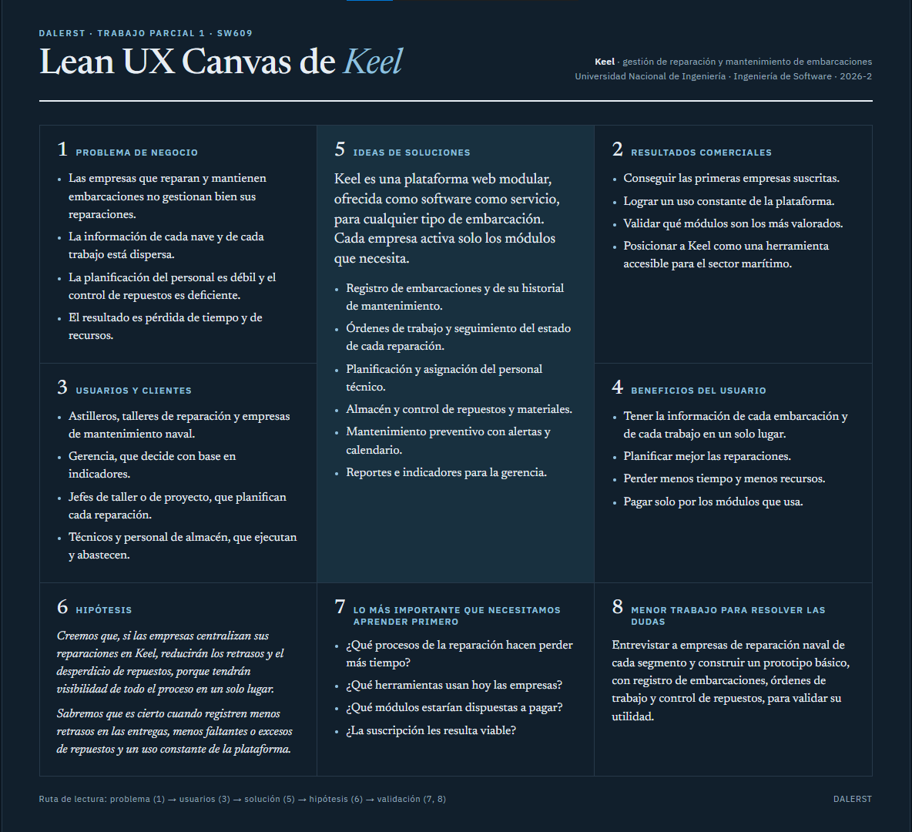
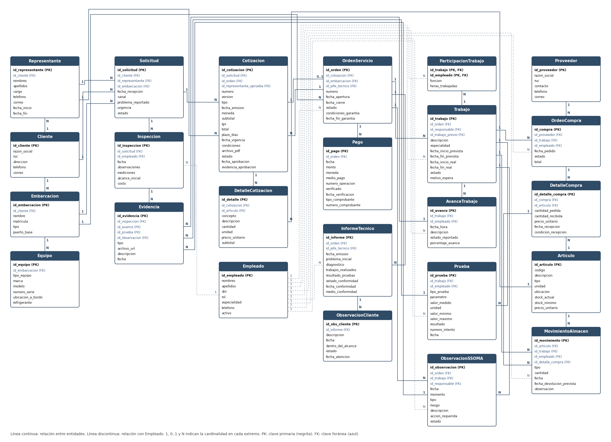

**UNIVERSIDAD NACIONAL DE INGENIERÍA**  
**Ingeniería de Software**  
**Período:** 2026-2  
**Curso:** Sistema de Gestión de Base de Datos  
**Código:** SW609  
**NRC:** \[completar\]  
**Docente:** Mg. Richard Leonardo Berrocal Navarro  
**INFORME DE TRABAJO PARCIAL (TP1)**  
**Nombre del startup:** DALERST  
**Nombre del producto:** Keel  
**Relación de integrantes**

| Código | Apellidos y nombres |
| :---- | :---- |
|  20244028F | Nuñez Villazana Franz Pool |
|  20244011F | Puris Ricaldi Roy Farid |
|  20240243J | Castro Aguirre Lenin Giomar |
|  20232156D | Ramos Jacay Dair David |

Lima, octubre de 2026

# **Registro de versiones del informe**

| Versión | Fecha | Autor | Descripción de modificación |
| :---- | :---- | :---- | :---- |
| 1.0 | 29/10/2026 | Franz Nuñez | Primera versión del informe: Capítulo I. |
| 1.1 | 30/10/2026 | Roy Farid Puris Ricaldi | Redacción del Capítulo I (secciones 1.1 a 1.3). |
| 1.2 | 12/11/2026 | Roy Farid Puris Ricaldi | Redacción de los capítulos II y III (secciones 2.1 a 3.3). |

*Cada fila lleva un solo autor. Agregar una fila por cada versión relevante (secciones nuevas, correcciones por retroalimentación del docente, etc.).*

# **Contenido**

[**Registro de versiones del informe	1**](#registro-de-versiones-del-informe)

[**Contenido	1**](#contenido)

[**Student Outcome	3**](#student-outcome)

[**Capítulo I: Introducción	3**](#capítulo-i-introducción)

[1.1. Startup profile	3](#11-startup-profile)

[1.1.1. Descripción del startup	3](#111-descripción-del-startup)

[1.1.2. Perfiles de integrantes del equipo	4](#112-perfiles-de-integrantes-del-equipo)

[1.2. Solution profile	5](#12-solution-profile)

[1.2.1. Antecedentes y problemática	5](#121-antecedentes-y-problemática)

[1.2.2. Propuesta de valor	7](#122-propuesta-de-valor)

[1.3. Segmentos objetivo	8](#13-segmentos-objetivo)

[**Capítulo II: Recopilación y análisis de requisitos	9**](#capítulo-ii-recopilación-y-análisis-de-requisitos)

[2.1. Entrevistas	9](#21-entrevistas)

[2.1.1. Diseño de entrevistas	9](#211-diseño-de-entrevistas)

[2.1.2. Registro de entrevistas	9](#212-registro-de-entrevistas)

[2.1.3. Análisis de entrevistas	10](#213-análisis-de-entrevistas)

[2.2. Requisitos	10](#22-requisitos)

[**Capítulo III: Diseño de base de datos	10**](#capítulo-iii-diseño-de-base-de-datos)

[3.1. Entidades	10](#31-entidades)

[3.2. Atributos	10](#32-atributos)

[3.3. Enfoque relacional	10](#33-enfoque-relacional)

[3.3.1. Diagrama entidad-relación lógico	10](#331-diagrama-entidad-relación-lógico)

[3.4. Enfoque no relacional (TF1)	10](#34-enfoque-no-relacional-tf1)

[3.4.1. Colecciones	10](#341-colecciones)

[3.4.2. Validación de esquema	10](#342-validación-de-esquema)

[3.4.3. Patrones de modelo de datos	10](#343-patrones-de-modelo-de-datos)

[**Capítulo IV: Implementación de base de datos	11**](#capítulo-iv-implementación-de-base-de-datos)

[4.1. Sistema de gestión de base de datos	11](#41-sistema-de-gestión-de-base-de-datos)

[4.1.1. Evaluación y elección del sistema de gestión de base de datos relacional	11](#411-evaluación-y-elección-del-sistema-de-gestión-de-base-de-datos-relacional)

[4.1.2. Evaluación y elección del sistema de gestión de base de datos no relacional (TF1)	11](#412-evaluación-y-elección-del-sistema-de-gestión-de-base-de-datos-no-relacional-tf1)

[4.2. Diagramas de datos	11](#42-diagramas-de-datos)

[4.2.1. Diagrama entidad-relación físico	11](#421-diagrama-entidad-relación-físico)

[4.2.2. Diagrama de documentos (TF1)	11](#422-diagrama-de-documentos-tf1)

[4.3. Scripts de creación de la base de datos (TF1)	11](#43-scripts-de-creación-de-la-base-de-datos-tf1)

[4.3.1. Scripts de creación y carga de datos de la base de datos relacional	11](#431-scripts-de-creación-y-carga-de-datos-de-la-base-de-datos-relacional)

[4.3.2. Scripts de creación y carga de datos de la base de datos no relacional	11](#432-scripts-de-creación-y-carga-de-datos-de-la-base-de-datos-no-relacional)

[4.4. Consultas (TF1)	11](#44-consultas-tf1)

[4.4.1. Consultas para la base de datos relacional	11](#441-consultas-para-la-base-de-datos-relacional)

[4.4.2. Consultas para la base de datos no relacional	11](#442-consultas-para-la-base-de-datos-no-relacional)

[**Conclusiones	12**](#conclusiones)

[Conclusiones y recomendaciones	12](#conclusiones-y-recomendaciones)

[Video About-the-Team	12](#video-about-the-team)

[**Bibliografía	12**](#bibliografía)

[**Anexos	12**](#anexos)

[Anexo A. Videos de exposiciones	12](#anexo-a-videos-de-exposiciones)

# 

# **Student Outcome**

ABET \- EAC \- Student Outcome 7: la capacidad de adquirir y aplicar nuevos conocimientos según sea necesario, utilizando estrategias de aprendizaje apropiadas.

| Criterio específico | Acciones realizadas | Conclusiones |
| :---- | :---- | :---- |
| 7.c1. Actualiza conceptos y conocimientos necesarios para su desarrollo profesional y, en especial, para su proyecto en soluciones de ingeniería de software. | \[Por integrante: nombres y apellidos, y las acciones realizadas en cada entrega relacionadas con el criterio.\] | \[Conclusión grupal, acumulable en cada entrega.\] |
| 7.c2. Reconoce la necesidad del aprendizaje permanente para el desempeño profesional y el desarrollo de proyectos en soluciones de ingeniería de software. | \[Por integrante: nombres y apellidos, y las acciones realizadas en cada entrega relacionadas con el criterio.\] | \[Conclusión grupal, acumulable en cada entrega.\] |

# 

# 

# **Capítulo I: Introducción**

## **1.1. Startup profile**

### **1.1.1. Descripción del startup**

DALERST es una startup peruana dedicada al desarrollo de software para empresas de distintos rubros. Su nombre nace de la combinación de los nombres de sus cuatro integrantes, estudiantes de Ingeniería de Software de la Universidad Nacional de Ingeniería (UNI), quienes la conformaron en 2026 en el marco de un proyecto académico con visión de empresa.  
La startup ofrece sus soluciones bajo el modelo de software como servicio (SaaS): el cliente accede a la plataforma desde la web, sin instalar ni mantener infraestructura propia, y paga una suscripción. Los productos de DALERST se construyen por módulos, de modo que cada empresa activa solo las funciones que su operación necesita y puede ampliarlas a medida que crece.  
El equipo parte de una idea simple: muchas empresas todavía gestionan procesos clave con hojas de cálculo, cuadernos y mensajes dispersos, y pierden tiempo y dinero por ello. DALERST busca reemplazar esa dispersión por sistemas ordenados, apoyados en bases de datos bien diseñadas, que den a cada empresa información confiable y a la mano.  
Su primer producto es Keel, una plataforma para la gestión de reparaciones y mantenimiento de embarcaciones. Keel es el punto de partida de la startup en el sector marítimo; su descripción detallada se desarrolla en la sección 1.2.  
**Misión.** Desarrollar software en la nube, modular y accesible, que ayude a las empresas a ordenar sus procesos y a decidir con información confiable, de manera que puedan operar con menos tiempo y recursos perdidos.  
**Visión.** Ser una empresa de software reconocida en el Perú y en América Latina por crear productos que simplifican la operación de las empresas, empezando por los sectores que hoy trabajan con herramientas poco integradas.  
**Valores.** Los valores que guían el trabajo de DALERST son los siguientes:

* **Rigor técnico:** diseñamos con criterio los datos y la arquitectura de cada solución.  
* **Modularidad:** cada cliente usa solo lo que necesita y puede crecer a su ritmo.  
* **Cercanía con el cliente:** partimos de entender cómo trabaja realmente cada empresa antes de proponer una solución.  
* **Mejora continua:** aprendemos de cada entrevista, de cada prueba y de cada error.

**Contexto.** DALERST se desarrolla como proyecto del curso Sistemas de Gestión de Base de Datos (SW609), del periodo 2026-2, a cargo del docente Mg. Richard Leonardo Berrocal Navarro. En este informe se presenta la primera entrega, que corresponde a la presentación del startup, la problemática y los segmentos objetivo.  
 

### **1.1.2. Perfiles de integrantes del equipo**

Los cuatro integrantes del equipo cursan Ingeniería de Software en la Universidad Nacional de Ingeniería, carrera que forma profesionales en el análisis, el diseño, la construcción y el mantenimiento de sistemas de software. A continuación se presenta el perfil de cada uno.

**Franz Pool Nuñez Villazana**

**Código:** 20244028F. Carrera: Ingeniería de Software (UNI).  
**Acerca de mí:** Estudiante de Ingeniería de Software (UNI) desde 2024, actualmente en el sexto ciclo. Interesado en manejo de datos y el desarrollo de aplicaciones web.  

                                                    **Roy Farid Puris Ricaldi**

**Código:** 20244011F. Carrera: Ingeniería de Software (UNI).  
**Acerca de mí:** Estudiante de Ingeniería de Software de la UNI desde 2024, actualmente en el sexto ciclo. Participó en el ICPC y trabaja con algoritmos y estructuras de datos.   

**Lenin Giomar Castro Aguirre**

**Código:** 20240243J. Carrera: Ingeniería de Software (UNI). Rol: Team Leader del equipo.  
**Acerca de mí:** Estudiante de Ingeniería de Software de la UNI desde 2024, actualmente en el sexto ciclo. Participó en el ICPC, interesado en el desarrollo de soluciones de software.

**Dair David Ramos Jacay**  
**Código:** 20232156D. Carrera: Ingeniería de Software (UNI).  
**Acerca de mí:** Estudiante de Ingeniería de Software (UNI) desde 2023, actualmente en el sexto ciclo. Participó en el Regional ICPC y trabajó con algoritmos y estructuras de datos. Interesado en manejo de datos y el desarrollo de aplicaciones web.

**Conocimientos técnicos del equipo.** Los cuatro integrantes tienen una base sólida en algoritmos y estructuras de datos, y todos participaron en el ICPC (International Collegiate Programming Contest). Esta experiencia aporta al proyecto capacidad de análisis, rigor para razonar sobre el rendimiento de las soluciones y habilidad para modelar los datos de un sistema, algo central en un curso de bases de datos.  
 

## **1.2. Solution profile**

### **1.2.1. Antecedentes y problemática**

El Perú cuenta con una flota de embarcaciones numerosa y diversa. La Sociedad Nacional de Pesquería informó que 16 405 de las 18 211 embarcaciones pesqueras del país, es decir el 90 %, son artesanales o de menor escala (Proactivo, s. f.). En 2025, los puertos peruanos registraron 20 794 arribos y 20 952 zarpes de naves, un 11,5 % y un 12,2 % más que en 2024, y en la Amazonía operaron 4 251 naves de pasajeros y más de 1 800 embarcaciones de carga mixta (MundoMarítimo, 2026).  
La reparación y el mantenimiento de esa flota se atienden en astilleros y talleres de distinto tamaño. Los astilleros de los Servicios Industriales de la Marina (SIMA Perú), ubicados en Callao, Iquitos y Chimbote, realizan trabajos de recorrido y mantenimiento de embarcaciones nacionales e internacionales de los sectores naviero, portuario y pesquero (Andina, s. f.). Además, el sector se está modernizando: SIMA ha iniciado la ampliación de sus astilleros (Andina, s. f.) y se anuncian proyectos de construcción y reparación naval de mayor escala en el país (Perú Retail, 2024).  
En paralelo, la digitalización del mantenimiento naval es un tema de investigación actual. Un estudio de 2026 sobre el registro digital de la sala de máquinas observa que el registro manual produce datos duplicados, errores en la programación del mantenimiento y dificultades para controlar los repuestos disponibles (Robbi et al., 2026).  
Esto deja ver una brecha: la flota crece y los astilleros se modernizan, pero la gestión diaria de cada reparación (qué trabajos se hacen, quién los hace, con qué repuestos y en cuánto tiempo) suele apoyarse en registros manuales o en herramientas que no están conectadas entre sí.  
**Problema.** Las empresas que reparan y mantienen embarcaciones no pueden gestionar las reparaciones de manera idónea y, como consecuencia, pierden tiempo y recursos. Para delimitar la problemática se aplicó la técnica de las 5 W y 2 H:  
**Who (¿Quiénes?):**

* Astilleros y talleres de reparación naval, de gran, mediana y pequeña escala.  
* Jefes de taller y de proyecto, que deben planificar y controlar cada reparación.  
* Personal técnico y de almacén, que ejecuta los trabajos y administra los repuestos.  
* Gerencias, que necesitan información para decidir y para responder a sus clientes.  
* Armadores y dueños de embarcaciones, afectados de forma indirecta cuando su nave tarda más de lo previsto en volver a operar.

**What (¿Qué problema?):**

* No pueden manejar las reparaciones de manera adecuada, lo que provoca pérdida de tiempo y de recursos.  
* La información de cada embarcación, de sus trabajos y de su historial de mantenimiento está dispersa.  
* Los trabajos y el personal se planifican sin una visión completa de la carga de trabajo.  
* El control de repuestos y materiales es débil.

**Where (¿Dónde ocurre?):**

* En los procesos de gestión de embarcaciones dentro de los astilleros y talleres del país, como los de Callao, Chimbote e Iquitos (Andina, s. f.).  
* En las áreas de taller, almacén y oficina técnica, donde la información debe fluir entre varias personas.

**When (¿Cuándo ocurre?):**

* Cuando una embarcación ingresa y se estiman trabajos, tiempos y costos.  
* Durante la ejecución de la reparación, sobre todo cuando se atienden varias embarcaciones a la vez.  
* Al programar el mantenimiento preventivo y al entregar la embarcación terminada.

**Why (¿Por qué ocurre?):**

* La información no está reunida en un solo sistema y se registra de forma manual, lo que genera duplicados y errores (Robbi et al., 2026).  
* Cada empresa trabaja de manera distinta y las herramientas genéricas no se adaptan a su forma de operar.  
* Las empresas pequeñas y medianas, que son mayoría en la flota (Proactivo, s. f.), tienen pocos recursos para adoptar sistemas costosos.

**How (¿Cómo se presenta?):**

* Retrasos en la entrega de las embarcaciones y dificultad para estimar tiempos.  
* Repuestos que faltan en el momento justo o que se compran de más.  
* Reprocesos y trabajos repetidos por falta de trazabilidad.  
* Personal con poca carga en unos momentos y sobrecargado en otros.

**How much (¿Qué impacto tiene?):**

* Más días de embarcación detenida, horas de personal sin uso productivo y repuestos comprados o almacenados sin control, lo que se traduce en pérdida de tiempo y de dinero para la empresa y para sus clientes.  
* La escala de la flota (18 211 embarcaciones pesqueras y más de 20 000 arribos de naves en 2025\) indica que el problema afecta a un mercado amplio (Proactivo, s. f.; MundoMarítimo, 2026).  
* El costo exacto de cada reparación mal gestionada se medirá con las entrevistas del Capítulo II.

**Problemática.** Las empresas de reparación y mantenimiento naval atienden una flota grande sin una herramienta que integre la gestión de sus reparaciones. Esto alarga los tiempos de entrega, aumenta los costos y desperdicia el trabajo y los materiales disponibles. DALERST propone resolverlo con un sistema que ordene esa gestión en un solo lugar.  
 

### **1.2.2. Propuesta de valor**

**Problema a resolver.** Las empresas que reparan y mantienen embarcaciones no gestionan sus reparaciones de forma adecuada y, por ello, pierden tiempo y recursos.  
**Propuesta.** Keel es el primer producto de DALERST: un software como servicio (SaaS) que centraliza la gestión de las reparaciones y del mantenimiento de embarcaciones de todo tipo, es decir, de cualquier nave del ámbito marítimo. Como cada empresa trabaja de manera distinta, Keel es modular: cada cliente contrata y usa solo las funciones que necesita. El nombre hace referencia a la quilla (keel, en inglés), la pieza central del casco de una nave: Keel busca ser la base sobre la que se organiza la operación de un astillero o de un taller naval.  
**Hipótesis Lean UX**

* Creemos que las empresas que reparan y mantienen embarcaciones, en especial las pequeñas y medianas, necesitan una plataforma que reúna la información de sus reparaciones y les permita planificar y controlar su trabajo.  
* Creemos que, al implementar un sistema modular como Keel, con registro de embarcaciones, órdenes de trabajo, control de personal y de repuestos, estas empresas reducirán sus retrasos y aprovecharán mejor sus recursos.  
* Sabremos que esto es cierto cuando las empresas que prueben Keel registren menos retrasos en las entregas, menos faltantes o excesos de repuestos y un uso constante de la plataforma en su trabajo diario.

**Lean UX Canvas**  
**1\. Problema de negocio.** Las empresas de reparación naval no gestionan bien sus reparaciones: la información está dispersa, la planificación es débil y el control de repuestos es deficiente, lo que genera pérdida de tiempo y de recursos.  
**2\. Resultados comerciales.** Conseguir las primeras empresas suscritas, lograr un uso constante de la plataforma, validar qué módulos son los más valorados y posicionar a Keel como una herramienta accesible para el sector marítimo.  
**3\. Usuarios y clientes.** Astilleros, talleres de reparación y empresas de mantenimiento naval. Dentro de ellos, usan la plataforma la gerencia, los jefes de taller o de proyecto, los técnicos y el personal de almacén.  
**4\. Beneficios del usuario.** Tener la información de cada embarcación y de cada trabajo en un solo lugar, planificar mejor las reparaciones, perder menos tiempo y recursos, y pagar solo por los módulos que usa.  
**5\. Ideas de soluciones.** Plataforma web modular que puede incluir los siguientes módulos:

* Registro de embarcaciones y de su historial de mantenimiento.  
* Órdenes de trabajo y seguimiento del estado de cada reparación.  
* Planificación y asignación del personal técnico.  
* Almacén y control de repuestos y materiales.  
* Mantenimiento preventivo con alertas y calendario.  
* Reportes e indicadores para la gerencia.

**6\. Hipótesis.** Si las empresas centralizan sus reparaciones en Keel, entonces reducirán los retrasos y el desperdicio de repuestos, porque tendrán visibilidad de todo el proceso en un solo lugar.  
**7\. Lo más importante que se necesita aprender primero.** Qué procesos de la reparación son los que más tiempo hacen perder, qué herramientas usan hoy las empresas, qué módulos estarían dispuestas a pagar y si la modalidad por suscripción les resulta viable.  
**8\. Menor cantidad de trabajo para resolver las dudas.** Entrevistar a empresas de reparación naval de cada segmento (Capítulo II) y construir un prototipo básico con registro de embarcaciones, órdenes de trabajo y control de repuestos para validar su utilidad.  

 

## **1.3. Segmentos objetivo**

Keel se dirige a las empresas que reparan y mantienen embarcaciones. Se distinguen segmentos primarios y secundarios según el tamaño y el tipo de operación de la empresa. Las fuentes consultadas no publican un registro consolidado de empresas de reparación naval; por ello, el tamaño de cada segmento se estima a partir de la flota que atiende y se afinará con las entrevistas del Capítulo II.  
**Segmentos primarios**  
**Astilleros de gran escala.** Empresas con instalaciones y proyectos de gran envergadura, como SIMA Perú, que opera astilleros en Callao, Iquitos y Chimbote (Andina, s. f.). La Armada del Perú planea la renovación de 23 buques en los próximos años (Revista Economía, s. f.), y SIMA desarrolla un proyecto para ampliar su capacidad de reparación con un nuevo dique seco (Perú Retail, 2024). Gestionan muchos trabajos a la vez, por lo que necesitan control de personal, de almacén y de plazos.  
**Astilleros y talleres medianos y pequeños de la costa.** Atienden principalmente a embarcaciones pesqueras. La flota pesquera del país suma 18 211 embarcaciones, de las cuales 16 405 (90 %) son artesanales o de menor escala (Proactivo, s. f.). Son empresas de menor tamaño, con procesos más manuales y poco presupuesto, para las que un servicio modular y por suscripción es una alternativa adecuada.  
**Talleres y empresas de mantenimiento fluvial de la Amazonía.** Atienden el transporte de personas y de carga por los ríos amazónicos. En 2025 operaron en esa región 4 251 naves de pasajeros y más de 1 800 embarcaciones de carga mixta (MundoMarítimo, 2026), y SIMA cuenta con un astillero en Iquitos (Andina, s. f.). Dependen de que las embarcaciones vuelvan a operar con rapidez, pues son un medio de transporte clave en la región.  
**Segmentos secundarios**  
**Empresas navieras, pesqueras y de transporte con flota propia.** Algunas cuentan con áreas internas de mantenimiento que también necesitan registrar el historial de sus embarcaciones y programar el mantenimiento preventivo.  
**Armadores y propietarios de embarcaciones.** No usan Keel para gestionar reparaciones, pero se benefician al recibir información más clara sobre el estado y los plazos de sus naves.  
**Criterio de priorización.** Por la facilidad de acceso y por el tamaño de la flota atendida, el equipo prioriza como primer público a los astilleros y talleres medianos y pequeños, y usará los otros segmentos para validar y ampliar la plataforma.  
 

# **Capítulo II: Recopilación y análisis de requisitos**

## **2.1. Entrevistas**

### **2.1.1. Diseño de entrevistas**

Para identificar las entidades de datos, sus atributos y las relaciones que debe modelar Keel, se preparó una entrevista semiestructurada para una persona de Refrymar Perú S.A.C., empresa que se dedica al mantenimiento y la reparación de sistemas de refrigeración de embarcaciones. El entrevistado trabaja desde hace varios años en la dirección de la empresa. Recibe los pedidos, coordina la revisión inicial y prepara las propuestas con el área técnica, por lo que conoce los datos que se manejan en cada etapa del servicio.  
Refrymar pertenece al segmento de astilleros y talleres medianos y pequeños de la costa, que es el segmento prioritario definido en la sección 1.3. En esta entrega se entrevistó solo a este segmento; los demás se validarán en las siguientes entregas.  
La guía tiene 18 preguntas principales agrupadas en ocho bloques que siguen el orden del proceso de reparación. Para obtener respuestas concretas, se pidió al entrevistado que eligiera un servicio reciente y lo siguiera de principio a fin. Antes de la entrevista, el entrevistado revisó la guía y se acordó hacer solo las preguntas principales. Las preguntas son las siguientes.  
**Entrevistado:** integrante de la dirección de Refrymar Perú S.A.C.  
**Bloque 1: Empresa y caso reciente**

1. ¿Qué servicios realiza Refrymar Perú y cuál es su participación en ellos?  
2. Pensemos en una reparación reciente que conozca bien. ¿Qué necesitaba el cliente y cómo transcurrió el servicio desde el primer contacto hasta su situación actual?

**Bloque 2: Clientes, embarcaciones y equipos**

3. En ese servicio, ¿quién contrató la reparación y con quién coordinaron las decisiones?  
4. ¿Cómo identifican la embarcación y el sistema o equipo que van a intervenir, y dónde guardan su historial?

**Bloque 3: Solicitudes, inspecciones y cotizaciones**

5. En el caso que estamos siguiendo, ¿cómo recibieron el pedido y qué revisaron antes de preparar la primera cotización?  
6. ¿Qué información incluyeron en la cotización y cómo determinaron el importe y el plazo?  
7. ¿Cómo se acordó la cotización definitiva y qué evidencia se conservó de esa aprobación?

**Bloque 4: Organización, ejecución y cambios**

8. Con el presupuesto aceptado, ¿cómo organizaron los trabajos y quién quedó a cargo de cada uno?  
9. Mientras se ejecutaba el servicio, ¿cómo sabían qué se había hecho, qué faltaba y qué se estaba haciendo?  
10. Cuando aparece una falla o un trabajo que no estaba incluido en lo aprobado, ¿cómo deciden qué hacer? Cuéntenos un caso, si les ha ocurrido.

**Bloque 5: Repuestos, herramientas y compras**

11. En esa reparación, ¿cómo controlaron los repuestos y materiales utilizados y las herramientas que debían devolverse?  
12. Si falta un repuesto o material, ¿cómo gestionan su compra y confirman que está disponible para usarlo?

**Bloque 6: Seguridad y pruebas**

13. ¿Cómo interviene el responsable de seguridad, salud ocupacional y medio ambiente (SSOMA) antes y durante los trabajos, y qué deja registrado?  
14. ¿Cómo verificaron que la reparación quedó bien y qué resultados conservaron?

**Bloque 7: Entrega, cobro y cierre**

15. ¿Cómo presentaron el resultado al cliente y cómo quedó registrada su conformidad o sus observaciones?  
16. Después de la entrega, ¿cómo gestionan el cobro y qué debe quedar resuelto para dar el servicio por cerrado?

**Bloque 8: Problemas actuales y adopción de Keel**

17. De todo el recorrido, ¿qué dificultad de gestión les genera más trabajo o pérdidas? Cuéntenos la última vez que ocurrió y cómo la resolvieron.  
18. Pensando en esa dificultad, ¿qué tendría que resolver una herramienta como Keel para que Refrymar decida probarla, y qué podría impedir que la use?

### **2.1.2. Registro de entrevistas**

**Segmento:** astilleros y talleres medianos y pequeños de la costa (segmento primario). Entrevista 1 de 1\.

| Campo | Dato |
| :---- | :---- |
| Nombres | Alexis Yanpoll |
| Apellidos | Garay Yovera |
| Edad | \[completar\] |
| Distrito | \[completar\] |
| Empresa y cargo | Refrymar Perú S.A.C., dirección de la empresa |
| Fecha y modalidad | 12/11/2026, por videollamada |
| URL de YouTube | [https\://www\.youtube.com/watch?v=hxBYQtThdpo](https://www.youtube.com/watch?v=hxBYQtThdpo) |
| Minuto de inicio y duración | Inicio: 00:00. Duración: 18:42. |

**Resumen de las respuestas**  
**Empresa y caso reciente (preguntas 1 y 2).** Refrymar se dedica al mantenimiento y la reparación de sistemas de refrigeración, sobre todo de embarcaciones pesqueras del Callao y de otros puertos del país, y también hace trabajos eléctricos y electrónicos relacionados con esos sistemas. El entrevistado recibe los pedidos, coordina la revisión inicial y prepara la propuesta con el área técnica de refrigeración. Como caso reciente contó el de una embarcación que no alcanzaba la temperatura de operación necesaria para conservar el pescado. Recibieron el aviso, prepararon la cotización, organizaron los trabajos, retiraron del almacén los materiales y ejecutaron la reparación. Durante la intervención encontraron un componente deteriorado que no estaba en la cotización inicial; lo cotizaron por separado y esperaron la autorización del cliente. Al final hicieron las pruebas, entregaron el informe y cobraron.  
**Clientes, embarcaciones y equipos (preguntas 3 y 4).** El servicio lo contrató una empresa pesquera, que coordina por medio de un representante. Una misma empresa puede pedir trabajos para varias embarcaciones, y si cambia de representante lo comunica y el nuevo continúa con lo coordinado antes. La embarcación se identifica por su nombre, su matrícula y la empresa que contrata el servicio. Del equipo se anota la ubicación a bordo, la marca, el modelo y otros datos propios del equipo cuando están disponibles. Las cotizaciones y los informes se guardan en carpetas digitales ordenadas por cliente y embarcación, pero las fotografías y los mensajes quedan en otros lugares y hay que buscarlos para armar el historial.  
**Solicitud, inspección y cotización (preguntas 5, 6 y 7).** El pedido llegó por correo al área de operaciones, donde se anotó el contacto, la embarcación, el problema reportado y la urgencia. Luego se coordinó una inspección: quien revisó el sistema registró observaciones, fotografías y mediciones, y con eso se definió el alcance inicial. Si el cliente no contrata, igual se conservan la ficha y la propuesta; cuando la inspección tiene un costo propio, se acuerda antes de hacerla. La cotización incluye los trabajos propuestos, los repuestos y materiales con sus cantidades y precios, la mano de obra, los gastos de traslado, los gases, la moneda, el IGV, el plazo estimado de ejecución, la vigencia y las condiciones del servicio. El importe se calcula con el costo de materiales, las horas de mano de obra, otros gastos y el margen comercial, y para el plazo se considera el acceso a la embarcación, porque a veces el puerto se cierra por el clima. En este caso el cliente pidió cambiar una parte del alcance y se envió una segunda versión. Cada cotización tiene un número y una versión, y se guarda cada PDF para saber qué cambió. El representante aceptó la nueva versión por correo; esa respuesta se conserva y recién entonces se pasa a la ejecución. Si la cotización vence o no hay respuesta, se hace seguimiento, y si no se aprueba queda archivada.  
**Organización, ejecución y cambios (preguntas 8, 9 y 10).** Con la cotización aprobada se abre una orden de servicio vinculada a esa cotización y a la embarcación. El jefe técnico divide el alcance en trabajos y asigna un responsable a cada uno según su especialidad, experiencia y disponibilidad. Pueden participar varios técnicos, pero cada trabajo tiene un responsable, fechas previstas y recursos. Algunas actividades siguen una secuencia y otras avanzan en paralelo. Durante la ejecución, el responsable de cada trabajo comunica el avance y se registra en una hoja de Excel, donde se distingue lo pendiente, lo que está en ejecución, en espera o en pruebas. Si falta un repuesto o una autorización se anota, y los cambios de fecha los corrige el jefe técnico. Cuando aparece algo no incluido, el técnico lo reporta y explica por qué; el jefe técnico revisa qué se necesita y operaciones prepara la propuesta para el cliente, que debe aprobarla antes de ejecutarla, como pasó con el componente deteriorado.  
**Repuestos, herramientas y compras (preguntas 11 y 12).** La empresa tiene un almacén de repuestos, materiales y herramientas que se controla en Excel, con código, descripción, ubicación, cantidad y unidad. Cada salida indica la orden de servicio, el trabajo y la persona que recibe. Al terminar se informa cuánto se consumió y cuánto sobró, y el sobrante vuelve al inventario. Las herramientas se controlan como préstamos que deben devolverse. También se revisan físicamente las existencias, porque si una salida no se anota a tiempo el registro muestra más de lo que hay. Si falta un repuesto, el técnico lo comunica, almacén verifica el stock y compras lo solicita al proveedor, cuyos datos y contactos se guardan. Al recibir el pedido se verifican cantidades y condiciones, y recién entonces se actualiza el stock. Si llega solo una parte, se registra lo recibido y lo pendiente. El trabajo afectado espera y los demás continúan si no dependen de ese repuesto.  
**Seguridad y pruebas (preguntas 13 y 14).** El responsable de SSOMA supervisa los trabajos y revisa las condiciones de seguridad antes, durante y después de la intervención. Registra los controles, las observaciones, los responsables y las evidencias. Ante riesgos específicos, como una fuga de amoniaco, los controles son más estrictos. Para verificar la reparación, el jefe técnico define las pruebas según el equipo y el alcance. Con la embarcación en el muelle se registran las condiciones de operación, como presión y temperatura, y se comparan con los criterios del equipo. Si están en el rango aceptable, la prueba se valida y se informa al cliente. Si una prueba falla, se registra el resultado, se corrige la causa y se vuelve a probar.  
**Entrega, cobro y cierre (preguntas 15 y 16).** El jefe técnico prepara un informe con el problema inicial, el diagnóstico, los trabajos realizados, los materiales y las pruebas. Se envía al representante del cliente y se coordina una revisión para obtener su conformidad, por correo u otro medio. Las observaciones del cliente se registran; si corresponden al alcance del servicio se corrigen y se verifica todo de nuevo. El cobro se hace según el presupuesto aprobado y los adicionales autorizados. El cliente paga por transferencia y administración verifica el ingreso en la cuenta antes de marcar el trabajo como pagado y asociar el comprobante; el movimiento se registra en el sistema de caja de la empresa. Para cerrar el servicio deben estar terminados los trabajos y las pruebas, hecha la entrega técnica y registrada la garantía con sus condiciones.  
**Problemas actuales y adopción de Keel (preguntas 17 y 18).** La mayor dificultad es que la información está repartida en mensajes, hojas de Excel, fotografías y documentos. Para preparar un informe hay que pedir todo a varias áreas y se pierde tiempo; la demora no está solo en la ejecución, sino también en la parte administrativa de entregar el informe y los documentos. Para probar una herramienta, pediría ver el estado de cada reparación y reunir en el sistema los trabajos, los materiales y lo demás; que los técnicos puedan registrar desde el celular; que el cliente pueda consultar el avance y aprobar lo que corresponda; y que registrar no tome mucho tiempo ni genere duplicados. La evaluarían con una prueba en una reparación, revisando si facilita el seguimiento y reduce el tiempo de preparar el informe. Sobre el precio no dio una cifra. Al cierre indicó que las preguntas cubrieron lo necesario para entender la situación de la empresa.  
 

### **2.1.3. Análisis de entrevistas**

**Segmento:** astilleros y talleres medianos y pequeños de la costa (1 entrevista). Como hay una sola entrevista, los porcentajes se calculan sobre los registros y las necesidades que mencionó el entrevistado, no sobre un grupo de personas.  
**Características objetivas**

* Refrymar atiende principalmente a embarcaciones pesqueras del Callao y de otros puertos del país, y sus clientes son empresas que coordinan por medio de un representante.  
* El servicio sigue nueve etapas: pedido, inspección, cotización, aprobación, orden de servicio, ejecución de trabajos, pruebas, entrega con conformidad, y cobro y cierre.  
* Intervienen siete roles: operaciones, jefe técnico, técnicos, almacén, compras, SSOMA y administración.

De los ocho registros del proceso que mencionó, siete (87,5 %) se llevan en herramientas no conectadas entre sí (correo, Excel y carpetas con PDF). Solo los pagos (12,5 %) se registran en un sistema.

| Medio actual | Registros que se llevan ahí | Cantidad | Porcentaje |
| :---- | :---- | :---- | :---- |
| Correo | Pedido del cliente, aprobación de la cotización, conformidad del cliente | 3 | 37,5 % |
| Excel | Avance de los trabajos, inventario y salidas de almacén | 2 | 25,0 % |
| Carpetas digitales y PDF | Historial de cotizaciones e informes, versiones de la cotización | 2 | 25,0 % |
| Sistema de caja | Pagos | 1 | 12,5 % |
| **Total** |  | 8 | 100 % |

**Características subjetivas**

* Lo que más le preocupa es el tiempo que se pierde buscando información dispersa, sobre todo al preparar el informe final y los documentos de entrega.  
* Ve con buenos ojos una herramienta que reúna todo, pero la probaría primero en una sola reparación antes de adoptarla.  
* No dio una cifra de precio, así que la viabilidad de la suscripción queda pendiente de validar.

El entrevistado mencionó cinco necesidades. Dos de ellas (40 %) ya están en los módulos propuestos en la sección 1.2.2, y tres (60 %) son nuevas y se agregan como requisitos.

| Necesidad mencionada | ¿Está en los módulos de la 1.2.2? | Cómo se atiende |
| :---- | :---- | :---- |
| Ver el estado de cada reparación | Sí | Órdenes de trabajo y seguimiento del estado |
| Reunir trabajos, materiales y documentos en un solo lugar | Sí | Registro de embarcaciones, órdenes de trabajo y almacén |
| Que los técnicos registren desde el celular | No | Nuevo requisito (HU12) |
| Que el cliente consulte el avance y apruebe en línea | No | Nuevo requisito (HU22) |
| Registrar rápido y sin duplicados | No | Requisito no funcional |

**Conclusión del segmento.** La entrevista respalda la hipótesis de la sección 1.2.2: el problema principal es la información dispersa, que hace perder tiempo en el seguimiento y en la entrega. También confirma los datos que Keel debe manejar: clientes y representantes, embarcaciones y equipos, solicitudes con inspección, cotizaciones con versiones, órdenes de servicio divididas en trabajos, almacén y compras, SSOMA, pruebas, informe con conformidad y pagos.  
 

## **2.2. Requisitos**

Los requisitos funcionales se escriben como historias de usuario. Cada una indica la pregunta de la entrevista de la que surge.

| ID | Historia de usuario | Origen |
| :---- | :---- | :---- |
| HU01 | Como personal de operaciones, quiero registrar clientes y sus representantes, indicando cuál está vigente, para saber con quién coordinar cada servicio. | P3 |
| HU02 | Como personal de operaciones, quiero registrar embarcaciones con su nombre, matrícula y empresa contratante, y sus equipos con ubicación a bordo, marca, modelo y número de serie, para identificarlos sin confusiones. | P4 |
| HU03 | Como personal de operaciones, quiero consultar en un solo lugar el historial de servicios, cotizaciones, informes y fotografías de una embarcación, para no buscarlos en carpetas y mensajes separados. | P4, P17 |
| HU04 | Como personal de operaciones, quiero registrar una solicitud con el contacto, la embarcación, el problema reportado y la urgencia, para empezar el servicio con la información completa. | P5 |
| HU05 | Como técnico, quiero registrar la inspección inicial con observaciones, mediciones y fotografías, para definir el alcance de la cotización. | P5 |
| HU06 | Como personal de operaciones, quiero elaborar cotizaciones con trabajos, materiales, mano de obra, traslados, moneda, IGV, plazo, vigencia y condiciones, para presentar un presupuesto completo. | P6 |
| HU07 | Como personal de operaciones, quiero que cada cotización tenga número y versión y que se conserven todas las versiones, para saber qué cambió entre una y otra. | P7 |
| HU08 | Como personal de operaciones, quiero registrar la aprobación del cliente con la fecha, el representante y la evidencia, para pasar a la ejecución solo con una versión aprobada. | P7 |
| HU09 | Como personal de operaciones, quiero ver las cotizaciones vencidas o sin respuesta, para hacerles seguimiento o archivarlas. | P7 |
| HU10 | Como jefe técnico, quiero abrir una orden de servicio vinculada a la cotización aprobada y a la embarcación, para organizar la ejecución. | P8 |
| HU11 | Como jefe técnico, quiero dividir la orden en trabajos y asignar a cada uno un responsable, técnicos de apoyo, fechas previstas y trabajos previos, para planificar la reparación. | P8 |
| HU12 | Como técnico, quiero registrar el avance de mi trabajo desde el celular y cambiar su estado (pendiente, en ejecución, en espera, en pruebas o terminado), para que todos sepan cómo va. | P9, P18 |
| HU13 | Como jefe técnico, quiero ver el estado de todas las reparaciones y sus trabajos, incluidos los que esperan un repuesto o una autorización, para reprogramar fechas. | P9, P18 |
| HU14 | Como técnico, quiero reportar un hallazgo no incluido en la cotización, para que operaciones prepare un adicional y el cliente lo apruebe antes de ejecutarlo. | P10 |
| HU15 | Como encargado de almacén, quiero registrar artículos con código, descripción, ubicación, stock y unidad, para saber qué hay disponible. | P11 |
| HU16 | Como encargado de almacén, quiero registrar cada salida con la orden, el trabajo y la persona que recibe, y luego lo consumido y lo devuelto, para controlar el uso de materiales. | P11 |
| HU17 | Como encargado de almacén, quiero registrar el préstamo y la devolución de herramientas, para saber quién tiene cada una. | P11 |
| HU18 | Como encargado de compras, quiero registrar pedidos a proveedores y sus recepciones parciales o completas, para actualizar el stock solo con lo recibido. | P12 |
| HU19 | Como responsable de SSOMA, quiero registrar controles, observaciones, responsables y evidencias antes, durante y después de los trabajos, para dejar constancia de la seguridad. | P13 |
| HU20 | Como jefe técnico, quiero registrar las pruebas con los valores medidos de presión y temperatura y compararlos con el rango aceptable, para validar la reparación o repetir la prueba si falla. | P14 |
| HU21 | Como jefe técnico, quiero generar el informe técnico con lo ya registrado (problema, diagnóstico, trabajos, materiales y pruebas), para entregarlo más rápido. | P15, P17 |
| HU22 | Como representante del cliente, quiero consultar el avance de mi reparación y aprobar cotizaciones y adicionales en línea, para no depender del correo. | P18 |
| HU23 | Como personal de operaciones, quiero registrar la conformidad o las observaciones del cliente y su atención, para cerrar la entrega. | P15 |
| HU24 | Como personal de administración, quiero registrar el pago, verificarlo y asociar el comprobante, para marcar la orden como pagada. | P16 |
| HU25 | Como jefe técnico, quiero cerrar la orden solo cuando los trabajos, las pruebas, la conformidad y el pago estén completos, y registrar la garantía, para dar el servicio por terminado. | P16 |

Además, el entrevistado pidió que registrar la información sea rápido y no genere duplicados. Esto se considera un requisito no funcional de usabilidad e integridad de datos.  
 

# **Capítulo III: Diseño de base de datos**

## **3.1. Entidades**

A partir de la entrevista y de los requisitos se identificaron 24 entidades. Están ordenadas según la etapa del proceso en la que aparecen.  
**Cliente.** Empresa que contrata los servicios de reparación, por ejemplo una pesquera.  
**Representante.** Persona que coordina con la empresa reparadora en nombre del cliente. Un cliente puede cambiar de representante.  
**Embarcacion.** Nave del cliente que recibe los servicios.  
**Equipo.** Sistema o equipo de refrigeración instalado en una embarcación.  
**Solicitud.** Pedido de servicio que hace un cliente.  
**Inspeccion.** Revisión técnica previa que permite definir el alcance y cotizar.  
**Cotizacion.** Propuesta económica enviada al cliente. Cada cambio genera una nueva versión, y los trabajos adicionales que aparecen durante la ejecución se cotizan por separado.  
**DetalleCotizacion.** Cada línea de una cotización.  
**OrdenServicio.** Orden que se abre al aprobarse una cotización y agrupa todo el trabajo de una reparación.  
**Trabajo.** Parte del alcance de una orden que se asigna a un responsable.  
**Empleado.** Persona que trabaja en la empresa reparadora: técnicos, jefe técnico, almacén, compras, SSOMA, operaciones y administración.  
**ParticipacionTrabajo.** Relación entre un trabajo y los técnicos que participan en él.  
**AvanceTrabajo.** Registro de avance que reporta el responsable de un trabajo.  
**Articulo.** Repuesto, material, herramienta o gas que se guarda en el almacén.  
**MovimientoAlmacen.** Entrada o salida de un artículo: salida para un trabajo, devolución de sobrante, préstamo de herramienta, ingreso por compra o ajuste por inventario.  
**Proveedor.** Empresa a la que se compran repuestos y materiales.  
**OrdenCompra.** Pedido de compra a un proveedor cuando falta un repuesto o material.  
**DetalleCompra.** Cada artículo pedido en una compra, con lo recibido.  
**Prueba.** Prueba que valida un trabajo. Si falla, se registra un nuevo intento.  
**ObservacionSSOMA.** Control, observación o incidente de seguridad registrado en una orden.  
**Evidencia.** Fotografía o documento que respalda una inspección, un avance, una prueba o una observación de seguridad.  
**InformeTecnico.** Informe final que se entrega al cliente.  
**ObservacionCliente.** Observación del cliente sobre la entrega.  
**Pago.** Pago del cliente por una orden de servicio.  
 

## **3.2. Atributos**

Para cada entidad se listan sus atributos principales. PK indica la clave primaria y FK una clave foránea.  
**Cliente**

* id\_cliente (PK): Identificador del cliente.  
* razon\_social: Nombre legal de la empresa.  
* ruc: Número de RUC, único.  
* direccion: Dirección fiscal.  
* telefono: Teléfono de contacto.  
* correo: Correo de contacto.

**Representante**

* id\_representante (PK): Identificador del representante.  
* id\_cliente (FK): Cliente al que representa.  
* nombres: Nombres del representante.  
* apellidos: Apellidos del representante.  
* cargo: Cargo en la empresa cliente.  
* telefono: Teléfono de contacto.  
* correo: Correo de contacto.  
* fecha\_inicio: Desde cuándo representa al cliente.  
* fecha\_fin: Hasta cuándo lo representó; vacío si sigue vigente.

**Embarcacion**

* id\_embarcacion (PK): Identificador de la embarcación.  
* id\_cliente (FK): Empresa propietaria o que contrata el servicio.  
* nombre: Nombre de la embarcación.  
* matricula: Matrícula, única.  
* tipo: Tipo de embarcación, por ejemplo pesquera.  
* puerto\_base: Puerto donde suele operar.

**Equipo**

* id\_equipo (PK): Identificador del equipo.  
* id\_embarcacion (FK): Embarcación donde está instalado.  
* tipo\_equipo: Tipo de equipo, por ejemplo compresor o evaporador.  
* marca: Marca del equipo.  
* modelo: Modelo del equipo.  
* numero\_serie: Número de serie, si está disponible.  
* ubicacion\_a\_bordo: Lugar de la embarcación donde se encuentra.  
* refrigerante: Refrigerante que usa, por ejemplo amoniaco.

**Solicitud**

* id\_solicitud (PK): Identificador de la solicitud.  
* id\_cliente (FK): Cliente que hace el pedido.  
* id\_representante (FK): Persona que hizo el pedido.  
* id\_embarcacion (FK): Embarcación afectada.  
* fecha\_recepcion: Fecha y hora en que llegó el pedido.  
* canal: Medio por el que llegó: correo, teléfono u otro.  
* problema\_reportado: Descripción del problema según el cliente.  
* urgencia: Nivel de urgencia: baja, media o alta.  
* estado: Recibida, inspeccionada, cotizada, aprobada o archivada.

**Inspeccion**

* id\_inspeccion (PK): Identificador de la inspección.  
* id\_solicitud (FK): Solicitud que origina la inspección.  
* id\_empleado (FK): Persona que revisó el sistema.  
* fecha: Fecha de la inspección.  
* observaciones: Hallazgos de la revisión.  
* mediciones: Valores medidos durante la revisión.  
* alcance\_inicial: Trabajos que se proponen a partir de la revisión.  
* costo: Costo de la inspección, si se cobra aparte.

**Cotizacion**

* id\_cotizacion (PK): Identificador de la cotización.  
* id\_solicitud (FK): Solicitud a la que responde.  
* id\_orden (FK): Orden de servicio, solo si es un adicional surgido durante la ejecución.  
* id\_representante\_aprueba (FK): Representante que la aprobó.  
* numero: Número de la cotización.  
* version: Versión de la cotización (1, 2, 3...).  
* tipo: Principal o adicional.  
* fecha\_emision: Fecha en que se emitió.  
* moneda: Moneda de los importes.  
* subtotal: Importe sin impuestos.  
* igv: Impuesto general a las ventas.  
* total: Importe total.  
* plazo\_dias: Plazo estimado de ejecución en días.  
* fecha\_vigencia: Fecha hasta la que es válida.  
* condiciones: Condiciones del servicio.  
* archivo\_pdf: Ruta del PDF enviado al cliente.  
* estado: Borrador, enviada, aprobada, rechazada, vencida o archivada.  
* fecha\_aprobacion: Fecha en que el cliente la aprobó.  
* evidencia\_aprobacion: Ruta del correo o documento de aprobación.

**DetalleCotizacion**

* id\_detalle (PK): Identificador de la línea.  
* id\_cotizacion (FK): Cotización a la que pertenece.  
* id\_articulo (FK): Artículo del almacén, si la línea es un repuesto o material.  
* concepto: Mano de obra, repuesto, material, gas, traslado u otro.  
* descripcion: Descripción de la línea.  
* cantidad: Cantidad cotizada.  
* unidad: Unidad de medida, por ejemplo horas o kilos.  
* precio\_unitario: Precio por unidad.  
* subtotal: Cantidad por precio unitario.

**OrdenServicio**

* id\_orden (PK): Identificador de la orden.  
* id\_cotizacion (FK): Cotización aprobada que la origina.  
* id\_embarcacion (FK): Embarcación que se repara.  
* id\_jefe\_tecnico (FK): Empleado a cargo de la ejecución.  
* numero: Número de la orden.  
* fecha\_apertura: Fecha en que se abrió.  
* fecha\_cierre: Fecha en que se cerró.  
* estado: Abierta, en ejecución, en pruebas, entregada, pagada o cerrada.  
* condiciones\_garantia: Condiciones de la garantía del servicio.  
* fecha\_fin\_garantia: Fecha en que vence la garantía.

**Trabajo**

* id\_trabajo (PK): Identificador del trabajo.  
* id\_orden (FK): Orden a la que pertenece.  
* id\_responsable (FK): Empleado responsable del trabajo.  
* id\_trabajo\_previo (FK): Trabajo que debe terminar antes, si van en secuencia.  
* descripcion: Qué se debe hacer.  
* especialidad: Especialidad requerida, por ejemplo refrigeración o electricidad.  
* fecha\_inicio\_prevista: Inicio planificado.  
* fecha\_fin\_prevista: Fin planificado.  
* fecha\_inicio\_real: Inicio real.  
* fecha\_fin\_real: Fin real.  
* estado: Pendiente, en ejecución, en espera, en pruebas o terminado.  
* motivo\_espera: Razón de la espera, por ejemplo falta de repuesto o de autorización.

**Empleado**

* id\_empleado (PK): Identificador del empleado.  
* nombres: Nombres.  
* apellidos: Apellidos.  
* dni: Documento de identidad, único.  
* rol: Rol en la empresa.  
* especialidad: Especialidad técnica, si aplica.  
* telefono: Teléfono de contacto.  
* activo: Indica si sigue trabajando en la empresa.

**ParticipacionTrabajo**

* id\_trabajo (PK, FK): Trabajo.  
* id\_empleado (PK, FK): Técnico que participa.  
* funcion: Responsable o apoyo.  
* horas\_trabajadas: Horas dedicadas al trabajo.

**AvanceTrabajo**

* id\_avance (PK): Identificador del avance.  
* id\_trabajo (FK): Trabajo al que corresponde.  
* id\_empleado (FK): Quien reporta el avance.  
* fecha\_hora: Momento del reporte.  
* descripcion: Lo realizado o encontrado.  
* estado\_reportado: Estado del trabajo en ese momento.  
* porcentaje\_avance: Porcentaje de avance estimado.

**Articulo**

* id\_articulo (PK): Identificador del artículo.  
* codigo: Código interno, único.  
* descripcion: Descripción del artículo.  
* tipo: Repuesto, material, herramienta o gas.  
* unidad: Unidad de medida.  
* ubicacion: Lugar del almacén donde se guarda.  
* stock\_actual: Cantidad disponible.  
* stock\_minimo: Cantidad mínima antes de comprar.  
* precio\_unitario: Precio de referencia.

**MovimientoAlmacen**

* id\_movimiento (PK): Identificador del movimiento.  
* id\_articulo (FK): Artículo que se mueve.  
* id\_trabajo (FK): Trabajo para el que sale o del que vuelve, si aplica.  
* id\_empleado (FK): Persona que recibe o entrega.  
* id\_detalle\_compra (FK): Línea de compra, si es un ingreso por compra.  
* tipo: Salida, devolución, préstamo, ingreso o ajuste.  
* cantidad: Cantidad movida.  
* fecha: Fecha del movimiento.  
* fecha\_devolucion\_prevista: Para préstamos de herramientas.  
* observacion: Notas del movimiento.

**Proveedor**

* id\_proveedor (PK): Identificador del proveedor.  
* razon\_social: Nombre legal.  
* ruc: Número de RUC, único.  
* contacto: Persona de contacto.  
* telefono: Teléfono.  
* correo: Correo.

**OrdenCompra**

* id\_compra (PK): Identificador de la compra.  
* id\_proveedor (FK): Proveedor al que se pide.  
* id\_trabajo (FK): Trabajo que espera la compra, si aplica.  
* id\_empleado (FK): Persona de compras que la registra.  
* fecha\_pedido: Fecha del pedido.  
* estado: Solicitada, recibida parcialmente, recibida o anulada.  
* total: Importe total.

**DetalleCompra**

* id\_detalle\_compra (PK): Identificador de la línea.  
* id\_compra (FK): Compra a la que pertenece.  
* id\_articulo (FK): Artículo pedido.  
* cantidad\_pedida: Cantidad pedida.  
* cantidad\_recibida: Cantidad recibida hasta el momento.  
* precio\_unitario: Precio de compra.  
* fecha\_recepcion: Fecha de la última recepción.  
* condicion\_recepcion: Estado en que llegó el artículo.

**Prueba**

* id\_prueba (PK): Identificador de la prueba.  
* id\_trabajo (FK): Trabajo que se prueba.  
* id\_empleado (FK): Quien hizo la prueba.  
* tipo\_prueba: Por ejemplo, prueba de funcionamiento en muelle.  
* parametro: Magnitud medida, por ejemplo presión o temperatura.  
* valor\_medido: Valor obtenido.  
* unidad: Unidad del valor.  
* valor\_minimo: Límite inferior aceptable.  
* valor\_maximo: Límite superior aceptable.  
* resultado: Conforme o no conforme.  
* numero\_intento: Número de intento de la prueba.  
* fecha: Fecha de la prueba.

**ObservacionSSOMA**

* id\_observacion (PK): Identificador de la observación.  
* id\_orden (FK): Orden donde se registra.  
* id\_trabajo (FK): Trabajo relacionado, si aplica.  
* id\_responsable (FK): Empleado de SSOMA que la registra.  
* fecha: Fecha del registro.  
* momento: Antes, durante o después de la intervención.  
* tipo: Control, observación o incidente.  
* riesgo: Riesgo identificado, por ejemplo fuga de amoniaco.  
* descripcion: Detalle de lo observado.  
* accion\_requerida: Medida que se debe tomar.  
* estado: Abierta o cerrada.

**Evidencia**

* id\_evidencia (PK): Identificador de la evidencia.  
* id\_inspeccion (FK): Inspección a la que pertenece, si aplica.  
* id\_avance (FK): Avance al que pertenece, si aplica.  
* id\_prueba (FK): Prueba a la que pertenece, si aplica.  
* id\_observacion (FK): Observación SSOMA a la que pertenece, si aplica.  
* tipo: Fotografía, documento o medición.  
* archivo\_url: Ruta del archivo.  
* descripcion: Qué muestra la evidencia.  
* fecha: Fecha en que se tomó.

**InformeTecnico**

* id\_informe (PK): Identificador del informe.  
* id\_orden (FK): Orden a la que corresponde.  
* id\_jefe\_tecnico (FK): Quien lo elaboró.  
* fecha\_emision: Fecha de emisión.  
* problema\_inicial: Problema reportado al inicio.  
* diagnostico: Diagnóstico realizado.  
* trabajos\_realizados: Resumen de los trabajos.  
* resultado\_pruebas: Resumen de las pruebas.  
* estado\_conformidad: Pendiente, conforme o con observaciones.  
* fecha\_conformidad: Fecha en que el cliente dio su conformidad.  
* medio\_conformidad: Correo u otro medio.

**ObservacionCliente**

* id\_obs\_cliente (PK): Identificador de la observación.  
* id\_informe (FK): Informe observado.  
* descripcion: Lo que observa el cliente.  
* fecha: Fecha de la observación.  
* dentro\_del\_alcance: Indica si corresponde al servicio contratado.  
* estado: Pendiente o atendida.  
* fecha\_atencion: Fecha en que se atendió.

**Pago**

* id\_pago (PK): Identificador del pago.  
* id\_orden (FK): Orden que se paga.  
* fecha: Fecha del pago.  
* monto: Importe pagado.  
* moneda: Moneda del pago.  
* medio\_pago: Por ejemplo, transferencia.  
* numero\_operacion: Número de la operación bancaria.  
* verificado: Indica si administración confirmó el ingreso.  
* fecha\_verificacion: Fecha de la verificación.  
* tipo\_comprobante: Factura o boleta.  
* numero\_comprobante: Serie y número del comprobante.

 

## **3.3. Enfoque relacional**

### **3.3.1. Diagrama entidad-relación lógico**

El diagrama muestra las 24 entidades con sus atributos y las relaciones entre ellas. Las cardinalidades se indican con 1 y N en cada extremo de la relación.  

 

## **3.4. Enfoque no relacional (TF1)**

### **3.4.1. Colecciones**

 

### **3.4.2. Validación de esquema**

 

### **3.4.3. Patrones de modelo de datos**

 

# **Capítulo IV: Implementación de base de datos**

## **4.1. Sistema de gestión de base de datos**

### **4.1.1. Evaluación y elección del sistema de gestión de base de datos relacional**

*\[Comparar MySQL, SQL Server y Oracle según escalabilidad, rendimiento y compatibilidad. Incluir evidencia de la implementación del sistema elegido.\]*  
 

### **4.1.2. Evaluación y elección del sistema de gestión de base de datos no relacional (TF1)**

 

## **4.2. Diagramas de datos**

### **4.2.1. Diagrama entidad-relación físico**

*\[Diagrama hecho con la extensión ERD Editor de Visual Studio Code: tablas, columnas, claves primarias y foráneas, restricciones.\]*  
 

### **4.2.2. Diagrama de documentos (TF1)**

 

## **4.3. Scripts de creación de la base de datos (TF1)**

### **4.3.1. Scripts de creación y carga de datos de la base de datos relacional**

 

### **4.3.2. Scripts de creación y carga de datos de la base de datos no relacional**

 

## **4.4. Consultas (TF1)**

### **4.4.1. Consultas para la base de datos relacional**

 

### **4.4.2. Consultas para la base de datos no relacional**

 

# **Conclusiones**

## **Conclusiones y recomendaciones**

 

## **Video About-the-Team**

*\[Resumen, pauta de secuencias con minutos de inicio (hh:mm:ss), un cuadro representativo y la URL de YouTube.\]*  
 

# **Bibliografía**

Andina. (s. f.). Sima Perú inició proceso de modernización y ampliación de sus astilleros. https\://andina.pe/agencia/noticia-sima-peru-inicio-proceso-modernizacion-y-ampliacion-sus-astilleros-869295.aspx  
MundoMarítimo. (2026, 11 de marzo). Puertos de Perú registran más de 20.000 arribos y zarpes de naves en 2025\. https\://www\.mundomaritimo.cl/noticias/editor/55585  
Perú Retail. (2024, 12 de junio). Hyundai, el mayor astillero del mundo, construirá embarcaciones en Perú. https\://www\.peru-retail.com/hyundai-el-mayor-astillero-del-mundo-construira-embarcaciones-en-peru/  
Proactivo. (s. f.). SNP: El 90 % de la flota pesquera peruana es artesanal y de menor escala. https\://proactivo.com.pe/snp-el-90-de-la-flota-pesquera-peruana-es-artesanal-y-de-menor-escala/  
Revista Economía. (s. f.). Expansión naval: Compiten gigantes Hyundai y Fincantieri como astilleros. https\://www\.revistaeconomia.com/?p=59482  
Robbi, S. D., Kristiyono, A. E., Prawoto, A., Evrianto, H. A., Cahyaningtyas, C. K. D., & Nasution, F. (2026). Digitization of the engine room logbook to optimize the planned maintenance system (PMS) and ship inventory control. International Journal of Marine Engineering Innovation and Research, 11(3), 966–972. https\://journal.its.ac.id/index.php/ijmeir/article/view/10010  
 

# **Anexos**

## **Anexo A. Videos de exposiciones**

*\[Enlace del video de cada entrega, indicando a qué entrega corresponde.\]*
